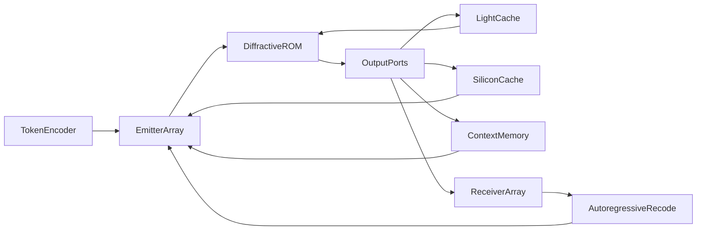

# OLLMU: Optical Large Language Model Unit

A concept for a passive diffractive core (optical ROM): processing in light, a short light cache in slower media, SiliconCache and context memory off-crystal.

Version 0.1.2 · September 2026 · license [OLLMU IAL 1.0](LICENSE) (implementation unrestricted; keep originator credit) · idea: **Anisul Wałsymzerp** · Polish version: [CONCEPT.pl.md](CONCEPT.pl.md) · citations: [REFERENCES.md](REFERENCES.md) · [attribution](ATTRIBUTION.md)

**This is not a working device.** It is a concept paper. No number in this text is a measurement from an OLLMU unit, because no such unit exists.

---

## 1. Abstract

We propose an inference architecture called **OLLMU** (Optical Large Language Model Unit). **Processing is optical:** frozen weights live in a three-dimensional diffractive core, and light performs linear MACs in transit. The crystal already delays the wave; different media can be chosen so that, where a short echo is useful, a **light cache** appears (including slow light). **SiliconCache** (nonlinearity, a fast buffer, a thinking loop) and **context memory** (long conversational state) sit **outside the crystal**. The load-bearing claim is that the model must be trained *when and how* to use those external memories — by interference routing and edge ports, not by a CPU that decides for the network at inference.

The GaN quasi-BIC blue laser (**Fact**: Fąs et al., *Nano Letters*, 2026) is a **candidate coherent source**, not the compute core. The 2026 device is optically pumped, has a grating footprint of order \(100 \times 100\,\mu\mathrm{m}\), and is not an addressable array.

A full transformer in one crystal is not a claim of this paper. The honest split is: static FFN blocks and MoE experts as optical ROM; attention \(QK^{\mathsf{T}}\) as a hybrid block, because it depends on the input. The autoregressive loop (detection → re-encoding of the next token) is part of the architecture and **is not free**.

---

## 2. How to read this document

Every technical claim carries one label:

| Label | Meaning |
| --- | --- |
| **Fact** | Result from a cited publication |
| **Literature** | Established method, not original to OLLMU |
| **Hypothesis** | Element of the architecture proposed here |
| **Estimate** | Order of magnitude, not a measurement |

If a number has no label, it is not an OLLMU result.

---

## 3. Introduction

Digital inference of large language models is limited by data movement and heat, not only by arithmetic. **Literature**: photonic MACs scale favourably at large \(N\) and low analog precision, on the order of a few bits, not FP16 (Nahmias et al., 2020). **Literature**: diffractive deep neural networks (D²NN) perform inference passively after digital training (Lin, Ozcan et al., 2018). **Literature**: Mach–Zehnder meshes implement matrix multiplication on silicon photonic chips (Shen et al., 2017). None of these lines has produced an LLM in a crystal.

The gap OLLMU tries to *name*, not close, is how to combine (i) a frozen linear operator in light, (ii) a short optical light cache where wave delay is enough, (iii) SiliconCache and context memory off-crystal, (iv) training that teaches the model *when* to use those external memories, without a controller that replaces the network at inference.

---

## 4. Fact: the GaN quasi-BIC laser

**Fact.** Fąs, Pruszyńska-Karbownik, Sawicka, Yavorskiy, Feduniewicz, Gołyga, Słowikowski, Kacperski, Siekacz, Muzioł, Nowicki, Kazakov, Wróbel, Czyszanowski, and Suffczyński demonstrated lasing at 440–460 nm at room temperature. Gain is provided by InGaN quantum wells coupled to a quasi-BIC in a monolithic GaN subwavelength grating. A nanoporous GaN layer, formed by electrochemical etching, sits beneath the structure and suppresses mode leakage into the substrate. DOI: [10.1021/acs.nanolett.6c01930](https://doi.org/10.1021/acs.nanolett.6c01930) ([ACS](https://pubs.acs.org/doi/10.1021/acs.nanolett.6c01930), [PMC](https://pmc.ncbi.nlm.nih.gov/articles/PMC13397883/)).

Parameters from the same paper:

- threshold \(0.16\,\mathrm{mJ\,cm^{-2}}\) per pulse,
- linewidth below \(0.04\,\mathrm{nm}\),
- strongly linearly polarised emission; TE/TM ratio of 52,
- gratings of order \(100 \times 100\,\mu\mathrm{m}\),
- numerical design (PWAM), fabrication by e-beam lithography + RIE + TMAH smoothing,
- **optical pumping**, not electrical.

**Fact, limitation.** The paper does not describe an array of independently driven laser pixels, does not report wall-plug efficiency under electrical injection, and does not concern neural networks.

**Hypothesis (use in OLLMU).** If an electrically pumped, addressable array with similar coherence and polarisation appears later, it is a candidate input interface. Strong TE polarisation is an asset for interferometric arithmetic. A wavelength of ~450 nm is **not** suitable for advanced-chip lithography; the diffraction limit is an order of magnitude too coarse relative to 13.5 nm EUV. OLLMU is not a lithography project.

---

## 5. Literature the rest stands on

### 5.1. D²NN

**Literature.** Lin, Ozcan et al. (2018) train layer transmission coefficients digitally, then realise them physically. Inference is diffraction. Demonstrations: classification (including THz, 3D printing), not language models.

The field on layer \(\ell\) connects to the next layer through a diffraction propagator \(D_\ell\) and a learned local transmittance \(T_\ell\):

\[
U_{\ell+1} = D_\ell \bigl( T_\ell \odot U_\ell \bigr).
\]

After fabrication, \(T_\ell\) is fixed: an optical ROM.

### 5.2. Photonic MACs and industry

**Literature.** Shen et al. (2017): a programmable MZI mesh, vowel recognition. Nahmias et al. (2020): a photonic energy advantage at \(N \gtrsim 500\), processor size \(\gtrsim 100\,\mu\mathrm{m}\), and noise precision \(\lesssim 4\) bits. Lightmatter and related firms build **electronic–photonic hybrids**; that is industrial context, not evidence for OLLMU.

### 5.3. Slow light and Kerr

**Literature.** In a photonic crystal the group velocity drops: \(v_g = c / n_g\). Baba (2008) reviews that large \(n_g\) increases light–matter interaction and lowers the nonlinear threshold, at the cost of bandwidth (the delay–bandwidth product). Kerr:

\[
n(I) = n_0 + n_2 I.
\]

Phase shift over an effective length \(L_{\mathrm{eff}}\):

\[
\Delta\varphi = \frac{2\pi}{\lambda}\, n_2 I\, L_{\mathrm{eff}}.
\]

Slow light enlarges \(L_{\mathrm{eff}}\) and the local \(I\). Demonstrations of nonlinear photonic activations (including PhC cavities, Liu et al., 2026) are at femtojoule / picosecond scale, not LLM scale.

The electronic Kerr effect is fast and weak; thermal effects and free-carrier dispersion are stronger and slower. **The OLLMU hypothesis cannot assume that Kerr is ReLU by itself.**

### 5.4. Memory as delay

**Literature.** Optical reservoir computing and delay lines hold state as photons in transit. This is not DRAM. Capacity and lifetime are limited by loss and decoherence.

### 5.5. 3D writing in glass

**Literature.** Femtosecond refractive-index change in glass dates to 1996 (Davis et al.). A 3D photonic neural-network chip written by an fs laser (2026) classifies MNIST. Index contrast \(\Delta n\) is typically \(10^{-3}\)–\(10^{-2}\), not arbitrary. That is not a billion-parameter scale.

### 5.6. Materials at ~450 nm

**Material fact.** Silicon absorbs strongly in the blue (Green, 2008). Guiding uses Si₃N₄ (including ~0.08 dB/cm at 450 nm, Chauhan et al., 2020), GaN, or LiNbO₃. Hybrid bonding of InGaN diodes onto SiN platforms is literature (Mu et al., 2026), not production of BIC arrays.

---

## 6. Hypothesis: OLLMU architecture

**Hypothesis.** Processing lives in light. Memory has three time scales. The model learns which scale to light.

1. **Token encoder (hybrid).** Activations map onto amplitude and phase. At the start: electronics plus modulators.

2. **Emitter array.** Coherent sources. Candidate: a GaN BIC array. Today: optically pumped gratings.

3. **Diffractive core (ROM) — processing.** Written \(n(\mathbf{r})\). Light computes a fixed operator \(W\). Natural payload: FFN and MoE experts. Transit through the medium *already* delays the wave, \(\tau_{\mathrm{core}} = n L / c\); that is not a defect, it is an optical clock.

4. **Light cache (in-crystal / optical edge).** Where a *light* delay helps — aligning two passes, a layer echo, a phase beat — the field enters a slower medium (larger \(n\) or \(n_g\): slow light, another crystal, a longer path). This does **not** replace a KV-cache or ReLU. Kerr on that path is optional, not required.

5. **SiliconCache (off-crystal).** Detection → fast silicon cache → nonlinearity (ReLU/GELU/a small MLP) and/or a thinking vector. The result returns to the emitter array on a cadence the model learned: either as a re-process, or as extra data.

6. **Context memory (off-crystal).** Long state (KV-cache analogue, scratchpad, token history). SRAM/DRAM or another electronic buffer. Light does not live there.

7. **Receiver array and recode loop.** The next token. **Not free.**

### 6.1. Three delay scales

| Scale | Where | What it holds | Time order (**Estimate**) |
| --- | --- | --- | --- |
| Core transit | in the crystal | nothing but the wave in flight | ps–ns per centimetre |
| Light cache | slower optical medium | short echo, phase | ps–ns, delay–bandwidth product |
| SiliconCache | silicon off-crystal | nonlinearity, thinking, beat alignment | ns–µs |
| Context memory | silicon off-crystal | conversation context | µs–ms and longer, digital capacity |

**Literature.** Different \(n\) and \(n_g\) change time of flight; that is textbook optics. The **hypothesis** is only the *use*: the model treats these scales as tools, not as one magic memory.

### 6.2. Routing: the model learns SiliconCache and context

**Hypothesis, legal physics.** Edge ports lead to the light cache, SiliconCache, or context memory. Two arms \(E_1\), \(E_2\) give

\[
P_{\mathrm{port}} \propto \lvert E_1 + E_2 e^{i\theta} \rvert^2.
\]

\(\theta = \pi\) extinguishes the port (external memory stays dark). \(\theta = 0\) pushes energy onto the chosen path. The weights \(n(\mathbf{r})\) learn this *before* writing. At inference there is no spare CPU bit that says “use cache”.

That is a training load, not a material miracle. The loss \(\mathcal{L}\) must tell the network that SiliconCache and context memory both cost and pay. Otherwise the model never uses them, or burns them for nothing.

### 6.3. What the core does not do

The core does not train on the fly, is not DRAM, and does not hold 128k tokens. OLLMU is an inference ASIC for *one* weight snapshot; long context and nonlinearity are contracts with electronics that the model must learn to call.

---

## 7. Mapping onto a transformer (honest split)

**Literature.** A transformer layer (Vaswani et al., 2017) is attention plus an FFN. The FFN is usually two fixed matrices and a nonlinearity. MoE (Fedus et al.) selects a subset of experts.

| Block | Is optical ROM enough? | OLLMU proposal |
| --- | --- | --- |
| Embedding / unembedding | Partially (fixed matrix) | ROM or electronics |
| FFN (linear part) | Yes | Primary processing in light |
| FFN nonlinearity | Not in the ROM | SiliconCache, off-crystal |
| MoE expert | Routing = a port | Interference at the edge |
| Attention \(QK^{\mathsf{T}}\) | No: the matrix depends on tokens | Hybrid; state in context memory |
| Softmax | No | SiliconCache |
| KV-cache / context | Not as an optical volume | Context memory off-crystal |
| Short echo / phase | Yes, if \(\tau\) is small | Light cache (slower medium) |
| Autoregression | Not in a single pass | Recode loop |

**Working hypothesis.** Processing = light. SiliconCache and context memory = external contracts the network learns **before** \(n(\mathbf{r})\) is written into the crystal. Light cache = a short optical delay, not conversation memory.

---

## 8. Mathematics

The equations below are standard. They are not a proof that OLLMU scales to billions of parameters.

### 8.1. Propagation

**Literature.** Between planes \(z_\ell\) and \(z_{\ell+1}\), in the scalar angular-spectrum approximation:

\[
\tilde{U}(k_x, k_y; z_{\ell+1}) = \tilde{U}(k_x, k_y; z_\ell)\, \exp\bigl(i z_{\Delta} \sqrt{k_0^2 n^2 - k_x^2 - k_y^2}\bigr),
\]

where \(z_{\Delta} = z_{\ell+1}-z_\ell\), \(k_0 = 2\pi/\lambda\). On a layer plane a pointwise \(T_\ell(x,y)\) acts. In a volume with continuous \(n(\mathbf{r})\) one needs Maxwell or an eikonal / BPM approximation. Training needs a **differentiable twin**; full FDTD for every LLM epoch is impractical (**Estimate** of cost, not a measurement).

### 8.2. Linear operator

For a fixed wavelength and polarisation the core realises

\[
\mathbf{u}_{\mathrm{out}} = W \mathbf{u}_{\mathrm{in}},
\]

where \(W \in \mathbb{C}^{M \times N}\) follows from \(n(\mathbf{r})\). Digital FFN weights must be forced into a physically admissible \(W\) (loss, coupling, the range of \(\Delta n\)). That is an inverse problem, not a copy of a PyTorch matrix into glass.

### 8.3. Delay: core vs light cache vs silicon

Core transit:

\[
\tau_{\mathrm{core}} = \frac{n L}{c}.
\]

Light cache in a slower medium:

\[
\tau_{\mathrm{lc}} = \frac{n_g L_{\mathrm{lc}}}{c}.
\]

**Literature.** One cannot have arbitrarily large \(n_g\) and wide bandwidth at once. **Estimate:** \(\tau_{\mathrm{core}}\) and \(\tau_{\mathrm{lc}}\) are ps–ns — an echo and an optical clock, not a 128k context. SiliconCache and context memory are not bound by the delay–bandwidth product; their cost is O-E-O and DRAM.

### 8.4. Kerr on the light cache (optional)

\[
\Delta\varphi = \frac{2\pi}{\lambda}\, n_2 I\, L_{\mathrm{eff}}(n_g).
\]

Slower light raises local \(I\) and \(L_{\mathrm{eff}}\). That can be a side effect of a light cache. It is **not** the model's default nonlinearity. ReLU/GELU live in SiliconCache. Kerr ≠ ReLU unless someone measures it.

### 8.5. Port extinction

Let \(E_{\mathrm{port}} = a(\mathbf{u}_{\mathrm{in}}) + b(\mathbf{u}_{\mathrm{in}})\). Training — **before writing** — should reach \(a \approx -b\) when SiliconCache, context memory, or the light cache must stay dark, and \(a \approx b\) when that memory should act. Sparse energy steering, not a CPU bit at inference.

### 8.6. Loss function

**Hypothesis.** All of \(\mathcal{L}\) is evaluated on a digital twin **before** \(n(\mathbf{r})\) is written into the crystal.

\[
\mathcal{L} = \mathcal{L}_{\mathrm{task}} + \lambda_{\mathrm{si}} \mathbb{E}\bigl[ P_{\mathrm{Si}} \cdot \mathbf{1}_{\text{SiliconCache not needed}} \bigr] + \lambda_{\mathrm{ctx}} \mathbb{E}\bigl[ P_{\mathrm{ctx}} \cdot \mathbf{1}_{\text{context not needed}} \bigr] + \lambda_{\mathrm{lc}} \mathbb{E}\bigl[ P_{\mathrm{lc}} \cdot \mathbf{1}_{\text{echo not needed}} \bigr] + \lambda_{\mathrm{ph}} \mathcal{L}_{\mathrm{physics}} + \lambda_f \mathcal{L}_{\mathrm{fab}}.
\]

Without a twin that knows SiliconCache and context memory, “burning a model into glass” is a slogan.

### 8.7. Analog precision

**Literature / Estimate.** Under additive noise

\[
b \approx \tfrac12 \log_2 (1 + \mathrm{SNR}).
\]

Shot noise, phase drift, scattering, and write error limit \(b\) to **a few bits**, in line with Nahmias et al. (a ~4-bit threshold in their comparison). Digital models in INT4/INT8 show that low precision can suffice in FFNs — but this is analog, not INT4 with correction.

### 8.8. Energy

\[
E_{\mathrm{token}} = E_{\mathrm{src}} + E_{\mathrm{det}} + E_{\mathrm{Si}} + E_{\mathrm{ctx}} + E_{\mathrm{recode}} + E_{\mathrm{attn, hyb}}.
\]

\(E_{\mathrm{core}}\) is ~0 aside from optical loss (which the sources still pay). The light cache is optical; SiliconCache and context memory are O-E-O. **Methodological fact.** Zero joules applies only to the passive \(W\) in glass.

### 8.9. Volume and parameters

**Estimate, not a measurement.** Suppose voxels of size \(\sim\lambda\) in glass each carry \(k\) effective analog bits. For \(\lambda = 450\,\mathrm{nm}\) and \(k = 4\):

\[
\rho \sim \frac{k}{\lambda^3} \approx \frac{4}{(4.5\times 10^{-7})^3}\ \mathrm{bit/m^3} \sim 4\times 10^{19}\ \mathrm{bit/m^3}.
\]

This is a **diffraction-limited ceiling**, not a usable density. Crosstalk, waveguides, ports, and tolerances cut orders of magnitude. Even then the map “PyTorch parameter = voxel” is false: \(W\) is a dense wave operator, not a CSR matrix. Conclusion: LLM scale needs either a huge volume, or multiplexing (space × wavelength × time), or **giving up on the whole model in favour of the FFN**.

---

## 9. Training before writing into the crystal

**Hard hypothesis.** The network — including routing to SiliconCache, context memory, and the light cache — is trained **entirely on a digital twin before** \(n(\mathbf{r})\) is written. After writing, the crystal is ROM. There is no on-glass fine-tuning.

Order:

1. Twin: core propagator + light cache (\(n\), \(n_g\)) + SiliconCache and context-memory models (detector, nonlinearity, buffer, cadence).
2. Train \(\mathcal{L}\) from §8.6. The model learns *when* to light the silicon port, *when* to fetch context, *when* an optical echo is enough, *when* to leave everything dark.
3. Quantise \(n(\mathbf{r})\) to what fs-writing / lithography can do.
4. Write into the crystal. Optical-weight learning ends.
5. Calibrate electronics (thresholds, SiliconCache delay); do not “retrain the crystal”.

At inference the geometry already *is* the memory policy. A CPU does not pick the cache for the model.

---

## 10. Materials and fabrication

| Role | Candidate | Note |
| --- | --- | --- |
| Source | GaN quasi-BIC (Fąs 2026) | Today optically pumped |
| Visible guiding | Si₃N₄, GaN, LN | Not SOI silicon |
| ROM volume | Glass / crystal fs-write or a D²NN stack | Small demonstrations |
| Light cache | Slower medium, PhC, longer path | Short echo, not a KV-cache |
| SiliconCache | CMOS off-crystal | Nonlinearity, thinking, cadence |
| Context memory | SRAM/DRAM off-crystal | Context; the model learns before writing |
| Detection | Si / GaN array | Phase needs a local interferometer |

Blue light: smaller \(\lambda\) packs voxels more tightly, but Rayleigh scattering grows as \(\lambda^{-4}\), defects cost more, and glass photodarkening is a real risk. **The hypothesis does not decide** that 450 nm is better than 1550 nm for all of OLLMU. The BIC source is blue; the core might later run at another wavelength if conversion is added — a separate, expensive member, not magic.

---

## 11. Error model

Error sources this document admits in advance:

- \(\Delta n(\mathbf{r})\) write inaccuracy,
- roughness and loss,
- thermal phase drift (especially thermal Kerr),
- vibration and interferometer instability,
- shot noise and ADC,
- twin-versus-Maxwell mismatch,
- source ageing and photodarkening.

Without post-write calibration the device is a sculpture, not an accelerator.

---

## 12. Arguments for

1. **Passive MACs.** Consistent with D²NN and Nahmias: at large \(N\) and low precision, glass can be energetically cheaper *for the linear operator alone* than digital MACs.
2. **ROM makes business sense** if a frontier snapshot lives for months. No on-device fine-tuning is not a defect of an ASIC.
3. **Light cache** uses the fact that the crystal already delays the wave; a slower medium where a short echo helps — not as a KV-cache.
4. **Train-then-write:** SiliconCache and context policy live in the ROM geometry, not in an inference CPU.
5. **BIC source:** room temperature, low optical threshold, narrow line, strong polarisation — *if* an electrical array appears.
6. **Processing stays in light;** electronics are memory and nonlinearity, not the MAC core.

## 13. Arguments against

1. The 2026 BIC laser is not an electrical array.
2. Silicon does not guide 450 nm.
3. D²NN and fs-PNN are MNIST / small-network scale.
4. Attention is not a ROM; context memory is O-E-O.
5. Kerr on the light cache ≠ ReLU.
6. The token→light→token loop and SiliconCache eat the core’s gain.
7. The twin must model silicon *and* Maxwell — expensive and approximate.
8. After writing, optical weights cannot be fixed.
9. The density in §8.9 is a ceiling, not a production plan.
10. No paper assembles these pieces into an LLM — this one does not either.

---

## 14. Elements added relative to the source conversation

The conversation that produced this concept omitted or treated too lightly:

- SiliconCache and context memory off-crystal, with training **before** writing,
- light cache as a short echo, not a KV stand-in,
- the autoregressive loop as a cost,
- the FFN / attention split,
- MoE as routing,
- the digital twin and calibration,
- the error model and \(E_{\mathrm{token}}\).

---

## 15. Research phases

No phase is executed in this repository.

| Phase | Goal | Success criterion | What is not success |
| --- | --- | --- | --- |
| 0 | This document | Consistent Fact/Hypothesis labels | “We have an optical LLM” |
| 1 | Numerical twin of a small D²NN + 1 side loop | Agreement with analytic \(W\) and \(\Delta\varphi\) | GPT scale |
| 2 | Toy classification (as in D²NN) | Accuracy near digital at a few bits of SNR | Natural language |
| 3 | Mini-FFN (e.g. width 64–256) | MAC error vs NumPy at a stated SNR | A transformer |
| 4 | MoE routing onto 2–4 optical experts | Measured interferometric port extinction | A full MoE LLM |
| 5 | Hybrid: digital attention + optical FFN | *System* latency and energy vs GPU on the same FFN | “Zero watts” |
| 6 | Source: from optical pump to electrical array | A separate GaN materials line | Required for phase 5 only if SiN+InGaN is not enough |

---

## 16. What we do not claim

- That OLLMU exists in a laboratory.
- That the Fąs et al. (2026) laser is an AI accelerator.
- That LLM inference energy will fall to a fraction of a per-mille of a GPU.
- That a full frontier model fits in a crystal.
- That Kerr on the light cache is ReLU.
- That slow light replaces a KV-cache.
- That the model learns *after* the crystal is written.
- That a blue laser beats EUV in lithography.
- That space-aware training has been carried out.

---

## 17. Conclusions

OLLMU is a **named hardware hypothesis**: processing in light, a short light cache in a slower medium, SiliconCache and context memory off-crystal. The model learns to use them **before** the geometry is written; afterwards the crystal is ROM. Assembling that into an LLM is an open problem, not a discovery.

The most honest next paper is a twin with SiliconCache, not a sculpture of a frontier model.

---

## 18. Citations

Full list with DOIs (resolved on Crossref 2026-09-07): [REFERENCES.md](REFERENCES.md). Key items: Fąs et al. 2026; Lin/Ozcan 2018; Shen 2017; Nahmias 2020; Baba 2008; Vaswani 2017; Fedus 2022.
