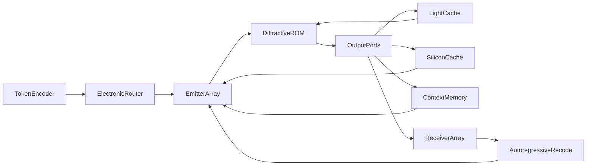
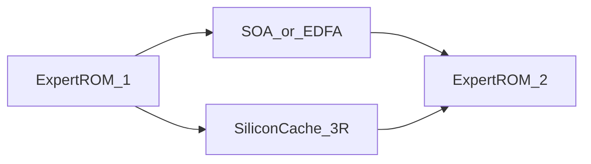
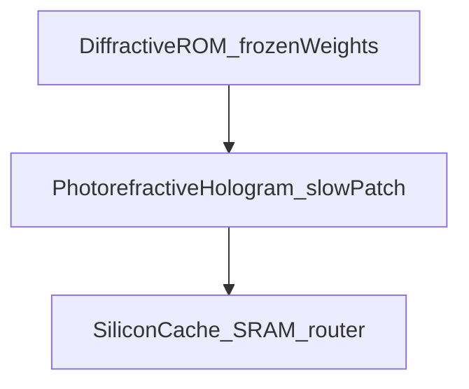

# OLLMU: Optical Large Language Model Unit

A concept for a passive diffractive core (optical ROM): the weights of a frozen linear operator are the medium, light computes the MAC in transit, and nonlinearity, attention, and the router stay in electronics.

Version 0.3.0 · October 2026 · license [OLLMU IAL 1.0](LICENSE) (implementation unrestricted; keep the public form of the originator credit) · idea: **Anisul Wałsymzerp** · Polish version: [CONCEPT.pl.md](CONCEPT.pl.md) · citations: [REFERENCES.md](REFERENCES.md) · [attribution](ATTRIBUTION.md)

**This is not a working device.** It is a public concept paper. No number in this text is a measurement from an OLLMU unit, because no such unit exists. The license requires attribution. It does not protect the idea and it is not a patent filing: public disclosure enters the state of the art.

---

## 1. Abstract

The expensive part of large-language-model inference, in token-by-token decoding, is not the multiply. It is reading the weights out of memory again for every token. **OLLMU** is the hypothesis that those weights can be written into a volumetric diffractive core: light performs the linear MAC in transit, and the weight bus disappears because the weights are the medium. The same move — put the operator and the weights in one carrier, instead of hauling weights to the arithmetic — is what Taalas does in digital silicon by hard-wiring a model into the chip. OLLMU is not that chip and does not inherit its measurements.

Everything else in the architecture is subordinate to that claim, and weaker than it. Nonlinearity (ReLU/GELU), attention, softmax, and the MoE router stay in electronics. After each optical matrix the signal is detected, converted, and emitted again. In photonics those converters are where the energy gain usually goes; §8.8 is a rough balance, not a measurement. An MoE router does not arise from interference in a fixed linear medium: extinguishing a port is a projection onto a fixed subspace, and a top-k choice needs a nonlinearity. Analog precision of a few bits, and the density in §8.9 (a diffraction ceiling), do not add up to a model of hundreds of billions of parameters. A burned snapshot ages: the crystal cannot be fine-tuned, and frontier snapshots move on a scale of months.

The GaN quasi-BIC blue laser (**Fact**: Fąs et al., *Nano Letters*, 2026) is a **candidate coherent source**, not the compute core. The 2026 device is optically pumped, has a grating footprint of order \(100 \times 100\,\mu\mathrm{m}\), and is not an addressable array.

A full transformer in one crystal is not a claim of this paper. The honest split is: the static linear parts of FFNs, and the matrices of MoE experts, as optical ROM; attention \(QK^{\mathsf{T}}\), softmax, and expert choice as electronics. The autoregressive loop (detection → re-encoding of the next token) is part of the architecture and **is not free**. A large brick cluster holds power with three measures: C-band (~1550 nm) in silica, SOA/EDFA amplifiers between blocks, 3R regeneration on SiliconCache — without pretending analog SNR is free.

Version 0.3 (October 2026) does not withdraw the stationary-weight claim and does not bring back interferometric routing. It narrows the workload. A frozen linear front-end fits a vision stream, and a C-band feature in front of a receiver, better than it fits chat decoding: the input is already a field, the context is a frame or a packet, and the weights are supposed to live long enough that amortising a crystal is even a question (§10). The replaceable part is a slow photorefractive hologram for adapters and signatures, not a fine-tune of the ROM and not a KV-cache. Correlation stays a similarity score. Top-k stays in electronics. No number in §10 is an OLLMU measurement.

---

## 2. How to read this document

Every technical claim carries one label:

| Label | Meaning |
| --- | --- |
| **Fact** | Result from a cited publication |
| **Literature** | Established method, not original to OLLMU |
| **Hypothesis** | Element of the architecture proposed here |
| **Estimate** | Order of magnitude, not a measurement |

If a number has no label, it is not an OLLMU result.

---

## 3. Introduction

In autoregressive decoding, at small batch, each new token reads essentially the whole weight set. The arithmetic intensity of that GEMV is of order one MAC per weight. **Literature**: the energy of a DRAM access sits orders of magnitude above the energy of the arithmetic itself. Horowitz (ISSCC 2014) gives a DRAM access of order 1–2 nJ, and the I/O itself above 20 pJ/bit; the circulated 45 nm table lists a 32-bit DRAM read at 640 pJ and an 8-bit multiply at 0.2 pJ. That is a 2014 teaching anchor, not a 2026 HBM datasheet. It is enough for the structural claim: while \(b \cdot e_{\mathrm{bit}} \gg e_{\mathrm{MAC}}\), the arithmetic is a cheap annex to moving the weights. **Literature (industrial context)**: Taalas draws the same conclusion in silicon — the model weights are hard-wired into the chip, inference does not haul them from off-chip memory, and a small SRAM remains for the KV-cache and LoRA. In public: Llama 3.1 8B, and of order two months from a received model to hardware ([taalas.com](https://taalas.com/the-path-to-ubiquitous-ai/), checked 2026-10-21). That is not photonics and it is not evidence for OLLMU.

**Literature**: photonic MACs scale favourably at large \(N\) and low analog precision, on the order of a few bits, not FP16 (Nahmias et al., 2020). **Literature**: diffractive deep neural networks (D²NN) perform inference passively after digital training (Lin, Ozcan et al., 2018). **Literature**: Mach–Zehnder meshes implement matrix multiplication on silicon photonic chips (Shen et al., 2017). None of these lines has produced an LLM in a crystal.

The gap OLLMU tries to *name*, not close, is which **frozen** linear operators are worth writing, given that (i) a gain exists only if the disappearance of the weight bus survives the light–current–light cost, (ii) analog precision is a few bits, (iii) the snapshot cannot be fine-tuned when the model ages. A short light cache and the electronics off-crystal are annexes to that claim, not substitutes for it. Version 0.3 does not change that gap. It asks on which stream a freeze is less absurd: vision and a C-band feature, not chat (§10).

---

## 4. Fact: the GaN quasi-BIC laser

**Fact.** Fąs, Pruszyńska-Karbownik, Sawicka, Yavorskiy, Feduniewicz, Gołyga, Słowikowski, Kacperski, Siekacz, Muzioł, Nowicki, Kazakov, Wróbel, Czyszanowski, and Suffczyński demonstrated lasing at 440–460 nm at room temperature. Gain is provided by InGaN quantum wells coupled to a quasi-BIC in a monolithic GaN subwavelength grating. A nanoporous GaN layer, formed by electrochemical etching, sits beneath the structure and suppresses mode leakage into the substrate. DOI: [10.1021/acs.nanolett.6c01930](https://doi.org/10.1021/acs.nanolett.6c01930) ([ACS](https://pubs.acs.org/doi/10.1021/acs.nanolett.6c01930), [PMC](https://pmc.ncbi.nlm.nih.gov/articles/PMC13397883/)).

Parameters from the same paper:

- threshold \(0.16\,\mathrm{mJ\,cm^{-2}}\) per pulse,
- linewidth below \(0.04\,\mathrm{nm}\),
- strongly linearly polarised emission; TE/TM ratio of 52,
- gratings of order \(100 \times 100\,\mu\mathrm{m}\),
- numerical design (PWAM), fabrication by e-beam lithography + RIE + TMAH smoothing,
- **optical pumping**, not electrical.

**Fact, limitation.** The paper does not describe an array of independently driven laser pixels, does not report wall-plug efficiency under electrical injection, and does not concern neural networks.

**Hypothesis (use in OLLMU).** If an electrically pumped, addressable array with similar coherence and polarisation appears later, it is a candidate input interface. Strong TE polarisation is an asset for interferometric arithmetic. A wavelength of ~450 nm is **not** suitable for advanced-chip lithography; the diffraction limit is an order of magnitude too coarse relative to 13.5 nm EUV. OLLMU is not a lithography project.

---

## 5. Literature the rest stands on

### 5.1. D²NN

**Literature.** Lin, Ozcan et al. (2018) train layer transmission coefficients digitally, then realise them physically. Inference is diffraction. Demonstrations: classification (including THz, 3D printing), not language models.

The field on layer \(\ell\) connects to the next layer through a diffraction propagator \(D_\ell\) and a learned local transmittance \(T_\ell\):

\[
U_{\ell+1} = D_\ell \bigl( T_\ell \odot U_\ell \bigr).
\]

After fabrication, \(T_\ell\) is fixed: an optical ROM.

### 5.2. Photonic MACs and industry

**Literature.** Shen et al. (2017): a programmable MZI mesh, vowel recognition. Nahmias et al. (2020): a photonic energy advantage at \(N \gtrsim 500\), processor size \(\gtrsim 100\,\mu\mathrm{m}\), and noise precision \(\lesssim 4\) bits. Lightmatter and related firms build **electronic–photonic hybrids**; that is industrial context, not evidence for OLLMU.

### 5.3. Slow light and Kerr

**Literature.** In a photonic crystal the group velocity drops: \(v_g = c / n_g\). Baba (2008) reviews that large \(n_g\) increases light–matter interaction and lowers the nonlinear threshold, at the cost of bandwidth (the delay–bandwidth product). Kerr:

\[
n(I) = n_0 + n_2 I.
\]

Phase shift over an effective length \(L_{\mathrm{eff}}\):

\[
\Delta\varphi = \frac{2\pi}{\lambda}\, n_2 I\, L_{\mathrm{eff}}.
\]

Slow light enlarges \(L_{\mathrm{eff}}\) and the local \(I\). Demonstrations of nonlinear photonic activations (including PhC cavities, Liu et al., 2026) are at femtojoule / picosecond scale, not LLM scale.

The electronic Kerr effect is fast and weak; thermal effects and free-carrier dispersion are stronger and slower. **The OLLMU hypothesis cannot assume that Kerr is ReLU by itself.**

### 5.4. Memory as delay

**Literature.** Optical reservoir computing and delay lines hold state as photons in transit. This is not DRAM. Capacity and lifetime are limited by loss and decoherence.

### 5.5. 3D writing in glass

**Literature.** Femtosecond refractive-index change in glass dates to 1996 (Davis et al.). A 3D photonic neural-network chip written by an fs laser (2026) classifies MNIST. Index contrast \(\Delta n\) is typically \(10^{-3}\)–\(10^{-2}\), not arbitrary. That is not a billion-parameter scale.

### 5.6. Materials at ~450 nm

**Material fact.** Silicon absorbs strongly in the blue (Green, 2008). Guiding uses Si₃N₄ (including ~0.08 dB/cm at 450 nm, Chauhan et al., 2020), GaN, or LiNbO₃. Hybrid bonding of InGaN diodes onto SiN platforms is literature (Mu et al., 2026), not production of BIC arrays.

### 5.7. Weights that stay put

**Literature.** Horowitz (ISSCC 2014), as in §3: moving a bit from DRAM costs many times a narrow MAC. **Literature (industrial context).** Taalas realises the conclusion in digital silicon: the model is part of the chip, not the contents of HBM. The flexibility the firm keeps sits beside the frozen weights — context window and LoRA in SRAM — not in rewiring the base weights. OLLMU carries the idea “the weights are the carrier” into glass. It does not carry CMOS mask density, a LoRA path, or a two-month cycle from snapshot to card.

---

## 6. Hypothesis: OLLMU architecture

Ports are optical paths. Which expert is lit, where the nonlinearity runs, and when context is fetched, is decided by an electronic router. A phase written into the glass does not make that decision.

**Hypothesis.** Frozen linear processing lives in light. Input-dependent decisions live in electronics. Memory has four time scales.

1. **Token encoder (hybrid).** Activations map onto amplitude and phase. At the start: electronics plus modulators.

2. **Router (electronics).** A small network: logits, softmax, top-k. It chooses which expert core to illuminate, and whether this beat should call SiliconCache or context memory. The router weights are small and stay in silicon, so they can be replaced without a new crystal.

3. **Emitter array.** Coherent sources. Candidate: a GaN BIC array. Today: optically pumped gratings. The router enables emission into the chosen core; that is an electronic switch, not interference in the glass.

4. **Diffractive core (ROM) — processing.** Written \(n(\mathbf{r})\). Light computes a fixed operator \(W\). Natural payload: the linear part of an FFN and the matrix of a selected expert. Transit through the medium *already* delays the wave, \(\tau_{\mathrm{core}} = n L / c\); that is not a defect, it is an optical clock.

5. **Light cache (in-crystal / optical edge).** Where a *light* delay helps — aligning two passes, a layer echo, a phase beat — the field enters a slower medium (larger \(n\) or \(n_g\): slow light, another crystal, a longer path). This does **not** replace a KV-cache or ReLU. Kerr on that path is optional, not required. Entry onto that path is a designed coupler or a switch, not a decision of the linear medium.

6. **SiliconCache (off-crystal).** Detection → analog-to-digital conversion → nonlinearity (ReLU/GELU/a small MLP) and/or a thinking vector. The router lands here too, if it is not placed beside the cache. The result returns to the emitter array. Every such crossing is light–current–light and enters the balance in §8.8.

7. **Context memory (off-crystal).** Long state (KV-cache analogue, scratchpad, token history). SRAM/DRAM or another electronic buffer. Light does not live there.

8. **Receiver array and recode loop.** The next token. **Not free.**

### 6.1. Four delay scales

| Scale | Where | What it holds | Time order (**Estimate**) |
| --- | --- | --- | --- |
| Core transit | in the crystal | nothing but the wave in flight | ps–ns per centimetre |
| Light cache | slower optical medium | short echo, phase | ps–ns, delay–bandwidth product |
| SiliconCache | silicon off-crystal | nonlinearity, router, thinking, beat alignment | ns–µs |
| Context memory | silicon off-crystal | conversation context | µs–ms and longer, digital capacity |

**Literature.** Different \(n\) and \(n_g\) change time of flight; that is textbook optics. The **hypothesis** is only the *use*: a short optical echo is a clock and a phase alignment. Long state, and the decision “which expert”, are electronic.

### 6.2. What interference will not choose

**Hypothesis, physics.** A core with fixed \(n(\mathbf{r})\) is a linear operator, \( \mathbf{u}_{\mathrm{out}} = W \mathbf{u}_{\mathrm{in}} \), with one \(W\) for every input. Power at port \(i\) is

\[
P_i = \lvert \mathbf{w}_i^{\dagger} \mathbf{u}_{\mathrm{in}} \rvert^2.
\]

That is a fixed quadratic form. The inputs that extinguish the port are the kernel of the functional \(\mathbf{w}_i\): a fixed subspace, chosen at write time, independent of any comparison of “which expert is larger”.

Two arms with a fabricated phase \(\theta\) do not change the verdict. If \(\theta\) extinguishes the port for every input, that row of \(W\) is zero and the port is dead. If the power depends on the input, it is still a soft match to one direction chosen in advance, not a top-k.

An MoE router (**Literature**: Fedus et al.) computes

\[
r(\mathbf{u}) = \mathrm{TopK}\bigl(\mathrm{softmax}(W_r \mathbf{u})\bigr).
\]

\(\mathrm{softmax}\) and \(\mathrm{TopK}\) are nonlinear. \(W_r\) is small and stays in electronics. The selected expert is then one of several fixed optical maps \(W^{(e)}\). Lighting only that expert is enabling a modulator or selecting a brick, which is electronics again.

Earlier drafts of this text described extinguishing a port with phase \(\theta = \pi\) as a memory policy learned into the geometry. That was a mistake: a fixed medium does not make an input-dependent decision. What remains is narrower and true. The glass holds the large \(W\). Silicon decides which \(W\) works on this beat.

### 6.3. What the core does not do

The core does not train on the fly, is not DRAM, does not hold 128k tokens, and does not choose experts. OLLMU is a carrier for *one* snapshot of linear operators. Long context, nonlinearity, and the router are a contract with electronics. The electronics can be corrected later. \(n(\mathbf{r})\) can only be replaced together with the crystal. A neighbour does not rewrite it either: a slow photorefractive patch, if one is ever built, sits beside the ROM (§10).

### 6.4. Signal fade in a large cluster

A large OLLMU is a chain of bricks (expert → expert), not one boulder. Light weakens. Three measures — labelled, not advertised.

**A. C-band, ~1550 nm, silica.** **Literature:** a pure-silica-core fibre has a record loss of 0.1424 dB/km at 1550 nm (Tamura et al., *JLT* 2018, DOI [10.1109/JLT.2018.2796647](https://doi.org/10.1109/JLT.2018.2796647)). **Estimate** for 30 cm of that fibre: \(\sim 4\times 10^{-5}\,\mathrm{dB}\) — a rounding error. **That is not ROM loss.** Written \(\Delta n\), voxel scatter, diffraction and fs-laser colour centres dominate bulk absorption. Rayleigh \(\propto \lambda^{-4}\): 450 → 1550 nm cuts that term by a factor of \(\sim 140\). **Scaling hypothesis:** small chips / a BIC interface may stay blue; **large cluster bricks** move to 1550 nm (fused silica). Silicon as a *waveguide* is then transparent; a photodiode at 1550 nm is Ge or InGaAs, not plain Si.

**B. Optical amplifiers between bricks (SOA, EDFA).** **Literature:** EDFAs and SOAs raise power without detection. **Hypothesis:** after expert 1 a weak field enters an amplifier pumped by a cheap laser and enters expert 2 still as light. **We do not claim** phase and analog amplitude come out untouched. ASE adds noise (amplifier noise figure, a few dB); an SOA has chirp (Henry factor) and saturation that crush MAC precision. This is a power station, not magic photon copying. An amplifier cascade **without** a drop into electronics accumulates that noise; see §8.7.

**C. 3R regeneration on SiliconCache.** **Hypothesis, the most honest analog save.** Weak light hits a detector, silicon applies the nonlinearity (ReLU and so on), a new laser fires a full-power pulse into the next core. That is classical regeneration: reamplify / reshape (and optionally retime). It resets SNR. It pays O-E-O: time, energy, loss of phase unless you rebuild I/Q. In OLLMU that side path *already exists* — here it is also a pump station, not only a nonlinearity. The SNR reset and the converter cost are the same event. A long analog chain without accumulated error, and a path without converters, are not available together.

**Order of use (**Hypothesis**):** light cache and 1550 nm where loss is small and phase should survive; SOA/EDFA between bricks while analog still holds; SiliconCache when you need nonlinearity, a router, or when analog SNR has died. The schedule is a system design. It is not a phase learned into \(n(\mathbf{r})\).

---

## 7. Mapping onto a transformer (honest split)

**Literature.** A transformer layer (Vaswani et al., 2017) is attention plus an FFN. The FFN is usually two fixed matrices and a nonlinearity. MoE (Fedus et al.) selects a subset of experts with a nonlinear router.

| Block | Is optical ROM enough? | OLLMU proposal |
| --- | --- | --- |
| Embedding / unembedding | Partially (fixed matrix) | ROM or electronics |
| FFN, linear part \(W_1, W_2\) | Yes, as a frozen \(W\) | Primary processing in light; the weights do not move |
| FFN nonlinearity | No | SiliconCache; every crossing is O-E-O |
| MoE expert matrix | Yes, each one alone | A separate ROM per expert |
| MoE router, top-k | No | Electronics; interference is not a router (§6.2) |
| Attention \(QK^{\mathsf{T}}\) | No: the matrix depends on tokens | Hybrid; state in context memory |
| Softmax | No | SiliconCache |
| KV-cache / context | Not as an optical volume | Context memory off-crystal |
| Short echo / phase | Yes, if \(\tau\) is small | Light cache (slower medium) |
| Autoregression | Not in a single pass | Recode loop |

**Working hypothesis.** Glass = a fixed \(W\), read by light instead of from HBM. Silicon = everything that depends on the current input, or that should stay replaceable: \(\varphi\), the router, attention, context, a possible low-rank correction. Light cache = a short optical delay, not conversation memory.

**Hypothesis (0.3).** The same split, a different workload. The first vision layers, and a correlation against a frozen set of signatures, are closer to a fixed \(W\) than token-dependent attention. The detail and the limits are in §10. Interference is still not a router.

---

## 8. Mathematics

The equations below are standard. They are not a proof that OLLMU scales to hundreds of billions of parameters. They are not a measurement of energy per token either.

### 8.1. Propagation

**Literature.** Between planes \(z_\ell\) and \(z_{\ell+1}\), in the scalar angular-spectrum approximation:

\[
\tilde{U}(k_x, k_y; z_{\ell+1}) = \tilde{U}(k_x, k_y; z_\ell)\, \exp\bigl(i z_{\Delta} \sqrt{k_0^2 n^2 - k_x^2 - k_y^2}\bigr),
\]

where \(z_{\Delta} = z_{\ell+1}-z_\ell\), \(k_0 = 2\pi/\lambda\). On a layer plane a pointwise \(T_\ell(x,y)\) acts. In a volume with continuous \(n(\mathbf{r})\) one needs Maxwell or an eikonal / BPM approximation. Training needs a **differentiable twin**; full FDTD for every LLM epoch is impractical (**Estimate** of cost, not a measurement).

### 8.2. Linear operator

For a fixed wavelength and polarisation the core realises

\[
\mathbf{u}_{\mathrm{out}} = W \mathbf{u}_{\mathrm{in}},
\]

where \(W \in \mathbb{C}^{M \times N}\) follows from \(n(\mathbf{r})\). Digital FFN weights must be forced into a physically admissible \(W\) (loss, coupling, the range of \(\Delta n\)). That is an inverse problem, not a copy of a PyTorch matrix into glass.

### 8.3. Delay: core vs light cache vs silicon

Core transit:

\[
\tau_{\mathrm{core}} = \frac{n L}{c}.
\]

Light cache in a slower medium:

\[
\tau_{\mathrm{lc}} = \frac{n_g L_{\mathrm{lc}}}{c}.
\]

**Literature.** One cannot have arbitrarily large \(n_g\) and wide bandwidth at once. **Estimate:** \(\tau_{\mathrm{core}}\) and \(\tau_{\mathrm{lc}}\) are ps–ns — an echo and an optical clock, not a 128k context. SiliconCache and context memory are not bound by the delay–bandwidth product; their cost is O-E-O and DRAM.

### 8.4. Kerr on the light cache (optional)

\[
\Delta\varphi = \frac{2\pi}{\lambda}\, n_2 I\, L_{\mathrm{eff}}(n_g).
\]

Slower light raises local \(I\) and \(L_{\mathrm{eff}}\). That can be a side effect of a light cache. It is **not** the model's default nonlinearity. ReLU/GELU live in SiliconCache. Kerr ≠ ReLU unless someone measures it.

### 8.5. A port is a quadratic form

Let the port row be a fixed \(\mathbf{w}\). Then \(P = \lvert \mathbf{w}^{\dagger} \mathbf{u} \rvert^2\) depends on \(\mathbf{u}\) only insofar as \(\mathbf{u}\) has a component along \(\mathbf{w}\). Training before writing can choose \(\mathbf{w}\) (which direction couples to the port at all). It cannot make the same port be expert 3 on one token and expert 7 on the next. That second job is the router \(W_r\) from §6.2, and it stays out of the glass.

### 8.6. Loss function

**Hypothesis.** \(\mathcal{L}_{\mathrm{task}}\) and the penalty for calling electronics are evaluated on a digital twin. Only the \(n(\mathbf{r})\) that corresponds to the chosen \(W\) is written into glass. Router weights, nonlinearity scale, and any low-rank correction stay in the SiliconCache description and may change after writing.

\[
\mathcal{L} = \mathcal{L}_{\mathrm{task}} + \lambda_{\mathrm{si}} \mathbb{E}[C_{\mathrm{Si}}] + \lambda_{\mathrm{ctx}} \mathbb{E}[C_{\mathrm{ctx}}] + \lambda_{\mathrm{ph}} \mathcal{L}_{\mathrm{physics}} + \lambda_f \mathcal{L}_{\mathrm{fab}}.
\]

\(C_{\mathrm{Si}}\) and \(C_{\mathrm{ctx}}\) are the costs of actual electronic calls (converter, router, context read), not optical power at a port pretending to be a decision bit. Without a twin that has noise, O-E-O, and a separate router, “burning a model into glass” is a slogan.

### 8.7. Analog precision and accumulation

**Literature / Estimate.** Under additive noise

\[
b \approx \tfrac12 \log_2 (1 + \mathrm{SNR}).
\]

Shot noise, phase drift, scattering, and write error limit \(b\) to **a few bits**, in line with Nahmias et al. (a ~4-bit threshold in their comparison). For \(b = 4\) the formula gives \(\mathrm{SNR} \approx 255\) (about 24 dB): an rms error of a few percent of full scale, before write error and drift. Digital models in INT4/INT8 show that low precision can suffice in FFNs — but that is arithmetic with a scale and exact accumulation, not an analog chain.

**Estimate, accumulation.** Three mechanisms are in play, and they must not be collapsed into one sentence.

- Inside one optical matrix the budget is those few bits. That is what remains at the detector, even if the previous stage passed through 3R.
- An analog cascade without a drop into electronics (brick, SOA, brick, …) adds amplifier noise and phase error at each stage. Uncorrelated relative error grows as \(\sqrt{L}\); a systematic \(\Delta n\) error does not average down at all.
- A drop into SiliconCache and a fresh emission **reset** SNR and **are** the cost \(e_{\mathrm{conv}}\) from §8.8. A long analog path without accumulation, and a path without converters, are not available together.

Separately: the write error \(\Delta n(\mathbf{r})\) is systematic. A louder laser does not cancel it. This paper does not show that a chain with a budget of ~4 bits per matrix, after tens of layers and after a real write error, stays inside the quality basin of a digital INT4 FFN.

### 8.8. Energy per token

The equation is a split, not a result:

\[
E_{\mathrm{token}} = E_{\mathrm{src}} + N_{\mathrm{conv}}\, e_{\mathrm{conv}} + E_{\mathrm{ctx}} + E_{\mathrm{recode}} + E_{\mathrm{attn, hyb}}.
\]

For a frozen \(W\) the term “read the weights from memory” is zero. Optical loss is still paid by the source, so it sits in \(E_{\mathrm{src}}\). **Methodological fact.** Zero joules on the weight bus applies only to \(W\) not travelling from HBM. It does not apply to the token.

On the GPU decode side, one layer, batch 1, weights that do not reside next to the arithmetic:

\[
E_{\mathrm{move}} = N_w \, b \, e_{\mathrm{bit}}, \qquad E_{\mathrm{MAC}} = N_w \, e_{\mathrm{MAC}}, \qquad \frac{E_{\mathrm{move}}}{E_{\mathrm{MAC}}} = \frac{b \, e_{\mathrm{bit}}}{e_{\mathrm{MAC}}}.
\]

\(N_w = 2\, d\, d_{\mathrm{ff}}\) for the two FFN matrices. The ratio does not depend on width. On the Horowitz anchor (\(b = 4\), \(e_{\mathrm{bit}} = 20\,\mathrm{pJ}\), \(e_{\mathrm{MAC}} = 0.2\,\mathrm{pJ}\)) it is 400. The probe “what if a bit is twenty times cheaper”, \(e_{\mathrm{bit}} = 1\,\mathrm{pJ}\), gives a ratio of 20. The probe is not an HBM measurement. It shows where the thesis breaks: at \(e_{\mathrm{bit}}\) of order \(e_{\mathrm{MAC}} / b\), a fraction of a picojoule per bit on this MAC anchor, the multiply catches the transport. Below that neighbourhood the main claim of this paper loses force even before lasers are added.

On the OLLMU side the same layer pays converters. Four events are charged to this layer: emitting the input (\(d\)), detecting after \(W_1\) (\(d_{\mathrm{ff}}\)), emitting into \(W_2\) (\(d_{\mathrm{ff}}\)), detecting after \(W_2\) (\(d\)).

\[
N_{\mathrm{conv}} = 2\,(d + d_{\mathrm{ff}}).
\]

In a stack, neighbouring layers share a boundary (one layer’s detection is the next layer’s emission), so a deep stack pays fewer events per layer and the budget per event rises. The threshold below is the stricter one: this layer is charged for its entrance and its exit in full.

The threshold at which the converters alone catch the weight transport alone:

\[
e_{\mathrm{conv}}^{\star} = \frac{d\, d_{\mathrm{ff}}}{d + d_{\mathrm{ff}}}\, b\, e_{\mathrm{bit}}.
\]

**Estimate, not a measurement.** A width in the style of a 7B layer (\(d = 4096\), \(d_{\mathrm{ff}} = 11008\)) and the toy layer of phase 1 (\(d = 256\), \(d_{\mathrm{ff}} = 1024\)):

| Assumption | \(e_{\mathrm{bit}}\) | \(E_{\mathrm{move}}/E_{\mathrm{MAC}}\) | \(e_{\mathrm{conv}}^{\star}\) at \(d=4096\) | \(e_{\mathrm{conv}}^{\star}\) at \(d=256\) |
| --- | --- | --- | --- | --- |
| DRAM I/O, Horowitz 2014 | 20 pJ | 400 | ~240 nJ | ~16 nJ |
| Probe: bit 20× cheaper | 1 pJ | 20 | ~12 nJ | ~0.8 nJ |

A wide layer gives the converter a budget of hundreds of nanojoules on the 2014 anchor, and about ten nanojoules if the bit has become twenty times cheaper. The narrow layer of phase 1 is much less forgiving. \(E_{\mathrm{src}}\) sits **outside** this table and can void it. An identity to substitute, not a laser measurement: \(1\,\mathrm{mW}\times 1\,\mu\mathrm{s} = 1\,\mathrm{nJ}\). A 1 W source for 100 ns is already 100 nJ per pulse, the order of the wide-layer threshold at 20 pJ/bit and clearly above the threshold at 1 pJ/bit.

What this table does not do: do not multiply 20 pJ/bit by a frontier parameter count and call the product a GPU’s energy. The anchor is for the ratio and for the threshold \(e_{\mathrm{conv}}^{\star}\). The verdict “glass beats a GPU” needs measured \(e_{\mathrm{conv}}\) and \(E_{\mathrm{src}}\). This paper does not have them. Phase 1 is where they get collected.

### 8.9. Volume, parameters, ceiling

**Estimate, not a measurement.** Suppose voxels of size \(\sim\lambda\) in glass each carry \(k\) effective analog bits. For \(\lambda = 450\,\mathrm{nm}\) and \(k = 4\):

\[
\rho \sim \frac{k}{\lambda^3} \approx \frac{4}{(4.5\times 10^{-7})^3}\ \mathrm{bit/m^3} \sim 4\times 10^{19}\ \mathrm{bit/m^3}.
\]

This is a **diffraction-limited ceiling**, not a usable density. Crosstalk, waveguides, ports, and tolerances cut orders of magnitude. Even then the map “PyTorch parameter = voxel” is false: \(W\) is a dense wave operator, not a CSR matrix. A voxel of size \(\lambda\) does not store 4 bits with a digital noise margin.

Volume at this ceiling, \(V = N b / \rho\), for \(b = 4\):

| Parameters \(N\) | Volume at the ceiling |
| --- | --- |
| \(10^{11}\) | \(\sim 10\,\mathrm{cm}^3\) |
| \(10^{12}\) | \(\sim 0.1\,\mathrm{dm}^3\) |

Frontier models are of that order and larger. The ceiling looks modest only because it is a ceiling. Three orders down for coupling is litres; six orders is cubic metres. On top of that, §8.7: even if the volume worked out, a budget of a few bits per matrix through tens of layers is not shown to be enough. The operational conclusion of this paper is narrower than “the whole model in a crystal”: one linear FFN layer, then a brick of experts, if phases 1–4 pass at all.

---

## 9. Training before writing into the crystal

**Hard hypothesis.** The operators \(W\) that are to live in glass are trained on a digital twin **before** \(n(\mathbf{r})\) is written. After writing, the crystal is a ROM of those operators. There is no fine-tuning of \(n(\mathbf{r})\).

Order:

1. Twin: core propagator + light cache (\(n\), \(n_g\)) + models of the detector, the ADC, the nonlinearity, the router, and context memory, with noise at the declared bit width.
2. Train \(\mathcal{L}\) from §8.6. The router learns *when* to call silicon and *which* expert to light. Those weights do not go into the glass.
3. Quantise \(n(\mathbf{r})\) to what fs-writing / lithography can do.
4. Write into the crystal. Optical-weight learning ends.
5. Calibrate the electronics (thresholds, delay, router weights). That is not retraining the crystal.

A new base model means a new crystal. A correction that fits in the router, or in a small low-rank patch on the silicon side, does not touch the crystal — and for that reason it does not save a snapshot that has to be replaced as a whole. Taalas keeps an SRAM and a mask cycle of order months for that margin. OLLMU has no such SRAM in the volume of the glass.

**Estimate, lifetime.** Frontier snapshots are replaced on a scale of months. A GPU pays the weight bus and can load the next checkpoint the same day. The crystal saves the bus and will not accept the next checkpoint. A brick is rational only while the useful life of the snapshot exceeds the write time, and the transport energy saved has time to repay fabrication. This paper does not show that inequality. The freeze that, on a GPU, is the price of flexibility is sharper here: the carrier dies with the model.

**Hypothesis.** The patch in §10 is not an exception to the sentence that \(n(\mathbf{r})\) is not fine-tuned. It is a different medium, written by an exposure, for adapters and signatures. It does not accept the next base checkpoint and it is not a fine-tune of the burned \(W\).

---

## 10. Workloads that tolerate frozen weights

Version 0.2 keeps the claim about weights and gives the router to electronics. Version 0.3 does not move that split. It asks which workload is worth freezing at all. Token-by-token chat is a bad customer here: the context is long, a frontier snapshot lives on a scale of months (§9), and every layer pays light–current–light (§8.8). **Hypothesis.** A better customer is a stream that is already light and has a short context, and whose model is supposed to stand for longer than such a snapshot.

### 10.1. Vision and the network, not chat

**Literature.** The D²NN demonstrations (Lin, Ozcan et al., 2018; §5.1) are image classification, not a language model. **Literature.** Chang, Sitzmann, Dun, Heidrich, and Wetzstein (2018) place the first convolutional layer in the imaging path: a diffractive element optimised for the task, then a digital CNN tail. In their imaging model the light is spatially incoherent, as in an ordinary scene, and approximately monochromatic after a spectral filter. The prototype is a fabricated phase mask plus one digital fully connected layer, on grayscale CIFAR-10. The paper reports about 30% accuracy for that digital layer alone and above 44% for the prototype. That is small-classification scale, one mask, not a volumetric ROM and not an LLM. It is not an OLLMU measurement and it is not a win over a GPU.

**Hypothesis (vision).** A diffractive core sits behind the lens and computes the first linear layers (convolution, feature extraction) in flight. The scene is the source. Detection happens once, at the end of the linear stack. If the tail is digital, there is no return from current to light and into a second crystal. The term \(E_{\mathrm{recode}}\) from §8.8 does not enter the account on a single pass per frame. \(N_{\mathrm{conv}}\) is then not \(2\,(d + d_{\mathrm{ff}})\) per matrix: one detection of the feature volume, not a drop after every \(W\). That is the converter cost §8.8 names as a threshold. The hypothesis does not recompute the threshold and does not supply a new \(e_{\mathrm{conv}}\). The literature cited above has one optical layer. A stack of several frozen linear layers on a single detection is already an OLLMU hypothesis, not a result of Chang et al.

**Hypothesis, limitation.** The incoherent front-end (Chang) and the coherent stack (D²NN) are two different contracts. The scene feeds the first without a separate encoder. A coherent stack needs the image written onto a coherent field, which is a modulator, which is the entrance cost again. A spectral filter, the illumination, and a local oscillator if phase is measured at all, are not zero inside \(E_{\mathrm{src}}\). Nonlinearity, a threshold, and any top-k stay in electronics (§6.2). An optical front-end does not delete the digital tail.

**Literature.** Large OLLMU bricks already sit in the C-band, ~1550 nm, because that is where silica fibre is specified (§6.4, Tamura et al.). **Hypothesis (network).** Traffic in the fibre is already that field. A linear pre-filter, or an anomaly feature, can be formed on a tap before a full O-E-O hands the waveform to electronics. The context is a packet or a waveform window, not a conversation. There is no chat-length KV-cache.

**Hypothesis, limitation.** What is visible in the field before decryption is the physical layer: spectrum, timing, polarisation, the shape of the modulation. An encrypted payload of the higher layers is not a hologram to be read. WDM is many carriers in one fibre; one frozen filter on one wavelength is not a network router. Flow state, a header parser, and the decision “is this an alarm” are nonlinear or policy-dependent and stay in SiliconCache. If the tap is only after O-E-O and decryption, the premise that the light has not yet hit a detector is gone. The tap itself has an insertion loss. This paper does not estimate that loss.

**Hypothesis (why a freeze).** The workload meant here has a model that is small beside a frontier model, a short context (a frame or a packet), a continuous stream, a low latency budget, and weights that are supposed to outlive a snapshot replaced on a scale of months (§9). The crystal is amortised by the life of those weights. The inequality in §9 — snapshot life longer than the write, and transport saved larger than fabrication — is still not shown. Version 0.3 only names the place where that inequality is less obviously false. A model retrained every week falls back into the objection of §9. **Hypothesis (precision).** Detection and an anomaly score can live inside a few analog bits, the budget already named in §8.7. This is not a detector this paper has shown. It is a match to the budget, not a measured accuracy.

**Hypothesis, limitation.** Threats move, and a frozen model can be probed. Some of the weights have to be replaceable faster than a new crystal. That part is not the ROM.

### 10.2. A hologram as the slow bridge

**Literature (ancestor).** Psaltis, Brady, Gu, and Lin (*Nature*, 1990) connect optoelectronic neurons by holograms written in photorefractive crystals. Learning, in that paper, is part of the picture. OLLMU does not take that picture as an update at token rate. **Literature.** Psaltis and Farhat (1985) describe an optical realisation of an associative memory whose model has a threshold and feedback. The threshold and the loop are nonlinear. In the split of §6 they stay in electronics. The hologram supplies the linear map.

**Literature (correlation).** Vander Lugt (1964) shows how to realise a general complex spatial filter in a coherent system, for detection of a known signal. A filter matched to a stored pattern \(s\) produces, at the output, the correlation of the input \(u\) with \(s\). The detected power is the squared modulus of that correlation. \(\star\) denotes correlation:

\[
c(\mathbf{x}) = (u \star s)(\mathbf{x}), \qquad P(\mathbf{x}) = \lvert c(\mathbf{x}) \rvert^2.
\]

At zero shift, \(P(0)\) is proportional to \(\lvert \langle s, u \rangle \rvert^2\). That is the same object as the port power in §8.5.

**Hypothesis.** This is an optical similarity stage: a query against stored patterns, a signature against a tap, or a counterpart of a \(QK^{\mathsf{T}}\) score computed against one set written in advance. It stays consistent with version 0.2. \(P\) is a fixed quadratic form, a soft match, not a choice. \(\arg\max\), a threshold, and top-k are nonlinear, and the electronic router computes them. A bright correlation spot does not bring back interferometric routing (§6.2). Attention whose keys change with the context remains the case of §7 and stays in electronics. The hologram holds only the fixed set.

**Literature (a rewritable record).** In Fe:LiNbO₃, Mok (1993) stored as many as 5000 holograms of 320 × 220 pixel images in one crystal, angle-multiplexed; fractal-space multiplexing was also used to widen the band. **Literature.** Wavelength multiplexing in a photorefractive crystal is a second axis (Rakuljic, Leyva, Yariv, 1992), set there against angular multiplexing specifically on crosstalk. **Literature.** Lee, Gu, and Psaltis (1989) show that crosstalk of volume interconnections limits the number of independent connections. **Literature.** The \(M/\#\) (Mok, Burr, Psaltis, 1996) is the system constant they define. With the dynamic range shared equally, the diffraction efficiency of each of \(M\) holograms is

\[
\eta(M) = \left(\frac{M/\#}{M}\right)^2.
\]

**Literature (erasure).** Buse, Adibi, and Psaltis (1998): readout with uniform light usually erases a photorefractive hologram and amplifies scattered light. Thermal and electrical fixing had produced laboratory demonstrators with practical drawbacks. Their answer is LiNbO₃ with two traps (iron and manganese): recording under ultraviolet, readout in red light without erasure, provided the ultraviolet is absent at readout. Optical erasure with ultraviolet remains. On their crystals the diffraction efficiency reaches 32%. This is not an SRAM write cycle and it is not an OLLMU capacity.

**Hypothesis (role in OLLMU).** Beside the burned ROM sits a photorefractive volume as a slow patch: linear adapters and signatures that may be replaced by an exposure, without a new base crystal. Writing is an exposure that moves charge, not a memory cycle. The patch is therefore a tool on the time scale of a signature or an adapter, not on the time scale of a token. Refresh or fixing is part of the contract. Without it, readout erases the weights that were supposed to be stationary. If a signature ages faster than the exposure-and-fix cycle, the update stays in SiliconCache SRAM, and the hologram does not take that signature.

**Literature (industrial context, not a measurement).** InPhase Technologies was working on holographic storage. Contemporary report: by February 2010 the company was no longer operating (TV Technology, 8 February 2010); a 2011 report describes the Chapter 11 filing (BizWest, 19 October 2011). That is not a neural network, and this paper does not treat that medium as a measured OLLMU carrier. **Literature.** Project HSD at Microsoft Research (Cheriere et al., 2025) asks whether holographic storage makes sense in the cloud. The authors report 1.8× the density of the previous state of the art, on commodity parts, with machine learning against the noise, and 14× over the previous approach in their end-to-end energy model, on a typical workload, without giving up capacity. The authors’ conclusion: still far from the density, capacity scaling, and energy of an HDD or an SSD; the medium needs another 1–2 orders of magnitude in energy efficiency, without losing density. Read refresh is a maintenance operation there. **Literature.** Project Silica (Anderson et al., SOSP 2023) is a different branch: permanent femtosecond writing in fused silica, a write-once medium (WORM). The paper states a lifetime above 1000 years for the written structures. Readout is polarisation microscopy, and the read light does not erase the voxel. This is a cousin of §5.5 (Davis, the fs-PNN chip), that is, a cousin of the frozen ROM, not of the photorefractive patch. None of the three is an OLLMU unit.

### 10.3. Memory hierarchy

**Hypothesis.** Three carriers, three write speeds. This is not a fifth delay scale from §6.1. The light cache remains a short echo. The hierarchy says who may be rewritten.

**Hypothesis.** On the signal path the field may pass the ROM, then the patch, and drop once into silicon. The arrow does not mean the patch is mandatory on every beat, or that every photon visits all three stages. The order on the drawing is the order of writing: from the slowest to the fastest.

| Carrier | What it holds | Write | What it does not hold |
| --- | --- | --- | --- |
| Diffractive ROM, burned | the main linear weights | a new crystal | patches, context, top-k |
| Photorefractive hologram | slow patches, signatures, the correlation | an exposure, then fixing or a refresh | a KV-cache, the router |
| SiliconCache, SRAM and the router | fast context of a frame or a packet, nonlinearity, top-k | an electronic cycle | the large frozen \(W\) |

**Hypothesis.** The ROM is stationary, as in version 0.2. The small silicon correction of §9 stays in silicon. The hologram does not replace it, and it is not a LoRA path. It is the slow optical stage for a patch that is worth an exposure: an adapter or a signature that should meet the field before that one detection. \(\arg\max\) and the router do not move into the hologram.

### 10.4. What the patch will not do

The points below are the boundary of the hypothesis. They are not a result.

- Photorefractive writing is an exposure. This paper has no write time in milliseconds and does not invent one.
- Readout erases the hologram until there is fixing or a refresh (Buse et al.).
- Crosstalk and \(M/\#\) cut the number of independent pages. That is not a capacity for a frontier snapshot.
- A few bits is the budget from §8.7, not a measured detector accuracy.
- The correlation does not choose top-k.
- This is not a conversational KV-cache. Phases 8 and 9 (§16) are the check on this boundary, not a shortcut to a language model. Phases 1–4 still gate anything that is supposed to look like a language layer (§8.9).

---

## 11. Materials and fabrication

| Role | Candidate | Note |
| --- | --- | --- |
| Source | GaN quasi-BIC (Fąs 2026) | Today optically pumped |
| Visible guiding | Si₃N₄, GaN, LN | Not SOI silicon |
| Source (large brick) | DFB / InP, ~1550 nm | C-band; more mature than a BIC array |
| ROM volume (cluster) | Fused silica, written at 1550 nm | Fibre absorption ≠ ROM loss |
| Inter-brick amplifier | SOA, EDFA | ASE, chirp, saturation |
| Detection at 1550 nm | Ge / InGaAs | Not plain silicon |
| Light cache | Slower medium, PhC, longer path | Short echo, not a KV-cache |
| SiliconCache | CMOS off-crystal | Nonlinearity, router, thinking, cadence |
| Context memory | SRAM/DRAM off-crystal | Context; replaceable without new glass |
| Slow patch | volume hologram in Fe:LiNbO₃ | Exposure; readout erasure; \(M/\#\); not a KV-cache (§10) |
| Detection | Si / GaN array | Phase needs a local interferometer |

Blue light: smaller \(\lambda\) packs voxels; Rayleigh \(\propto \lambda^{-4}\). **Scaling hypothesis (§6.4):** GaN BIC as a candidate small interface; large bricks at 1550 nm. A Si detector does not see 1550 nm.

---

## 12. Error model

Error sources this document admits in advance:

- \(\Delta n(\mathbf{r})\) write inaccuracy (the systematic term, §8.7),
- roughness and loss,
- thermal phase drift (especially thermal Kerr),
- vibration and interferometer instability,
- shot noise and ADC,
- ASE and SOA/EDFA saturation in a cascade without 3R,
- the photodiode at 1550 nm (Ge/InGaAs, not Si),
- twin-versus-Maxwell mismatch,
- source ageing and photodarkening,
- ageing of the *model*: a snapshot in glass does not accept the next checkpoint (§9),
- readout erasure of a photorefractive hologram until it is fixed or refreshed (§10),
- crosstalk and the sharing of dynamic range (\(M/\#\)) when many pages share one volume (§10).

Without post-write calibration the device is a sculpture, not an accelerator. Calibration corrects electronics and thresholds. It does not rewrite \(n(\mathbf{r})\).

---

## 13. Arguments for

1. **The weights do not move.** This is the claim of the paper. In token-by-token decoding a GPU reads the weight set for every token, and the arithmetic is cheap beside that (§3, §8.8). Writing \(W\) into the crystal takes that read off the bus. In digital silicon Taalas makes the same move; we cite it as context, not as an OLLMU result.
2. **Passive MACs are a literature condition, not a result.** Consistent with D²NN and with Nahmias, glass can be energetically cheaper for the linear operator alone at large \(N\) and a precision of a few bits. The condition for that to survive is §8.8: \(e_{\mathrm{conv}}\) and \(E_{\mathrm{src}}\) have to fit under the threshold.
3. **Light cache** uses the fact that the crystal already delays the wave; a slower medium where a short echo helps — not as a KV-cache.
4. **A split of carriers.** Glass holds what is supposed to be large and fixed. Silicon holds what depends on the input, or what should stay replaceable: nonlinearity, the router, attention, context, a small correction.
5. **BIC source:** room temperature, low optical threshold, narrow line, strong polarisation — *if* an electrical array appears.
6. **The boundary is named.** Phase 1 has to compute one layer, the noise, and the energy per token, before anyone speaks of a model.
7. **A stream instead of chat.** A vision input is already a field, and C-band traffic is already in the fibre. One drop at the end of a linear front-end skips the recode loop and the drop after every matrix, the cost §8.8 is there to name (§10). That is a hypothesis about where the claim sits, not a measurement.
8. **A slow patch beside the ROM.** An adapter or a signature that lives longer than a token and shorter than a crystal has a candidate in a photorefractive hologram. The base \(W\) stays frozen. A signature that moves faster than an exposure stays in SRAM.

## 14. Arguments against

1. The 2026 BIC laser is not an electrical array.
2. Silicon does not guide 450 nm.
3. D²NN and fs-PNN are MNIST / small-network scale.
4. Every nonlinearity and every router is light–current–light. Converters and the laser can eat the gain from stationary weights; §8.8 shows a threshold, not a win.
5. Interference in a fixed core is not a top-k choice (§6.2).
6. Kerr on the light cache ≠ ReLU.
7. A budget of ~4 bits per matrix, a systematic write error, and an SOA cascade without 3R are not shown to be tolerable through tens of layers (§8.7).
8. The density in §8.9 is a ceiling. Frontier models are of order \(10^{11}\)–\(10^{12}\) parameters; usable density and the map “weight = voxel” are open.
9. A burned snapshot ages in months and does not accept the next checkpoint. A GPU that hauls weights can at least replace them. Here the same rigidity is sharper (§9).
10. The twin must model silicon, the converter, and Maxwell — expensive and approximate.
11. No paper assembles these pieces into an LLM. This one does not either.
12. A frozen detector can be probed, and threats do not stand still. The patch is slow: exposure, erasure, \(M/\#\). It does not catch a weekly frontier checkpoint or a KV-cache (§10).
13. A hybrid optical front-end is literature at small-classification scale (Chang et al.). It is not a security camera and it is not a packet parser. The field before decryption does not contain the payload of the higher layers.
14. Correlation is a similarity score. Calling the brightest spot a decision moves \(\arg\max\) back into electronics. The hologram does not revive interferometric routing (§6.2).

---

## 15. Boundary of versions 0.2 and 0.3

Version 0.1 treated interferometric routing as the way the geometry itself chooses memory and experts. A fixed linear medium cannot do that; the claim is withdrawn (§6.2). The claim that remains is narrower: a frozen linear operator does not fetch weights from memory on every token. Nonlinearity, attention, and expert choice stay in electronics, and their cost is open (§8.8). Snapshot lifetime is an argument against, not for (§9, §14).

Version 0.3 (October 2026) does not withdraw the 0.2 boundary. Interference is still not a router (§6.2). The balance in §8.8 is still a threshold, not a win. The lifetime of a frontier snapshot is still an argument against chat (§9, §14). What is new is narrower: the workload on which a freeze is less absurd is a vision stream and a C-band feature, and the replaceable part is a slow photorefractive hologram for adapters and signatures (§10). Correlation stays a linear score. Top-k stays in electronics. No number in §10 is an OLLMU measurement.

---

## 16. Research phases

No phase is executed in this repository. The repository is public documentation and does not contain a simulator.

The next artifact that can be shown, or filed as a note, is phase 1: a small differentiable simulator, not a crystal and not a frontier model. Phases 8 and 9 test the turn in version 0.3 (a vision front-end, a patch cycle). They do not jump ahead of phase 1, and they do not mean phase 1 has passed.

| Phase | Goal | Success criterion | What is not success |
| --- | --- | --- | --- |
| 0 | This document | Fact/Hypothesis labels; the weight claim in front; the router described as electronics; the 0.3 workload and the hologram described as a slow score, not as a router | “We have an optical LLM” |
| 1 | Differentiable simulator of one FFN layer: \(W_1\), \(\varphi\), \(W_2\), analog noise, an \(E_{\mathrm{token}}\) balance | Code; MAC error against NumPy at a named SNR; \(E_{\mathrm{token}}\) at named \(e_{\mathrm{bit}}\), \(e_{\mathrm{conv}}\), \(E_{\mathrm{src}}\) | A device, GPT scale, a verdict that O-E-O beats a GPU |
| 2 | Toy classification (as in D²NN) | Accuracy near digital at a few bits of SNR | Natural language |
| 3 | The same layer at width 64–256 | Error versus width and versus SNR | A transformer |
| 4 | An electronic router and 2–4 optical expert ROMs | Top-k is computed in silicon; a port with fixed \(\mathbf{w}\) is shown to be a projection, not a router | “Interferometric top-k” |
| 5 | Hybrid: digital attention + optical FFN | *System* energy against weight reads on the same FFN | “Zero watts” |
| 6 | Source: from optical pump to electrical array | A separate GaN materials line | Required for phase 5 only if SiN+InGaN is not enough |
| 7 | C-band + SOA between two mini-bricks | Analog SNR after the amplifier, measured, including accumulation without 3R | “Loss like 0.15 dB/km fibre” |
| 8 | Optical front-end of a small vision classifier against a digital baseline | On a named small image set, the front-end plus a digital tail stays inside an accuracy gap named in advance, against an all-digital line with the same tail; the optical stack is counted as one detection at the end, and that count is set beside a drop after every matrix | Chat, a verdict that O-E-O beats a GPU, treating incoherent optics and a coherent D²NN as the same device |
| 9 | Photorefractive patch: write, read, refresh or fix | One named patch (a small adapter or a few signatures) is written, read back as a linear map or a correlation score, and refreshed or fixed before erasure falls below a fidelity named in advance | A token-rate KV-cache, top-k in the hologram, a rewrite of the burned ROM |

---

## 17. What we do not claim

- That OLLMU exists in a laboratory.
- That the Fąs et al. (2026) laser is an AI accelerator.
- That LLM inference energy will fall to a fraction of a per-mille of a GPU.
- That the balance in §8.8 is a measurement or a win over a GPU.
- That a full frontier model fits in a crystal. §8.9 is a ceiling, not a capacity.
- That ~4 analog bits survive tens of layers.
- That interference in a fixed core selects top-k experts or turns a cache on.
- That Kerr on the light cache is ReLU.
- That slow light replaces a KV-cache.
- That the base model learns *after* the crystal is written.
- That freezing the weights is an advantage when a snapshot lives for months.
- That a blue laser beats EUV in lithography.
- That 0.15 dB/km of submarine fibre is the loss of a written ROM.
- That SOA/EDFA copy photons without noise or phase change.
- That version 0.3 makes OLLMU a competitor to chat.
- That a diffractive front-end deletes the digital tail, or that the scene zeroes \(E_{\mathrm{src}}\) in a coherent stack.
- That a few bits suffice for detection or for an anomaly score. That is a hypothesis consistent with §8.7, not a measurement.
- That a photorefractive hologram is a fast KV-cache or a weight update at token rate.
- That a correlation spot is a top-k choice.
- That InPhase, Project HSD, or Project Silica is OLLMU, an energy win, or a recipe for the patch.
- That a frozen security model stays safe against someone who can probe it.
- That the license confers an exclusive right. It is attribution. A public disclosure before filing removes novelty in the European system (Article 54 of the European Patent Convention). This is a notice of disclosure, not a legal opinion.

---

## 18. Conclusions

OLLMU is a **named hypothesis about a weight carrier**. In token-by-token decoding the expensive part is hauling the weights, not the multiply itself. Writing a fixed \(W\) into glass takes that haul off the bus. In silicon the same move is already made with a hard-wired model; glass is a different physics of the same shortcut, not a free one.

The rest is the condition under which the claim survives. Nonlinearity, attention, and the router stay in electronics, so every layer pays light–current–light. Interference does not choose an expert. A few analog bits and a diffraction ceiling are not a plan for a model of hundreds of billions of parameters. A snapshot in a crystal ages with the model and cannot be fine-tuned.

The most honest next paper is phase 1: a differentiable simulator of one FFN layer, with noise and with an energy-per-token balance under named assumptions. Only that note has something to show. A sculpture of a frontier model does not.

Version 0.3 does not move that claim onto chat. It moves the question onto a stream whose input is already light and whose context is short: a frame, or a packet in the band the cluster already uses. The replaceability the burned ROM does not have is either a slow holographic patch, with fixing and with an \(M/\#\) limit, or it stays in silicon. Phases 8 and 9 check the front-end and the patch cycle. They do not replace the measurement this paper does not have.

---

## 19. Citations

Full list with DOIs (items 1–21 resolved on Crossref 2026-09-07; Horowitz, Taalas, and items 24–36 added 2026-10-21; items 33–34 are news reports, no DOI): [REFERENCES.md](REFERENCES.md). Key items: Fąs et al. 2026; Lin/Ozcan 2018; Shen 2017; Nahmias 2020; Horowitz 2014; Taalas (industrial context); Chang 2018; Psaltis 1990; Vander Lugt 1964; Mok 1993; Buse 1998; Baba 2008; Vaswani 2017; Fedus 2022.
