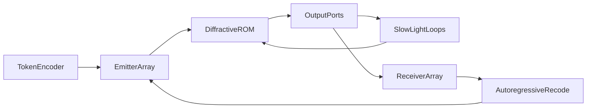

# OLLMU: Optical Large Language Model Unit

A concept for a passive diffractive core (optical ROM) with slow-light side loops, interference routing, and a hybrid mapping onto transformers.

Version 0.1.1 · September 2026 · license [OLLMU IAL 1.0](LICENSE) (implementation unrestricted; keep originator credit) · idea: **Anisul Wałsymzerp** · Polish version: [CONCEPT.pl.md](CONCEPT.pl.md) · citations: [REFERENCES.md](REFERENCES.md) · [attribution](ATTRIBUTION.md)

**This is not a working device.** It is a concept paper. No number in this text is a measurement from an OLLMU unit, because no such unit exists.

---

## 1. Abstract

We propose an inference architecture called **OLLMU** (Optical Large Language Model Unit). The weights of a mature, frozen model are written permanently into a three-dimensional diffractive core. Light performs linear multiply–accumulate (MAC) operations in transit. Nonlinearity and contextual memory are not baked into the whole crystal. They sit on **slow-light side loops**, which the field enters or is barred from by interference — according to what the network learned before fabrication.

The GaN quasi-BIC blue laser (**Fact**: Fąs et al., *Nano Letters*, 2026) is a **candidate coherent source**, not the compute core. The 2026 device is optically pumped, has a grating footprint of order \(100 \times 100\,\mu\mathrm{m}\), and is not an addressable array.

A full transformer in one crystal is not a claim of this paper. The honest split is: static FFN blocks and MoE experts as optical ROM; attention \(QK^{\mathsf{T}}\) as a hybrid block, because it depends on the input. The autoregressive loop (detection → re-encoding of the next token) is part of the architecture and **is not free**.

---

## 2. How to read this document

Every technical claim carries one label:

| Label | Meaning |
| --- | --- |
| **Fact** | Result from a cited publication |
| **Literature** | Established method, not original to OLLMU |
| **Hypothesis** | Element of the architecture proposed here |
| **Estimate** | Order of magnitude, not a measurement |

If a number has no label, it is not an OLLMU result.

---

## 3. Introduction

Digital inference of large language models is limited by data movement and heat, not only by arithmetic. **Literature**: photonic MACs scale favourably at large \(N\) and low analog precision, on the order of a few bits, not FP16 (Nahmias et al., 2020). **Literature**: diffractive deep neural networks (D²NN) perform inference passively after digital training (Lin, Ozcan et al., 2018). **Literature**: Mach–Zehnder meshes implement matrix multiplication on silicon photonic chips (Shen et al., 2017). None of these lines has produced an LLM in a crystal.

The gap OLLMU tries to *name*, not close, is how to combine (i) a frozen, large-scale linear operator in volume, (ii) sparse nonlinearity and memory at the edge, (iii) training that teaches the model *when* to use that edge, without an external controller at inference time.

---

## 4. Fact: the GaN quasi-BIC laser

**Fact.** Fąs, Pruszyńska-Karbownik, Sawicka, Yavorskiy, Feduniewicz, Gołyga, Słowikowski, Kacperski, Siekacz, Muzioł, Nowicki, Kazakov, Wróbel, Czyszanowski, and Suffczyński demonstrated lasing at 440–460 nm at room temperature. Gain is provided by InGaN quantum wells coupled to a quasi-BIC in a monolithic GaN subwavelength grating. A nanoporous GaN layer, formed by electrochemical etching, sits beneath the structure and suppresses mode leakage into the substrate. DOI: [10.1021/acs.nanolett.6c01930](https://doi.org/10.1021/acs.nanolett.6c01930) ([ACS](https://pubs.acs.org/doi/10.1021/acs.nanolett.6c01930), [PMC](https://pmc.ncbi.nlm.nih.gov/articles/PMC13397883/)).

Parameters from the same paper:

- threshold \(0.16\,\mathrm{mJ\,cm^{-2}}\) per pulse,
- linewidth below \(0.04\,\mathrm{nm}\),
- strongly linearly polarised emission; TE/TM ratio of 52,
- gratings of order \(100 \times 100\,\mu\mathrm{m}\),
- numerical design (PWAM), fabrication by e-beam lithography + RIE + TMAH smoothing,
- **optical pumping**, not electrical.

**Fact, limitation.** The paper does not describe an array of independently driven laser pixels, does not report wall-plug efficiency under electrical injection, and does not concern neural networks.

**Hypothesis (use in OLLMU).** If an electrically pumped, addressable array with similar coherence and polarisation appears later, it is a candidate input interface. Strong TE polarisation is an asset for interferometric arithmetic. A wavelength of ~450 nm is **not** suitable for advanced-chip lithography; the diffraction limit is an order of magnitude too coarse relative to 13.5 nm EUV. OLLMU is not a lithography project.

---

## 5. Literature the rest stands on

### 5.1. D²NN

**Literature.** Lin, Ozcan et al. (2018) train layer transmission coefficients digitally, then realise them physically. Inference is diffraction. Demonstrations: classification (including THz, 3D printing), not language models.

The field on layer \(\ell\) connects to the next layer through a diffraction propagator \(D_\ell\) and a learned local transmittance \(T_\ell\):

\[
U_{\ell+1} = D_\ell \bigl( T_\ell \odot U_\ell \bigr).
\]

After fabrication, \(T_\ell\) is fixed: an optical ROM.

### 5.2. Photonic MACs and industry

**Literature.** Shen et al. (2017): a programmable MZI mesh, vowel recognition. Nahmias et al. (2020): a photonic energy advantage at \(N \gtrsim 500\), processor size \(\gtrsim 100\,\mu\mathrm{m}\), and noise precision \(\lesssim 4\) bits. Lightmatter and related firms build **electronic–photonic hybrids**; that is industrial context, not evidence for OLLMU.

### 5.3. Slow light and Kerr

**Literature.** In a photonic crystal the group velocity drops: \(v_g = c / n_g\). Baba (2008) reviews that large \(n_g\) increases light–matter interaction and lowers the nonlinear threshold, at the cost of bandwidth (the delay–bandwidth product). Kerr:

\[
n(I) = n_0 + n_2 I.
\]

Phase shift over an effective length \(L_{\mathrm{eff}}\):

\[
\Delta\varphi = \frac{2\pi}{\lambda}\, n_2 I\, L_{\mathrm{eff}}.
\]

Slow light enlarges \(L_{\mathrm{eff}}\) and the local \(I\). Demonstrations of nonlinear photonic activations (including PhC cavities, Liu et al., 2026) are at femtojoule / picosecond scale, not LLM scale.

The electronic Kerr effect is fast and weak; thermal effects and free-carrier dispersion are stronger and slower. **The OLLMU hypothesis cannot assume that Kerr is ReLU by itself.**

### 5.4. Memory as delay

**Literature.** Optical reservoir computing and delay lines hold state as photons in transit. This is not DRAM. Capacity and lifetime are limited by loss and decoherence.

### 5.5. 3D writing in glass

**Literature.** Femtosecond refractive-index change in glass dates to 1996 (Davis et al.). A 3D photonic neural-network chip written by an fs laser (2026) classifies MNIST. Index contrast \(\Delta n\) is typically \(10^{-3}\)–\(10^{-2}\), not arbitrary. That is not a billion-parameter scale.

### 5.6. Materials at ~450 nm

**Material fact.** Silicon absorbs strongly in the blue (Green, 2008). Guiding uses Si₃N₄ (including ~0.08 dB/cm at 450 nm, Chauhan et al., 2020), GaN, or LiNbO₃. Hybrid bonding of InGaN diodes onto SiN platforms is literature (Mu et al., 2026), not production of BIC arrays.

---

## 6. Hypothesis: OLLMU architecture

**Hypothesis.** The system has five members.

1. **Token encoder (hybrid).** An activation vector (embedding or layer state) is mapped onto field amplitudes and phases. At the start this is electronics plus modulators, not an “LLM in free space”.

2. **Emitter array.** Coherent, parallel sources. Long-term candidate: a GaN BIC array. Present state: single, optically pumped gratings.

3. **Diffractive core (ROM).** A transparent block with a written \(n(\mathbf{r})\). It realises a fixed linear operator \(W\) on the field. Natural payload: FFN and MoE experts.

4. **Slow-light side loops.** Ports at the core edge. Light that enters slows down, acquires phase, may reach a Kerr threshold, and returns after a delay \(\tau\).

5. **Receiver array and recode loop.** Photodetectors (and optional phase measurement) yield an output vector. The next token requires re-encoding. **That costs energy and time.**

### 6.1. Interference routing

**Hypothesis, legal physics.** Two arms with fields \(E_1\), \(E_2\) at a side port give power

\[
P_{\mathrm{side}} \propto \lvert E_1 + E_2 e^{i\theta} \rvert^2.
\]

For \(\theta = \pi\) and \(\lvert E_1\rvert \approx \lvert E_2\rvert\) the port is dark: the side loop is off without a transistor. For \(\theta = 0\) the port is bright. Core weights — that is, the geometry of \(n(\mathbf{r})\) — learn to set \(\theta\) as a function of the input, because the input itself shapes \(E_1\) and \(E_2\).

This is not new physics. What is new is the **use**: the model should treat port extinction as an MoE gate / a skip of nonlinearity.

### 6.2. What the core does not do

The core does not train on the fly, does not update weights, and does not implement dynamic attention \(QK^{\mathsf{T}}\) without extra hardware. OLLMU is an inference ASIC for *one* weight snapshot.

---

## 7. Mapping onto a transformer (honest split)

**Literature.** A transformer layer (Vaswani et al., 2017) is attention plus an FFN. The FFN is usually two fixed matrices and a nonlinearity. MoE (Fedus et al.) selects a subset of experts.

| Block | Is optical ROM enough? | OLLMU proposal |
| --- | --- | --- |
| Embedding / unembedding | Partially (fixed matrix) | ROM or electronics |
| FFN | Yes, if nonlinearity sits on a side loop | Primary optical target |
| MoE expert | Yes, if routing = a port | Interference routing |
| Attention \(QK^{\mathsf{T}}\) | No: the matrix depends on tokens | Electronic or programmable-photonic hybrid |
| Softmax | No (nonlinearity + normalisation) | Side loop or electronics |
| KV-cache | No as a fixed volume | Delay lines only for a short echo; longer context lives off-crystal |
| Autoregression | Not in a single pass | Recode loop |

**Working hypothesis.** The first useful thought-product is not a full conversational LLM in glass, but an FFN / MoE accelerator for a frozen model, with attention computed beside it.

---

## 8. Mathematics

The equations below are standard. They are not a proof that OLLMU scales to billions of parameters.

### 8.1. Propagation

**Literature.** Between planes \(z_\ell\) and \(z_{\ell+1}\), in the scalar angular-spectrum approximation:

\[
\tilde{U}(k_x, k_y; z_{\ell+1}) = \tilde{U}(k_x, k_y; z_\ell)\, \exp\bigl(i z_{\Delta} \sqrt{k_0^2 n^2 - k_x^2 - k_y^2}\bigr),
\]

where \(z_{\Delta} = z_{\ell+1}-z_\ell\), \(k_0 = 2\pi/\lambda\). On a layer plane a pointwise \(T_\ell(x,y)\) acts. In a volume with continuous \(n(\mathbf{r})\) one needs Maxwell or an eikonal / BPM approximation. Training needs a **differentiable twin**; full FDTD for every LLM epoch is impractical (**Estimate** of cost, not a measurement).

### 8.2. Linear operator

For a fixed wavelength and polarisation the core realises

\[
\mathbf{u}_{\mathrm{out}} = W \mathbf{u}_{\mathrm{in}},
\]

where \(W \in \mathbb{C}^{M \times N}\) follows from \(n(\mathbf{r})\). Digital FFN weights must be forced into a physically admissible \(W\) (loss, coupling, the range of \(\Delta n\)). That is an inverse problem, not a copy of a PyTorch matrix into glass.

### 8.3. Delay and the delay–bandwidth product

\[
\tau = \frac{n_g L}{c}.
\]

**Literature.** One cannot have arbitrarily large \(n_g\) and wide bandwidth at once. If tokens are pulses of duration \(T_p\), \(\tau\) must lock to the recode-loop cadence. **Estimate:** \(\tau\) of picoseconds–nanoseconds is a layer echo, not a 128k-token context.

### 8.4. Kerr on the side loop

\[
\Delta\varphi = \frac{2\pi}{\lambda}\, n_2 I\, L_{\mathrm{eff}}(n_g).
\]

For \(\Delta\varphi\) of order 1 rad one needs large \(n_2\), large \(I\), or large \(L_{\mathrm{eff}}\). Slow light helps. Two-photon absorption and heat compete with pure Kerr. An optical activation **is not** \(\mathrm{ReLU}(x)=\max(0,x)\) unless the device is designed and measured to be that.

### 8.5. Port extinction

Let \(E_{\mathrm{side}} = a(\mathbf{u}_{\mathrm{in}}) + b(\mathbf{u}_{\mathrm{in}})\). Training should reach \(a \approx -b\) when the side loop must stay silent and \(a \approx b\) when it must act. That is sparse energy steering, not a separate control bit from a CPU.

### 8.6. Loss function

**Hypothesis.**

\[
\mathcal{L} = \mathcal{L}_{\mathrm{task}} + \lambda_s \mathbb{E}\bigl[ P_{\mathrm{side}} \cdot \mathbf{1}_{\text{nonlinearity not needed}} \bigr] + \lambda_{\mathrm{ph}} \mathcal{L}_{\mathrm{physics}} + \lambda_f \mathcal{L}_{\mathrm{fab}}.
\]

- \(\mathcal{L}_{\mathrm{task}}\) — model loss (e.g. cross-entropy on the digital twin).
- The \(\lambda_s\) term — a penalty for lighting a side port when the task is linearly sufficient.
- \(\mathcal{L}_{\mathrm{physics}}\) — consistency with propagation and Kerr, not with a vacuum `Linear` layer.
- \(\mathcal{L}_{\mathrm{fab}}\) — tolerance to \(\Delta n\) error, roughness, misalignment.

Without a twin, “burning a frontier model into glass” is a slogan, not a procedure.

### 8.7. Analog precision

**Literature / Estimate.** Under additive noise

\[
b \approx \tfrac12 \log_2 (1 + \mathrm{SNR}).
\]

Shot noise, phase drift, scattering, and write error limit \(b\) to **a few bits**, in line with Nahmias et al. (a ~4-bit threshold in their comparison). Digital models in INT4/INT8 show that low precision can suffice in FFNs — but this is analog, not INT4 with correction.

### 8.8. Energy

Let \(E_{\mathrm{src}}\) be source energy per pass, \(E_{\mathrm{det}}\) detection and ADC, \(E_{\mathrm{recode}}\) loop electronics, \(E_{\mathrm{core}} \approx 0\) aside from optical loss (which the sources still pay).

\[
E_{\mathrm{token}} = E_{\mathrm{src}} + E_{\mathrm{det}} + E_{\mathrm{recode}} + E_{\mathrm{attn, hyb}}.
\]

**Methodological fact.** Zero joules applies only to the passive operator \(W\) in glass. A whole token is not free. Comparisons with GPUs that omit \(E_{\mathrm{src}}+E_{\mathrm{det}}+E_{\mathrm{recode}}+E_{\mathrm{attn, hyb}}\) are void. Nahmias et al. supply a framework; this paper does not supply a “times GPU” number.

### 8.9. Volume and parameters

**Estimate, not a measurement.** Suppose voxels of size \(\sim\lambda\) in glass each carry \(k\) effective analog bits. For \(\lambda = 450\,\mathrm{nm}\) and \(k = 4\):

\[
\rho \sim \frac{k}{\lambda^3} \approx \frac{4}{(4.5\times 10^{-7})^3}\ \mathrm{bit/m^3} \sim 4\times 10^{19}\ \mathrm{bit/m^3}.
\]

This is a **diffraction-limited ceiling**, not a usable density. Crosstalk, waveguides, ports, and tolerances cut orders of magnitude. Even then the map “PyTorch parameter = voxel” is false: \(W\) is a dense wave operator, not a CSR matrix. Conclusion: LLM scale needs either a huge volume, or multiplexing (space × wavelength × time), or **giving up on the whole model in favour of the FFN**.

---

## 9. Space-aware training

**Procedural hypothesis.**

1. Define a digital twin: propagator + Kerr on the side loops + a detector model.
2. Train with \(\mathcal{L}\) from §8.6 on an FFN/MoE task (not a full LLM at once).
3. Quantise \(n(\mathbf{r})\) to what fs-writing or lithography can do.
4. Write / etch.
5. Calibrate: measure \(W_{\mathrm{real}}\), fine-tune recode electronics and thresholds; do not “retrain the crystal”.

The model should learn to *ignore* side loops by interferometric darkness until the input arranges the field so as to light them. That is the routing idea from the source conversation; in this paper it is recorded as a training goal, not as a measured mechanism.

---

## 10. Materials and fabrication

| Role | Candidate | Note |
| --- | --- | --- |
| Source | GaN quasi-BIC (Fąs 2026) | Today optically pumped |
| Visible guiding | Si₃N₄, GaN, LN | Not SOI silicon |
| ROM volume | Glass / crystal fs-write or a D²NN stack | Small demonstrations |
| Slow-light side loop | PhC, microrings, metamaterial | Bandwidth vs \(n_g\) |
| Detection | Si / GaN array | Phase needs a local interferometer |

Blue light: smaller \(\lambda\) packs voxels more tightly, but Rayleigh scattering grows as \(\lambda^{-4}\), defects cost more, and glass photodarkening is a real risk. **The hypothesis does not decide** that 450 nm is better than 1550 nm for all of OLLMU. The BIC source is blue; the core might later run at another wavelength if conversion is added — a separate, expensive member, not magic.

---

## 11. Error model

Error sources this document admits in advance:

- \(\Delta n(\mathbf{r})\) write inaccuracy,
- roughness and loss,
- thermal phase drift (especially thermal Kerr),
- vibration and interferometer instability,
- shot noise and ADC,
- twin-versus-Maxwell mismatch,
- source ageing and photodarkening.

Without post-write calibration the device is a sculpture, not an accelerator.

---

## 12. Arguments for

1. **Passive MACs.** Consistent with D²NN and Nahmias: at large \(N\) and low precision, glass can be energetically cheaper *for the linear operator alone* than digital MACs.
2. **ROM makes business sense** if a frontier snapshot lives for months. No on-device fine-tuning is not a defect of an ASIC.
3. **Slow light** joins delay and a nonlinear threshold in one physical object — literature shows this at small scale.
4. **Interference routing** does not break physics; it maps MoE onto field geometry.
5. **BIC source:** room temperature, low optical threshold, narrow line, strong polarisation — desirable *if* an electrical array appears.
6. **FFN/attention hybrid** does not require waiting for a fully optical transformer.

## 13. Arguments against

1. The 2026 BIC laser is not an electrical array.
2. Silicon does not guide 450 nm; the whole material stack differs from 1550 nm silicon photonics.
3. D²NN and fs-PNN are MNIST / small-network scale.
4. Attention is not a ROM.
5. Kerr ≠ ReLU; heat wrecks phase.
6. The token→light→token loop eats the core’s gain.
7. The delay–bandwidth product blocks “memory like a KV-cache”.
8. A Maxwell twin is expensive and approximate.
9. The density in §8.9 is a ceiling, not a production plan.
10. There is no publication that joins GaN BIC + D²NN + slow-light MoE into one LLM — this paper does not either; it only names the hypothesis.

---

## 14. Elements added relative to the source conversation

The conversation that produced this concept omitted or treated too lightly:

- the autoregressive loop as a cost,
- the FFN / attention split,
- MoE as a better picture of routing than “the whole LLM thinks in glass”,
- the digital twin and calibration,
- the error model,
- the \(E_{\mathrm{token}}\) budget,
- the delay–bandwidth product,
- silicon’s blindness to blue,
- analog precision,
- electronic versus thermal Kerr,
- a phased research map instead of a jump to a frontier model.

---

## 15. Research phases

No phase is executed in this repository.

| Phase | Goal | Success criterion | What is not success |
| --- | --- | --- | --- |
| 0 | This document | Consistent Fact/Hypothesis labels | “We have an optical LLM” |
| 1 | Numerical twin of a small D²NN + 1 side loop | Agreement with analytic \(W\) and \(\Delta\varphi\) | GPT scale |
| 2 | Toy classification (as in D²NN) | Accuracy near digital at a few bits of SNR | Natural language |
| 3 | Mini-FFN (e.g. width 64–256) | MAC error vs NumPy at a stated SNR | A transformer |
| 4 | MoE routing onto 2–4 optical experts | Measured interferometric port extinction | A full MoE LLM |
| 5 | Hybrid: digital attention + optical FFN | *System* latency and energy vs GPU on the same FFN | “Zero watts” |
| 6 | Source: from optical pump to electrical array | A separate GaN materials line | Required for phase 5 only if SiN+InGaN is not enough |

---

## 16. What we do not claim

- That OLLMU exists in a laboratory.
- That the Fąs et al. (2026) laser is an AI accelerator.
- That LLM inference energy will fall to a fraction of a per-mille of a GPU.
- That a full frontier model fits in a crystal.
- That Kerr on a side loop is ReLU.
- That slow light replaces a KV-cache.
- That a blue laser beats EUV in lithography.
- That space-aware training has been carried out.

---

## 17. Conclusions

OLLMU is a **named hardware hypothesis**: a frozen linear operator in volume, sparse nonlinearity and a short echo on slow-light side loops, routing by interference, a hybrid for attention and the token loop. The literature supports the *pieces* (D²NN, photonic MACs, Kerr, slow light, GaN BIC). Assembling the pieces into an LLM is an open engineering problem, not a discovery.

The most honest next paper is a twin and a mini-FFN, not a sculpture of a frontier model.

---

## 18. Citations

Full list with DOIs (resolved on Crossref 2026-09-07): [REFERENCES.md](REFERENCES.md). Key items: Fąs et al. 2026; Lin/Ozcan 2018; Shen 2017; Nahmias 2020; Baba 2008; Vaswani 2017; Fedus 2022.
