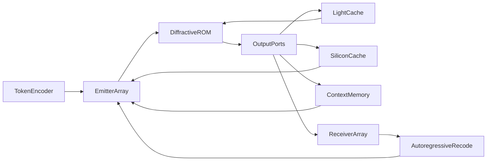

# OLLMU: optyczna jednostka modelu językowego

Koncepcja pasywnego rdzenia dyfrakcyjnego (optyczny ROM): przetwarzanie w świetle, krótki light cache w wolniejszym ośrodku, SiliconCache i pamięć kontekstu poza kryształem.

Wersja 0.1.2 · wrzesień 2026 · licencja [OLLMU IAL 1.0](LICENSE) (realizacja nieograniczona; zachować autora pomysłu) · pomysł: **Anisul Wałsymzerp** · wersja angielska: [CONCEPT.en.md](CONCEPT.en.md) · cytowania: [REFERENCES.md](REFERENCES.md) · [atrybucja](ATTRIBUTION.md)

**To nie jest działający układ.** To praca koncepcyjna. Żaden pomiar z tego tekstu nie pochodzi z egzemplarza OLLMU, bo takiego egzemplarza nie ma.

---

## 1. Streszczenie

Proponujemy architekturę inferencji o nazwie **OLLMU** (Optical Large Language Model Unit). **Przetwarzanie jest optyczne:** wagi zamrożonego modelu zapisuje się w trójwymiarowym rdzeniu dyfrakcyjnym, a światło wykonuje liniowe MAC podczas przelotu. Sam kryształ już opóźnia falę; różne ośrodki można dobrać tak, by tam, gdzie krótkie echo jest użyteczne, powstał **light cache** (w tym wolne światło). **SiliconCache** (nieliniowość, szybki bufor, pętla thinking) i **pamięć kontekstu** (długi stan rozmowy) siedzą **poza kryształem**. Najważniejsze: model ma być wytrenowany, *kiedy i jak* z tych zewnętrznych pamięci korzystać — routingiem interferencyjnym i portami na krawędzi, bez CPU, który w inferencji decyduje za sieć.

Laser błękitny GaN oparty na quasi-BIC (**Fakt**: Fąs et al., *Nano Letters*, 2026) jest tu **kandydatem na źródło spójne**, nie rdzeniem obliczeniowym. Układ z 2026 roku jest pompowany optycznie, ma rozmiar siatki rzędu \(100 \times 100\,\mu\mathrm{m}\) i nie stanowi adresowalnej matrycy.

Pełny transformer w jednym krysztale nie jest twierdzeniem tej pracy. Uczciwy podział: statyczne bloki FFN i eksperci MoE jako optyczny ROM; uwaga \(QK^{\mathsf{T}}\) jako blok hybrydowy, bo zależy od wejścia. Pętla autoregresyjna (detekcja → ponowne zakodowanie tokena) jest częścią architektury i **nie jest bezenergetyczna**.

---

## 2. Jak czytać ten dokument

Każde twierdzenie techniczne nosi jedną etykietę:

| Etykieta | Znaczenie |
| --- | --- |
| **Fakt** | Wynik z cytowanej publikacji |
| **Literatura** | Znana metoda, nie oryginalna dla OLLMU |
| **Hipoteza** | Element proponowanej architektury |
| **Oszacowanie** | Rząd wielkości, nie pomiar |

Jeśli etykiety brakuje przy liczbie, liczba nie jest wynikiem OLLMU.

---

## 3. Wstęp

Cyfrowe inferowanie dużych modeli językowych jest ograniczone przesyłem danych i ciepłem, nie tylko arytmetyką. **Literatura**: fotoniczne MAC skalują się korzystnie przy dużym \(N\) i niskiej precyzji analogowej, rzędu kilku bitów, a nie FP16 (Nahmias et al., 2020). **Literatura**: sieci dyfrakcyjne D²NN wykonują inferencję pasywnie po cyfrowym treningu (Lin, Ozcan et al., 2018). **Literatura**: siatki interferometrów Macha–Zehndera realizują mnożenie macierzy na chipie krzemowym (Shen et al., 2017). Żadna z tych linii nie dała dotychczas LLM w krysztale.

Luka, którą OLLMU próbuje nazwać, a nie zamknąć: jak połączyć (i) zamrożony operator liniowy w świetle, (ii) krótki optyczny light cache tam, gdzie opóźnienie fali wystarcza, (iii) SiliconCache i pamięć kontekstu poza kryształem, (iv) trening, który uczy model *kiedy* z tych zewnętrznych pamięci korzystać, bez sterownika, który w inferencji zastępuje sieć.

---

## 4. Fakt: laser quasi-BIC GaN

**Fakt.** Fąs, Pruszyńska-Karbownik, Sawicka, Yavorskiy, Feduniewicz, Gołyga, Słowikowski, Kacperski, Siekacz, Muzioł, Nowicki, Kazakov, Wróbel, Czyszanowski i Suffczyński wykazali lasing w zakresie 440–460 nm w temperaturze pokojowej. Wzmocnienie dają studnie kwantowe InGaN sprzężone z quasi-BIC w monolitycznej siatce podfalowej GaN. Pod strukturą leży warstwa nanoporowatego GaN z trawienia elektrochemicznego, która tłumi wyciek modów do podłoża. DOI: [10.1021/acs.nanolett.6c01930](https://doi.org/10.1021/acs.nanolett.6c01930) ([ACS](https://pubs.acs.org/doi/10.1021/acs.nanolett.6c01930), [PMC](https://pmc.ncbi.nlm.nih.gov/articles/PMC13397883/)).

Parametry z tej samej pracy:

- próg \(0{,}16\,\mathrm{mJ\,cm^{-2}}\) na impuls,
- szerokość linii poniżej \(0{,}04\,\mathrm{nm}\),
- emisja silnie spolaryzowana liniowo; stosunek TE/TM równy 52,
- siatki rzędu \(100 \times 100\,\mu\mathrm{m}\),
- projekt numeryczny (PWAM), fabrykacja e-beam + RIE + wygładzanie TMAH,
- **pompowanie optyczne**, nie elektryczne.

**Fakt, ograniczenie.** Praca nie opisuje matrycy niezależnie sterowanych pikseli laserowych, nie podaje sprawności ściany wtyczkowej elektrycznej i nie dotyczy sieci neuronowych.

**Hipoteza (zastosowanie w OLLMU).** Jeśli w przyszłości powstanie elektrycznie pompowana, adresowalna matryca o podobnej spójności i polaryzacji, nadaje się na interfejs wejściowy. Silna polaryzacja TE jest zaletą w rachunku interferencyjnym. Długość fali ~450 nm **nie** nadaje się do litografii zaawansowanych chipów; limit dyfrakcyjny jest o rząd za gruby względem EUV 13,5 nm. OLLMU nie jest projektem litograficznym.

---

## 5. Literatura, na której stoi reszta

### 5.1. D²NN

**Literatura.** Lin, Ozcan et al. (2018) trenują cyfrowo współczynniki transmisji warstw, potem fizycznie je realizują. Inferencja to dyfrakcja. Demonstracje: klasyfikacja (w tym THz, druk 3D), nie modele językowe.

Pole na warstwie \(\ell\) wiąże się z następną przez propagator dyfrakcyjny \(D_\ell\) i lokalny, wyuczony transmitancję \(T_\ell\):

\[
U_{\ell+1} = D_\ell \bigl( T_\ell \odot U_\ell \bigr).
\]

Po fabrykacji \(T_\ell\) jest stałe: to optyczny ROM.

### 5.2. Fotoniczne MAC i przemysł

**Literatura.** Shen et al. (2017): programowalna siatka MZI, rozpoznawanie samogłosek. Nahmias et al. (2020): przewaga energetyczna fotoniki przy \(N \gtrsim 500\), rozmiarze procesora \(\gtrsim 100\,\mu\mathrm{m}\) i precyzji szumowej \(\lesssim 4\) bity. Lightmatter i pokrewne firmy budują **hybrydy** elektroniczno-fotoniczne; to kontekst przemysłowy, nie dowód OLLMU.

### 5.3. Wolne światło i Kerr

**Literatura.** W krysztale fotonicznym prędkość grupowa spada: \(v_g = c / n_g\). Baba (2008) podsumowuje, że duże \(n_g\) zwiększa interakcję światło–materia i obniża próg nieliniowości, kosztem pasma (produkt pasmo–opóźnienie). Kerr:

\[
n(I) = n_0 + n_2 I.
\]

Przesunięcie fazy na długości efektywnej \(L_{\mathrm{eff}}\):

\[
\Delta\varphi = \frac{2\pi}{\lambda}\, n_2 I\, L_{\mathrm{eff}}.
\]

Slow light powiększa \(L_{\mathrm{eff}}\) i lokalne \(I\). Demonstracje aktywacji nieliniowych w fotonice (m.in. jamy PhC, Liu et al., 2026) są w skali femtodżuli / pikosekund, nie w skali LLM.

Efekt Kerra elektronowego jest szybki i słaby; efekt cieplny i dyspersja swobodnych nośników są silniejsze i wolniejsze. **Hipoteza OLLMU nie może zakładać, że Kerr sam z siebie jest ReLU.**

### 5.4. Pamięć jako opóźnienie

**Literatura.** Optyczne przetwarzanie rezerwuarowe i linie opóźniające trzymają stan jako fotony w drodze. To nie jest DRAM. Pojemność i czas życia ogranicza strata i dekoherencja.

### 5.5. Zapis 3D w szkle

**Literatura.** Femtosekundowa zmiana współczynnika załamania w szkle istnieje od 1996 (Davis et al.). Chip 3D PNN zapisany fs-laserem (2026) klasyfikuje MNIST. Kontrast \(\Delta n\) jest zwykle \(10^{-3}\)–\(10^{-2}\), nie dowolny. To nie jest skala miliardów parametrów.

### 5.6. Materiał na ~450 nm

**Fakt materiałowy.** Krzem w paśmie błękitnym silnie absorbuje (Green, 2008). Prowadzenie: Si₃N₄ (m.in. ~0,08 dB/cm przy 450 nm, Chauhan et al., 2020), GaN, LiNbO₃. Hybrydowe wiązanie diod InGaN do platformy SiN jest literaturą (Mu et al., 2026), nie produkcją matryc BIC.

---

## 6. Hipoteza: architektura OLLMU

**Hipoteza.** Przetwarzanie siedzi w świetle. Pamięć ma trzy skale czasu. Model uczy się, którą skalę zapalić.

1. **Koder tokenów (hybryda).** Wektor aktywacji jest mapowany na amplitudy i fazy. Na starcie: elektronika + modulatory.

2. **Matryca emisyjna.** Spójne źródła. Kandydat: matryca BIC GaN. Dziś: optycznie pompowane siatki.

3. **Rdzeń dyfrakcyjny (ROM) — processing.** Zapisane \(n(\mathbf{r})\). Światło liczy stały operator \(W\). Naturalny ładunek: FFN i eksperci MoE. Przelot przez ośrodek *już* jest opóźnieniem \(\tau_{\mathrm{core}} = n L / c\); to nie jest wada, tylko zegar optyczny.

4. **Light cache (w krysztale / na krawędzi optycznej).** Tam, gdzie przyda się *lekkie* opóźnienie — zsynchronizowanie dwóch przebiegów, echo warstwy, złożenie fazy — pole idzie w wolniejszy ośrodek (większe \(n\) albo \(n_g\): wolne światło, inny kryształ, dłuższa ścieżka). To **nie** zastępuje KV-cache ani ReLU. Kerr na tej ścieżce jest opcją, nie wymogiem.

5. **SiliconCache (poza kryształem).** Detekcja → szybki cache krzemowy → nieliniowość (ReLU/GELU/mały MLP) i/lub wektor thinking. Wynik wraca na matrycę emisyjną w takcie, którego model się nauczył: albo jako ponowne przetworzenie, albo jako dane dodatkowe.

6. **Pamięć kontekstu (poza kryształem).** Długi stan (odpowiednik KV-cache, scratchpad, historia tokenów). SRAM/DRAM albo inny bufor elektroniczny. Światło tam nie mieszka.

7. **Matryca odbiorcza i pętla recode.** Kolejny token. **Nie jest za darmo.**

### 6.1. Trzy skale opóźnienia

| Skala | Gdzie | Co trzyma | Rząd czasu (**Oszacowanie**) |
| --- | --- | --- | --- |
| Przelot rdzenia | w krysztale | nic poza falą w locie | ps–ns na centymetr |
| Light cache | wolniejszy ośrodek optyczny | krótkie echo, faza | ps–ns, produkt pasmo–opóźnienie |
| SiliconCache | krzem poza kryształem | nieliniowość, thinking, alignment taktów | ns–µs |
| Context memory | krzem poza kryształem | kontekst rozmowy | µs–ms i dłużej, pojemność cyfrowa |

**Literatura.** Różne \(n\) i \(n_g\) zmieniają czas przelotu; to standard optyki, nie nowy efekt. **Hipoteza** dotyczy tylko *użytku*: model traktuje te skale jak narzędzia, nie jak jedną magiczną pamięć.

### 6.2. Routing: model uczy się SiliconCache i kontekstu

**Hipoteza, fizyka legalna.** Porty na krawędzi rdzenia prowadzą do light cache, SiliconCache albo pamięci kontekstu. Dwa ramiona \(E_1\), \(E_2\) dają

\[
P_{\mathrm{port}} \propto \lvert E_1 + E_2 e^{i\theta} \rvert^2.
\]

\(\theta = \pi\) gasi port (pamięć zewnętrzna milczy). \(\theta = 0\) wpycha energię na wybraną ścieżkę. Wagi \(n(\mathbf{r})\) uczą się tego *przed* wypaleniem. W inferencji nie ma osobnego bitu z CPU „użyj cache”.

To jest obciążenie treningu, nie magia materiału. Sieć musi dostać w \(\mathcal{L}\) sygnał, że SiliconCache i context memory coś kosztują i coś dają. Inaczej albo nigdy z nich nie skorzysta, albo będzie je palić bez potrzeby.

### 6.3. Czego rdzeń nie robi

Rdzeń nie trenuje się w locie, nie jest DRAM-em, nie trzyma 128k tokenów. OLLMU jest ASIC-iem inferencyjnym dla *jednego* zrzutu wag; długi kontekst i nieliniowość są kontraktami z elektroniką, których model ma się nauczyć używać.

---

## 7. Mapowanie na transformer (uczciwy podział)

**Literatura.** Warstwa transformera (Vaswani et al., 2017) to uwaga plus FFN. FFN to zwykle dwie stałe macierze i nieliniowość. MoE (Fedus et al.) wybiera podzbiór ekspertów.

| Blok | Czy ROM optyczny wystarczy? | Propozycja OLLMU |
| --- | --- | --- |
| Embedding / unembedding | Częściowo (stała macierz) | ROM albo elektronika |
| FFN (liniowa część) | Tak | Główny processing w świetle |
| Nieliniowość FFN | Nie w ROM | SiliconCache, poza kryształem |
| Ekspert MoE | Routing = port | Interferencja na krawędzi |
| Uwaga \(QK^{\mathsf{T}}\) | Nie: macierz zależy od tokenów | Hybryda; stan w context memory |
| Softmax | Nie | SiliconCache |
| KV-cache / kontekst | Nie jako objętość optyczna | Context memory poza kryształem |
| Krótkie echo / faza | Tak, jeśli \(\tau\) małe | Light cache (wolniejszy ośrodek) |
| Autoregresja | Nie w jednym przelocie | Pętla recode |

**Hipoteza operacyjna.** Processing = światło. SiliconCache i context memory = kontrakty zewnętrzne, których sieć uczy się **zanim** \(n(\mathbf{r})\) zostanie zapisane w krysztale. Light cache = krótkie optyczne opóźnienie, nie pamięć rozmowy.

---

## 8. Matematyka

Równania poniżej są standardowe. Nie stanowią dowodu, że OLLMU skaluje się do miliardów parametrów.

### 8.1. Propagacja

**Literatura.** Między płaszczyznami \(z_\ell\) i \(z_{\ell+1}\) pole w przybliżeniu skalarnego widma kątowego:

\[
\tilde{U}(k_x, k_y; z_{\ell+1}) = \tilde{U}(k_x, k_y; z_\ell)\, \exp\bigl(i z_{\Delta} \sqrt{k_0^2 n^2 - k_x^2 - k_y^2}\bigr),
\]

gdzie \(z_{\Delta} = z_{\ell+1}-z_\ell\), \(k_0 = 2\pi/\lambda\). Na płaszczyźnie warstwy działa punktowo \(T_\ell(x,y)\). W objętości z ciągłym \(n(\mathbf{r})\) trzeba Maxwella albo przybliżenia eikonalnego / BPM. Trening wymaga **różniczkowalnego bliźniaka**; pełny FDTD na każdą epokę LLM jest niepraktyczny (**Oszacowanie** kosztu, nie pomiar).

### 8.2. Operator liniowy

Dla ustalonej długości fali i polaryzacji rdzeń realizuje

\[
\mathbf{u}_{\mathrm{out}} = W \mathbf{u}_{\mathrm{in}},
\]

gdzie \(W \in \mathbb{C}^{M \times N}\) wynika z \(n(\mathbf{r})\). Wagi cyfrowego FFN trzeba wcisnąć w fizycznie dopuszczalne \(W\) (straty, sprzężenie, zakres \(\Delta n\)). To problem odwrotny, nie kopiowanie macierzy PyTorch do szkła.

### 8.3. Opóźnienie: rdzeń vs light cache vs krzem

Przelot przez rdzeń:

\[
\tau_{\mathrm{core}} = \frac{n L}{c}.
\]

Light cache w wolniejszym ośrodku:

\[
\tau_{\mathrm{lc}} = \frac{n_g L_{\mathrm{lc}}}{c}.
\]

**Literatura.** Nie można jednocześnie mieć dowolnie dużego \(n_g\) i szerokiego pasma. **Oszacowanie:** \(\tau_{\mathrm{core}}\) i \(\tau_{\mathrm{lc}}\) to ps–ns — echo i zegar optyczny, nie kontekst 128k. SiliconCache i context memory nie podlegają produktowi pasmo–opóźnienie; ich cena to O-E-O i DRAM.

### 8.4. Kerr na light cache (opcja)

\[
\Delta\varphi = \frac{2\pi}{\lambda}\, n_2 I\, L_{\mathrm{eff}}(n_g).
\]

Wolniejsze światło podnosi lokalne \(I\) i \(L_{\mathrm{eff}}\). To może być przyjemny efekt uboczny light cache. **Nie** jest to domyślna nieliniowość modelu. ReLU/GELU siedzą w SiliconCache. Kerr ≠ ReLU, chyba że ktoś to zmierzy.

### 8.5. Gaszenie portu

Niech \(E_{\mathrm{port}} = a(\mathbf{u}_{\mathrm{in}}) + b(\mathbf{u}_{\mathrm{in}})\). Trening — **przed zapisem** — ma osiągać \(a \approx -b\), gdy SiliconCache, context memory albo light cache mają milczeć, oraz \(a \approx b\), gdy dana pamięć ma działać. To rzadkie sterowanie energią, nie bit z CPU w inferencji.

### 8.6. Funkcja straty

**Hipoteza.** Cała \(\mathcal{L}\) jest liczona na cyfrowym bliźniaku **zanim** \(n(\mathbf{r})\) trafi w kryształ.

\[
\mathcal{L} = \mathcal{L}_{\mathrm{task}} + \lambda_{\mathrm{si}} \mathbb{E}\bigl[ P_{\mathrm{Si}} \cdot \mathbf{1}_{\text{SiliconCache zbędny}} \bigr] + \lambda_{\mathrm{ctx}} \mathbb{E}\bigl[ P_{\mathrm{ctx}} \cdot \mathbf{1}_{\text{kontekst zbędny}} \bigr] + \lambda_{\mathrm{lc}} \mathbb{E}\bigl[ P_{\mathrm{lc}} \cdot \mathbf{1}_{\text{echo zbędne}} \bigr] + \lambda_{\mathrm{ph}} \mathcal{L}_{\mathrm{physics}} + \lambda_f \mathcal{L}_{\mathrm{fab}}.
\]

Bez bliźniaka, który umie SiliconCache i context memory, „wypalenie modelu w szkle” jest hasłem.

### 8.7. Precyzja analogowa

**Literatura / Oszacowanie.** Przy szumie addytywnym

\[
b \approx \tfrac12 \log_2 (1 + \mathrm{SNR}).
\]

Szum śrutowy, dryf fazy, rozpraszanie i błąd zapisu ograniczają \(b\) do **kilku bitów**, zgodnie z Nahmias et al. (próg ~4 bity w ich porównaniu). Modele cyfrowe w INT4/INT8 pokazują, że niska precyzja bywa wystarczająca w FFN — ale to analog, nie INT4 z korekcją.

### 8.8. Energia

\[
E_{\mathrm{token}} = E_{\mathrm{src}} + E_{\mathrm{det}} + E_{\mathrm{Si}} + E_{\mathrm{ctx}} + E_{\mathrm{recode}} + E_{\mathrm{attn, hyb}}.
\]

\(E_{\mathrm{core}}\) poza stratą optyczną jest ~0 (stratę i tak płacą źródła). Light cache jest optyczny; SiliconCache i context memory są O-E-O. **Fakt metodologiczny.** Zero dżuli dotyczy wyłącznie pasywnego \(W\) w szkle.

### 8.9. Objętość i parametry

**Oszacowanie, nie pomiar.** Niech wokseli o rozmiarze \(\sim\lambda\) w szkle niosą po \(k\) bitów analogowych efektywnych. Dla \(\lambda = 450\,\mathrm{nm}\) i \(k = 4\):

\[
\rho \sim \frac{k}{\lambda^3} \approx \frac{4}{(4{,}5\times 10^{-7})^3}\ \mathrm{bit/m^3} \sim 4\times 10^{19}\ \mathrm{bit/m^3}.
\]

To **górny sufit dyfrakcyjny**, nie gęstość użyteczna. Sprzężenia krzyżowe, prowadnice, porty i tolerancje obcinają rzędy wielkości. Nawet wtedy mapa „parametr PyTorch = wokseli” jest fałszywa: \(W\) jest gęstym operatorem falowym, nie CSR macierzą. Wniosek: skala LLM wymaga albo ogromnej objętości, albo multipleksacji (przestrzeń × długość fali × czas), albo **rezygnacji z całego modelu na rzecz FFN**.

---

## 9. Trening przed zapisem w krysztale

**Hipoteza twarda.** Sieć — w tym routing do SiliconCache, context memory i light cache — uczy się **w całości na cyfrowym bliźniaku, zanim** \(n(\mathbf{r})\) zostanie wypalone. Po zapisie kryształ jest ROM. Nie ma dotrenowania w szkle.

Kolejność:

1. Bliźniak: propagator rdzenia + light cache (\(n\), \(n_g\)) + modele SiliconCache i context memory (detektor, nieliniowość, bufor, takt).
2. Trening \(\mathcal{L}\) z §8.6. Model uczy się *kiedy* zapalić port krzemowy, *kiedy* sięgnąć po kontekst, *kiedy* wystarczy echo optyczne, *kiedy* nic nie ruszać.
3. Kwantyzacja \(n(\mathbf{r})\) do tego, co umie fs-zapis / litografia.
4. Zapis w krysztale. Koniec uczenia wag optycznych.
5. Kalibracja elektroniki (progi, delay SiliconCache), nie „przetrenowanie kryształu”.

W inferencji geometria już *jest* polityką pamięci. CPU nie wybiera cache za model.

---

## 10. Materiały i fabrykacja

| Rola | Kandydat | Uwaga |
| --- | --- | --- |
| Źródło | Quasi-BIC GaN (Fąs 2026) | Dziś optycznie pompowane |
| Prowadzenie widzialne | Si₃N₄, GaN, LN | Nie krzem SOI |
| Objętość ROM | Szkło / kryształ fs-write albo stos warstw D²NN | Demonstracje małe |
| Light cache | Wolniejszy ośrodek, PhC, dłuższa ścieżka | Krótkie echo, nie KV-cache |
| SiliconCache | CMOS poza kryształem | Nieliniowość, thinking, takt |
| Context memory | SRAM/DRAM poza kryształem | Kontekst; model uczy się przed zapisem |
| Detekcja | Matryca Si / GaN | Faza wymaga interferometru lokalnego |

Niebieskie światło: mniejsza \(\lambda\) zagęszcza woksele, ale rozpraszanie Rayleigha rośnie jak \(\lambda^{-4}\), defekty są droższe, a fotociemnienie szkła jest realnym ryzykiem. **Hipoteza nie przesądza**, że 450 nm jest lepsze niż 1550 nm dla całego OLLMU. Źródło BIC jest błękitne; rdzeń może w przyszłości pracować na innej fali, jeśli pojawi się konwersja — to osobny, kosztowny człon, nie magia.

---

## 11. Model błędu

Źródła błędu, które dokumentacja uznaje z góry:

- niedokładność \(\Delta n(\mathbf{r})\) przy zapisie,
- chropowatość i strata,
- dryf termiczny fazy (szczególnie Kerr cieplny),
- wibracje i niestabilność interferometrów,
- szum śrutowy i ADC,
- niezgodność bliźniaka z Maxwelllem,
- starzenie źródła i fotociemnienie.

Bez kalibracji po wypaleniu układ jest rzeźbą, nie akceleratorem.

---

## 12. Argumenty za

1. **Pasywne MAC.** Zgodne z D²NN i analizą Nahmiasa: przy dużym \(N\) i niskiej precyzji szkło może być tańsze energetycznie *na sam operator liniowy* niż cyfrowe MAC.
2. **ROM ma sens biznesowy**, jeśli zrzut frontier modelu żyje miesiącami. Brak dotrenowania nie jest wadą ASIC.
3. **Light cache** wykorzystuje to, że kryształ i tak opóźnia falę; wolniejszy ośrodek tam, gdzie krótkie echo jest użyteczne — nie jako KV-cache.
4. **Trening przed zapisem:** polityka SiliconCache i kontekstu jest w geometrii ROM, nie w CPU inferencji.
5. **Źródło BIC:** pokojowa temperatura, niski próg optyczny, wąska linia, silna polaryzacja — *jeśli* powstanie matryca elektryczna.
6. **Processing w świetle** zostaje; elektronika jest pamięcią i nieliniowością, nie rdzeniem MAC.

## 13. Argumenty przeciw

1. Laser BIC 2026 nie jest matrycą elektryczną.
2. Krzem nie prowadzi 450 nm.
3. D²NN i fs-PNN są na MNIST / małych sieciach.
4. Uwaga nie jest ROM-em; context memory to O-E-O.
5. Kerr na light cache ≠ ReLU.
6. Pętla token→światło→token i SiliconCache zjadają zysk rdzenia.
7. Bliźniak musi modelować krzem *i* Maxwella — drogi i przybliżony.
8. Po zapisie nie ma poprawiania wag optycznych.
9. Gęstość z §8.9 to sufit, nie plan produkcji.
10. Brak publikacji, która składa te kawałki w LLM — ta praca też tego nie robi.

---

## 14. Elementy dodane względem rozmowy źródłowej

Rozmowa, z której wyszła koncepcja, pomijała lub zbyt lekko traktowała:

- SiliconCache i context memory poza kryształem, z treningiem **przed** zapisem,
- light cache jako krótkie echo, nie jako namiastka KV,
- pętlę autoregresyjną jako koszt,
- rozdział FFN / uwagi,
- MoE jako routing,
- cyfrowy bliźniak i kalibrację,
- model błędu i \(E_{\mathrm{token}}\).

---

## 15. Fazy badawcze

Żadna faza nie jest wykonana w tym repozytorium.

| Faza | Cel | Kryterium sukcesu | Co nie jest sukcesem |
| --- | --- | --- | --- |
| 0 | Ten dokument | Spójne etykiety Fakt/Hipoteza | „Mamy optyczny LLM” |
| 1 | Bliźniak numeryczny małej D²NN + 1 bocznica | Zgodność z analitycznym \(W\) i \(\Delta\varphi\) | Skala GPT |
| 2 | Zabawkowa klasyfikacja (jak D²NN) | Trafność bliska cyfrowej przy kilku bitach SNR | Język naturalny |
| 3 | Mini-FFN (np. warstwa 64–256) | Błąd MAC vs NumPy w zadanym SNR | Transformer |
| 4 | Routing MoE na 2–4 ekspertów optycznych | Interferencyjne gaszenie portu zmierzone | Pełny MoE LLM |
| 5 | Hybryda: uwaga cyfrowa + FFN optyczne | Latencja i energia *systemu* vs GPU na tym samym FFN | „Zero watów” |
| 6 | Źródło: od pompy optycznej do elektrycznej matrycy | Osobna linia materiałowa GaN | Wymagane do fazy 5 tylko jeśli SiN+InGaN nie wystarczy |

---

## 16. Czego nie twierdzimy

- Że OLLMU istnieje w laboratorium.
- Że laser Fąsa et al. (2026) jest akceleratorem AI.
- Że energia inferencji LLM spadnie do ułamka promila GPU.
- Że pełny frontier model zmieści się w krysztale.
- Że Kerr na light cache jest ReLU.
- Że wolne światło zastąpi KV-cache.
- Że model uczy się *po* wypaleniu kryształu.
- Że błękitny laser pobije EUV w litografii.
- Że trening „świadomy przestrzeni” został przeprowadzony.

---

## 17. Wnioski

OLLMU jest **nazwaną hipotezą sprzętową**: processing w świetle, krótki light cache w wolniejszym ośrodku, SiliconCache i pamięć kontekstu poza kryształem. Model uczy się z nich korzystać **zanim** geometria zostanie zapisana; potem kryształ jest ROM. Złożenie w LLM jest otwartym problemem, nie odkryciem.

Najbardziej uczciwa następna praca to bliźniak z SiliconCache, nie rzeźba frontier modelu.

---

## 18. Cytowania

Pełna lista z DOI (sprawdzone w Crossref 2026-09-07): [REFERENCES.md](REFERENCES.md). Kluczowe: Fąs et al. 2026; Lin/Ozcan 2018; Shen 2017; Nahmias 2020; Baba 2008; Vaswani 2017; Fedus 2022.
