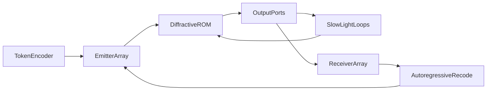

# OLLMU: optyczna jednostka modelu językowego

Koncepcja pasywnego rdzenia dyfrakcyjnego (optyczny ROM) z bocznicami wolnego światła, routingiem interferencyjnym i hybrydowym mapowaniem na transformaty.

Wersja 0.1.1 · wrzesień 2026 · licencja [OLLMU IAL 1.0](LICENSE) (realizacja nieograniczona; zachować autora pomysłu) · pomysł: **Anisul Wałsymzerp** · wersja angielska: [CONCEPT.en.md](CONCEPT.en.md) · cytowania: [REFERENCES.md](REFERENCES.md) · [atrybucja](ATTRIBUTION.md)

**To nie jest działający układ.** To praca koncepcyjna. Żaden pomiar z tego tekstu nie pochodzi z egzemplarza OLLMU, bo takiego egzemplarza nie ma.

---

## 1. Streszczenie

Proponujemy architekturę inferencji o nazwie **OLLMU** (Optical Large Language Model Unit). Wagi dojrzałego, zamrożonego modelu zapisuje się trwale w trójwymiarowym rdzeniu dyfrakcyjnym. Światło wykonuje liniowe operacje mnożenia i akumulacji (MAC) podczas przelotu. Nieliniowość i pamięć kontekstowa nie są wbudowywane w cały kryształ. Trafiają na **bocznice wolnego światła**, do których pole jest kierowane albo gaszone przez interferencję — zgodnie z tym, czego sieć nauczyła się przed wypaleniem.

Laser błękitny GaN oparty na quasi-BIC (**Fakt**: Fąs et al., *Nano Letters*, 2026) jest tu **kandydatem na źródło spójne**, nie rdzeniem obliczeniowym. Układ z 2026 roku jest pompowany optycznie, ma rozmiar siatki rzędu \(100 \times 100\,\mu\mathrm{m}\) i nie stanowi adresowalnej matrycy.

Pełny transformer w jednym krysztale nie jest twierdzeniem tej pracy. Uczciwy podział: statyczne bloki FFN i eksperci MoE jako optyczny ROM; uwaga \(QK^{\mathsf{T}}\) jako blok hybrydowy, bo zależy od wejścia. Pętla autoregresyjna (detekcja → ponowne zakodowanie tokena) jest częścią architektury i **nie jest bezenergetyczna**.

---

## 2. Jak czytać ten dokument

Każde twierdzenie techniczne nosi jedną etykietę:

| Etykieta | Znaczenie |
| --- | --- |
| **Fakt** | Wynik z cytowanej publikacji |
| **Literatura** | Znana metoda, nie oryginalna dla OLLMU |
| **Hipoteza** | Element proponowanej architektury |
| **Oszacowanie** | Rząd wielkości, nie pomiar |

Jeśli etykiety brakuje przy liczbie, liczba nie jest wynikiem OLLMU.

---

## 3. Wstęp

Cyfrowe inferowanie dużych modeli językowych jest ograniczone przesyłem danych i ciepłem, nie tylko arytmetyką. **Literatura**: fotoniczne MAC skalują się korzystnie przy dużym \(N\) i niskiej precyzji analogowej, rzędu kilku bitów, a nie FP16 (Nahmias et al., 2020). **Literatura**: sieci dyfrakcyjne D²NN wykonują inferencję pasywnie po cyfrowym treningu (Lin, Ozcan et al., 2018). **Literatura**: siatki interferometrów Macha–Zehndera realizują mnożenie macierzy na chipie krzemowym (Shen et al., 2017). Żadna z tych linii nie dała dotychczas LLM w krysztale.

Luka, którą OLLMU próbuje nazwać, a nie zamknąć: jak połączyć (i) zamrożony, wielkoskalowy operator liniowy w objętości, (ii) rzadką nieliniowość i pamięć na krawędzi, (iii) trening, który uczy model *kiedy* z tej krawędzi korzystać, bez zewnętrznego sterownika w czasie inferencji.

---

## 4. Fakt: laser quasi-BIC GaN

**Fakt.** Fąs, Pruszyńska-Karbownik, Sawicka, Yavorskiy, Feduniewicz, Gołyga, Słowikowski, Kacperski, Siekacz, Muzioł, Nowicki, Kazakov, Wróbel, Czyszanowski i Suffczyński wykazali lasing w zakresie 440–460 nm w temperaturze pokojowej. Wzmocnienie dają studnie kwantowe InGaN sprzężone z quasi-BIC w monolitycznej siatce podfalowej GaN. Pod strukturą leży warstwa nanoporowatego GaN z trawienia elektrochemicznego, która tłumi wyciek modów do podłoża. DOI: [10.1021/acs.nanolett.6c01930](https://doi.org/10.1021/acs.nanolett.6c01930) ([ACS](https://pubs.acs.org/doi/10.1021/acs.nanolett.6c01930), [PMC](https://pmc.ncbi.nlm.nih.gov/articles/PMC13397883/)).

Parametry z tej samej pracy:

- próg \(0{,}16\,\mathrm{mJ\,cm^{-2}}\) na impuls,
- szerokość linii poniżej \(0{,}04\,\mathrm{nm}\),
- emisja silnie spolaryzowana liniowo; stosunek TE/TM równy 52,
- siatki rzędu \(100 \times 100\,\mu\mathrm{m}\),
- projekt numeryczny (PWAM), fabrykacja e-beam + RIE + wygładzanie TMAH,
- **pompowanie optyczne**, nie elektryczne.

**Fakt, ograniczenie.** Praca nie opisuje matrycy niezależnie sterowanych pikseli laserowych, nie podaje sprawności ściany wtyczkowej elektrycznej i nie dotyczy sieci neuronowych.

**Hipoteza (zastosowanie w OLLMU).** Jeśli w przyszłości powstanie elektrycznie pompowana, adresowalna matryca o podobnej spójności i polaryzacji, nadaje się na interfejs wejściowy. Silna polaryzacja TE jest zaletą w rachunku interferencyjnym. Długość fali ~450 nm **nie** nadaje się do litografii zaawansowanych chipów; limit dyfrakcyjny jest o rząd za gruby względem EUV 13,5 nm. OLLMU nie jest projektem litograficznym.

---

## 5. Literatura, na której stoi reszta

### 5.1. D²NN

**Literatura.** Lin, Ozcan et al. (2018) trenują cyfrowo współczynniki transmisji warstw, potem fizycznie je realizują. Inferencja to dyfrakcja. Demonstracje: klasyfikacja (w tym THz, druk 3D), nie modele językowe.

Pole na warstwie \(\ell\) wiąże się z następną przez propagator dyfrakcyjny \(D_\ell\) i lokalny, wyuczony transmitancję \(T_\ell\):

\[
U_{\ell+1} = D_\ell \bigl( T_\ell \odot U_\ell \bigr).
\]

Po fabrykacji \(T_\ell\) jest stałe: to optyczny ROM.

### 5.2. Fotoniczne MAC i przemysł

**Literatura.** Shen et al. (2017): programowalna siatka MZI, rozpoznawanie samogłosek. Nahmias et al. (2020): przewaga energetyczna fotoniki przy \(N \gtrsim 500\), rozmiarze procesora \(\gtrsim 100\,\mu\mathrm{m}\) i precyzji szumowej \(\lesssim 4\) bity. Lightmatter i pokrewne firmy budują **hybrydy** elektroniczno-fotoniczne; to kontekst przemysłowy, nie dowód OLLMU.

### 5.3. Wolne światło i Kerr

**Literatura.** W krysztale fotonicznym prędkość grupowa spada: \(v_g = c / n_g\). Baba (2008) podsumowuje, że duże \(n_g\) zwiększa interakcję światło–materia i obniża próg nieliniowości, kosztem pasma (produkt pasmo–opóźnienie). Kerr:

\[
n(I) = n_0 + n_2 I.
\]

Przesunięcie fazy na długości efektywnej \(L_{\mathrm{eff}}\):

\[
\Delta\varphi = \frac{2\pi}{\lambda}\, n_2 I\, L_{\mathrm{eff}}.
\]

Slow light powiększa \(L_{\mathrm{eff}}\) i lokalne \(I\). Demonstracje aktywacji nieliniowych w fotonice (m.in. jamy PhC, Liu et al., 2026) są w skali femtodżuli / pikosekund, nie w skali LLM.

Efekt Kerra elektronowego jest szybki i słaby; efekt cieplny i dyspersja swobodnych nośników są silniejsze i wolniejsze. **Hipoteza OLLMU nie może zakładać, że Kerr sam z siebie jest ReLU.**

### 5.4. Pamięć jako opóźnienie

**Literatura.** Optyczne przetwarzanie rezerwuarowe i linie opóźniające trzymają stan jako fotony w drodze. To nie jest DRAM. Pojemność i czas życia ogranicza strata i dekoherencja.

### 5.5. Zapis 3D w szkle

**Literatura.** Femtosekundowa zmiana współczynnika załamania w szkle istnieje od 1996 (Davis et al.). Chip 3D PNN zapisany fs-laserem (2026) klasyfikuje MNIST. Kontrast \(\Delta n\) jest zwykle \(10^{-3}\)–\(10^{-2}\), nie dowolny. To nie jest skala miliardów parametrów.

### 5.6. Materiał na ~450 nm

**Fakt materiałowy.** Krzem w paśmie błękitnym silnie absorbuje (Green, 2008). Prowadzenie: Si₃N₄ (m.in. ~0,08 dB/cm przy 450 nm, Chauhan et al., 2020), GaN, LiNbO₃. Hybrydowe wiązanie diod InGaN do platformy SiN jest literaturą (Mu et al., 2026), nie produkcją matryc BIC.

---

## 6. Hipoteza: architektura OLLMU

**Hipoteza.** Układ ma pięć członów.

1. **Koder tokenów (hybryda).** Wektor aktywacji (embedding albo stan warstwy) jest mapowany na amplitudy i fazy pola. Na starcie to elektronika + modulatory, nie „LLM w powietrzu”.

2. **Matryca emisyjna.** Spójne, współbieżne źródła. Kandydat długoterminowy: matryca BIC GaN. Stan na dziś: pojedyncze, optycznie pompowane siatki.

3. **Rdzeń dyfrakcyjny (ROM).** Blok przezroczysty z zapisanym \(n(\mathbf{r})\). Realizuje stały operator liniowy \(W\) na polu. Naturalny ładunek: FFN i eksperci MoE.

4. **Bocznice wolnego światła.** Porty na krawędzi rdzenia. Światło, które wejdzie, zwalnia, nabiera fazy, może osiągnąć próg Kerra, wraca z opóźnieniem \(\tau\).

5. **Matryca odbiorcza i pętla recode.** Fotodetektory (i ewentualnie pomiar fazy) dają wektor wyjściowy. Kolejny token wymaga ponownego zakodowania. **To kosztuje energię i czas.**

### 6.1. Routing interferencyjny

**Hipoteza, fizyka legalna.** Dwa ramiona o polach \(E_1\), \(E_2\) w porcie bocznym dają moc

\[
P_{\mathrm{side}} \propto \lvert E_1 + E_2 e^{i\theta} \rvert^2.
\]

Dla \(\theta = \pi\) i \(\lvert E_1\rvert \approx \lvert E_2\rvert\) port jest ciemny: bocznica wyłączona bez tranzystora. Dla \(\theta = 0\) port jest jasny. Wagi rdzenia — czyli geometria \(n(\mathbf{r})\) — uczą się ustawiać \(\theta\) w zależności od wejścia, bo wejście samo kształtuje \(E_1\) i \(E_2\).

To nie jest nowa fizyka. Nowy jest **użytek**: model ma traktować gaszenie portu jak bramkę MoE / pominięcie nieliniowości.

### 6.2. Czego rdzeń nie robi

Rdzeń nie trenuje się w locie, nie aktualizuje wag, nie realizuje dynamicznej uwagi \(QK^{\mathsf{T}}\) bez dodatkowego sprzętu. OLLMU jest ASIC-iem inferencyjnym dla *jednego* zrzutu wag.

---

## 7. Mapowanie na transformer (uczciwy podział)

**Literatura.** Warstwa transformera (Vaswani et al., 2017) to uwaga plus FFN. FFN to zwykle dwie stałe macierze i nieliniowość. MoE (Fedus et al.) wybiera podzbiór ekspertów.

| Blok | Czy ROM optyczny wystarczy? | Propozycja OLLMU |
| --- | --- | --- |
| Embedding / unembedding | Częściowo (stała macierz) | ROM albo elektronika |
| FFN | Tak, jeśli nieliniowość na bocznicy | Główny cel optyczny |
| Ekspert MoE | Tak, jeśli routing = port | Routing interferencyjny |
| Uwaga \(QK^{\mathsf{T}}\) | Nie: macierz zależy od tokenów | Hybryda elektroniczna lub programowalna fotonika |
| Softmax | Nie (nieliniowość + normalizacja) | Bocznica albo elektronika |
| KV-cache | Nie jako objętość stała | Linie opóźniające tylko na krótkie echo; dłuższy kontekst — poza kryształem |
| Autoregresja | Nie w jednym przelocie | Pętla recode |

**Hipoteza operacyjna.** Pierwszy użyteczny produkt myślowy to nie pełny konwersacyjny LLM w szkle, tylko akcelerator FFN / MoE dla zamrożonego modelu, z uwagę liczoną obok.

---

## 8. Matematyka

Równania poniżej są standardowe. Nie stanowią dowodu, że OLLMU skaluje się do miliardów parametrów.

### 8.1. Propagacja

**Literatura.** Między płaszczyznami \(z_\ell\) i \(z_{\ell+1}\) pole w przybliżeniu skalarnego widma kątowego:

\[
\tilde{U}(k_x, k_y; z_{\ell+1}) = \tilde{U}(k_x, k_y; z_\ell)\, \exp\bigl(i z_{\Delta} \sqrt{k_0^2 n^2 - k_x^2 - k_y^2}\bigr),
\]

gdzie \(z_{\Delta} = z_{\ell+1}-z_\ell\), \(k_0 = 2\pi/\lambda\). Na płaszczyźnie warstwy działa punktowo \(T_\ell(x,y)\). W objętości z ciągłym \(n(\mathbf{r})\) trzeba Maxwella albo przybliżenia eikonalnego / BPM. Trening wymaga **różniczkowalnego bliźniaka**; pełny FDTD na każdą epokę LLM jest niepraktyczny (**Oszacowanie** kosztu, nie pomiar).

### 8.2. Operator liniowy

Dla ustalonej długości fali i polaryzacji rdzeń realizuje

\[
\mathbf{u}_{\mathrm{out}} = W \mathbf{u}_{\mathrm{in}},
\]

gdzie \(W \in \mathbb{C}^{M \times N}\) wynika z \(n(\mathbf{r})\). Wagi cyfrowego FFN trzeba wcisnąć w fizycznie dopuszczalne \(W\) (straty, sprzężenie, zakres \(\Delta n\)). To problem odwrotny, nie kopiowanie macierzy PyTorch do szkła.

### 8.3. Opóźnienie i produkt pasmo–opóźnienie

\[
\tau = \frac{n_g L}{c}.
\]

**Literatura.** Nie można jednocześnie mieć dowolnie dużego \(n_g\) i szerokiego pasma. Jeśli tokeny mają być impulsami o czasie \(T_p\), musi być \(\tau\) zsynchronizowane z taktowaniem pętli recode. **Oszacowanie:** \(\tau\) rzędu pikosekund–nanosekund to echo warstwy, nie kontekst 128k tokenów.

### 8.4. Kerr na bocznicy

\[
\Delta\varphi = \frac{2\pi}{\lambda}\, n_2 I\, L_{\mathrm{eff}}(n_g).
\]

Żeby \(\Delta\varphi\) było rzędu 1 rad, potrzeba albo dużego \(n_2\), albo dużego \(I\), albo dużego \(L_{\mathrm{eff}}\). Slow light pomaga. Dwu-fotonowa absorpcja i ciepło konkurują z czystym Kerrem. Funkcja aktywacji optyczna **nie jest** \(\mathrm{ReLU}(x)=\max(0,x)\) chyba że układ zostanie do tego zaprojektowany i zmierzony.

### 8.5. Gaszenie portu

Niech \(E_{\mathrm{side}} = a(\mathbf{u}_{\mathrm{in}}) + b(\mathbf{u}_{\mathrm{in}})\). Trening ma osiągać \(a \approx -b\) gdy bocznica ma milczeć oraz \(a \approx b\) gdy ma działać. To rzadkie sterowanie energią, nie osobny bit sterujący z CPU.

### 8.6. Funkcja straty

**Hipoteza.**

\[
\mathcal{L} = \mathcal{L}_{\mathrm{task}} + \lambda_s \mathbb{E}\bigl[ P_{\mathrm{side}} \cdot \mathbf{1}_{\text{nieliniowość zbędna}} \bigr] + \lambda_{\mathrm{ph}} \mathcal{L}_{\mathrm{physics}} + \lambda_f \mathcal{L}_{\mathrm{fab}}.
\]

- \(\mathcal{L}_{\mathrm{task}}\) — strata modelu (np. cross-entropy na cyfrowym bliźniaku).
- Człon \(\lambda_s\) — kara za świecenie w port boczny, gdy zadanie jest liniowo wystarczalne.
- \(\mathcal{L}_{\mathrm{physics}}\) — zgodność z propagacją i Kerrem, nie z warstwą `Linear` w próżni.
- \(\mathcal{L}_{\mathrm{fab}}\) — tolerancja na błąd \(\Delta n\), chropowatość, niecentryczność.

Bez bliźniaka „wypalenie frontier modelu w szkle” jest hasłem, nie procedurą.

### 8.7. Precyzja analogowa

**Literatura / Oszacowanie.** Przy szumie addytywnym

\[
b \approx \tfrac12 \log_2 (1 + \mathrm{SNR}).
\]

Szum śrutowy, dryf fazy, rozpraszanie i błąd zapisu ograniczają \(b\) do **kilku bitów**, zgodnie z Nahmias et al. (próg ~4 bity w ich porównaniu). Modele cyfrowe w INT4/INT8 pokazują, że niska precyzja bywa wystarczająca w FFN — ale to analog, nie INT4 z korekcją.

### 8.8. Energia

Niech \(E_{\mathrm{src}}\) będzie energią źródeł na jeden przelot, \(E_{\mathrm{det}}\) detekcji i ADC, \(E_{\mathrm{recode}}\) elektroniki pętli, \(E_{\mathrm{core}} \approx 0\) poza stratą optyczną (którą i tak płacą źródła).

\[
E_{\mathrm{token}} = E_{\mathrm{src}} + E_{\mathrm{det}} + E_{\mathrm{recode}} + E_{\mathrm{attn, hyb}}.
\]

**Fakt metodologiczny.** Zero dżuli dotyczy wyłącznie pasywnego operatora \(W\) w szkle. Cały token nie jest za darmo. Porównania z GPU bez \(E_{\mathrm{src}}+E_{\mathrm{det}}+E_{\mathrm{recode}}+E_{\mathrm{attn, hyb}}\) są nieważne. Nahmias et al. podają ramy; ta praca nie podaje liczby „razy GPU”.

### 8.9. Objętość i parametry

**Oszacowanie, nie pomiar.** Niech wokseli o rozmiarze \(\sim\lambda\) w szkle niosą po \(k\) bitów analogowych efektywnych. Dla \(\lambda = 450\,\mathrm{nm}\) i \(k = 4\):

\[
\rho \sim \frac{k}{\lambda^3} \approx \frac{4}{(4{,}5\times 10^{-7})^3}\ \mathrm{bit/m^3} \sim 4\times 10^{19}\ \mathrm{bit/m^3}.
\]

To **górny sufit dyfrakcyjny**, nie gęstość użyteczna. Sprzężenia krzyżowe, prowadnice, porty i tolerancje obcinają rzędy wielkości. Nawet wtedy mapa „parametr PyTorch = wokseli” jest fałszywa: \(W\) jest gęstym operatorem falowym, nie CSR macierzą. Wniosek: skala LLM wymaga albo ogromnej objętości, albo multipleksacji (przestrzeń × długość fali × czas), albo **rezygnacji z całego modelu na rzecz FFN**.

---

## 9. Trening świadomy przestrzeni

**Hipoteza procedury.**

1. Zdefiniować cyfrowy bliźniak: propagator + Kerr na bocznicach + model detektora.
2. Wytrenować sieć z \(\mathcal{L}\) z §8.6 na zadaniu FFN/MoE (nie od razu na pełnym LLM).
3. Skwantyzować \(n(\mathbf{r})\) do tego, co umie fs-zapis lub litografia.
4. Wypalić / wytrawić.
5. Skalibrować: zmierzyć \(W_{\mathrm{real}}\), dograć elektronikę recode i progi, nie „przetrenować kryształu”.

Model ma się nauczyć *ignorować* bocznice przez ciemność interferencyjną, aż wejście ułoży pole tak, by je zapalić. To jest Wasz pomysł routingu; w tej pracy jest zapisany jako cel treningu, nie jako zmierzony mechanizm.

---

## 10. Materiały i fabrykacja

| Rola | Kandydat | Uwaga |
| --- | --- | --- |
| Źródło | Quasi-BIC GaN (Fąs 2026) | Dziś optycznie pompowane |
| Prowadzenie widzialne | Si₃N₄, GaN, LN | Nie krzem SOI |
| Objętość ROM | Szkło / kryształ fs-write albo stos warstw D²NN | Demonstracje małe |
| Bocznica slow-light | PhC, mikropierścienie, metamateriał | Pasmo vs \(n_g\) |
| Detekcja | Matryca Si / GaN | Faza wymaga interferometru lokalnego |

Niebieskie światło: mniejsza \(\lambda\) zagęszcza woksele, ale rozpraszanie Rayleigha rośnie jak \(\lambda^{-4}\), defekty są droższe, a fotociemnienie szkła jest realnym ryzykiem. **Hipoteza nie przesądza**, że 450 nm jest lepsze niż 1550 nm dla całego OLLMU. Źródło BIC jest błękitne; rdzeń może w przyszłości pracować na innej fali, jeśli pojawi się konwersja — to osobny, kosztowny człon, nie magia.

---

## 11. Model błędu

Źródła błędu, które dokumentacja uznaje z góry:

- niedokładność \(\Delta n(\mathbf{r})\) przy zapisie,
- chropowatość i strata,
- dryf termiczny fazy (szczególnie Kerr cieplny),
- wibracje i niestabilność interferometrów,
- szum śrutowy i ADC,
- niezgodność bliźniaka z Maxwelllem,
- starzenie źródła i fotociemnienie.

Bez kalibracji po wypaleniu układ jest rzeźbą, nie akceleratorem.

---

## 12. Argumenty za

1. **Pasywne MAC.** Zgodne z D²NN i analizą Nahmiasa: przy dużym \(N\) i niskiej precyzji szkło może być tańsze energetycznie *na sam operator liniowy* niż cyfrowe MAC.
2. **ROM ma sens biznesowy**, jeśli zrzut frontier modelu żyje miesiącami. Brak dotrenowania nie jest wadą ASIC.
3. **Slow light** łączy w jednym fizycznym obiekcie opóźnienie i próg nieliniowości — literatura to pokazuje w małej skali.
4. **Routing interferencyjny** nie łamie fizyki; przenosi MoE na geometrię pola.
5. **Źródło BIC:** pokojowa temperatura, niski próg optyczny, wąska linia, silna polaryzacja — cechy pożądane *jeśli* powstanie matryca elektryczna.
6. **Hybryda FFN/uwaga** nie wymaga czekania na pełny optyczny transformer.

## 13. Argumenty przeciw

1. Laser BIC 2026 nie jest matrycą elektryczną.
2. Krzem nie prowadzi 450 nm; cały stos materiałowy jest inny niż silicon photonics 1550 nm.
3. D²NN i fs-PNN są na MNIST / małych sieciach.
4. Uwaga nie jest ROM-em.
5. Kerr ≠ ReLU; ciepło psuje fazę.
6. Pętla token→światło→token zjada zysk rdzenia.
7. Produkt pasmo–opóźnienie blokuje „pamięć jak KV-cache”.
8. Bliźniak Maxwella jest drogi i przybliżony.
9. Gęstość parametrów z §8.9 to sufit, nie plan produkcji.
10. Brak publikacji łączącej BIC GaN + D²NN + slow-light MoE w jeden LLM — w tym ta praca też tego nie robi, tylko nazywa hipotezę.

---

## 14. Elementy dodane względem rozmowy źródłowej

Rozmowa, z której wyszła koncepcja, pomijała lub zbyt lekko traktowała:

- pętlę autoregresyjną jako koszt,
- rozdział FFN / uwagi,
- MoE jako właściwszy obraz routingu niż „cały LLM myśli w szkle”,
- cyfrowy bliźniak i kalibrację,
- model błędu,
- rachunek \(E_{\mathrm{token}}\),
- produkt pasmo–opóźnienie,
- ślepotę krzemu na błękit,
- analogową precyzję,
- różnicę Kerra elektronowego i cieplnego,
- mapę faz badawczych zamiast skoku do frontier modelu.

---

## 15. Fazy badawcze

Żadna faza nie jest wykonana w tym repozytorium.

| Faza | Cel | Kryterium sukcesu | Co nie jest sukcesem |
| --- | --- | --- | --- |
| 0 | Ten dokument | Spójne etykiety Fakt/Hipoteza | „Mamy optyczny LLM” |
| 1 | Bliźniak numeryczny małej D²NN + 1 bocznica | Zgodność z analitycznym \(W\) i \(\Delta\varphi\) | Skala GPT |
| 2 | Zabawkowa klasyfikacja (jak D²NN) | Trafność bliska cyfrowej przy kilku bitach SNR | Język naturalny |
| 3 | Mini-FFN (np. warstwa 64–256) | Błąd MAC vs NumPy w zadanym SNR | Transformer |
| 4 | Routing MoE na 2–4 ekspertów optycznych | Interferencyjne gaszenie portu zmierzone | Pełny MoE LLM |
| 5 | Hybryda: uwaga cyfrowa + FFN optyczne | Latencja i energia *systemu* vs GPU na tym samym FFN | „Zero watów” |
| 6 | Źródło: od pompy optycznej do elektrycznej matrycy | Osobna linia materiałowa GaN | Wymagane do fazy 5 tylko jeśli SiN+InGaN nie wystarczy |

---

## 16. Czego nie twierdzimy

- Że OLLMU istnieje w laboratorium.
- Że laser Fąsa et al. (2026) jest akceleratorem AI.
- Że energia inferencji LLM spadnie do ułamka promila GPU.
- Że pełny frontier model zmieści się w krysztale.
- Że Kerr na bocznicy jest ReLU.
- Że wolne światło zastąpi KV-cache.
- Że błękitny laser pobije EUV w litografii.
- Że trening „świadomy przestrzeni” został przeprowadzony.

---

## 17. Wnioski

OLLMU jest **nazwaną hipotezą sprzętową**: zamrożony operator liniowy w objętości, rzadka nieliniowość i krótkie echo na bocznicach wolnego światła, routing przez interferencję, hybryda dla uwagi i pętli tokenów. Oparcie w literaturze dotyczy *kawałków* (D²NN, MAC fotoniczne, Kerr, slow light, BIC GaN). Złożenie kawałków w LLM jest otwartym problemem inżynieryjnym, nie odkryciem.

Najbardziej uczciwa następna praca to bliźniak i mini-FFN, nie rzeźba frontier modelu.

---

## 18. Cytowania

Pełna lista z DOI (sprawdzone w Crossref 2026-09-07): [REFERENCES.md](REFERENCES.md). Kluczowe: Fąs et al. 2026; Lin/Ozcan 2018; Shen 2017; Nahmias 2020; Baba 2008; Vaswani 2017; Fedus 2022.
