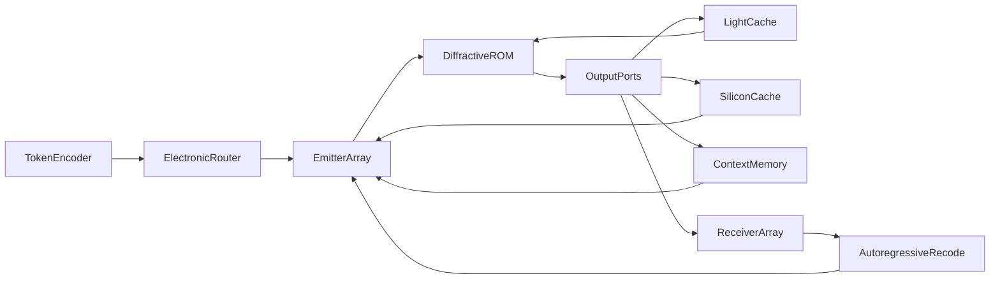
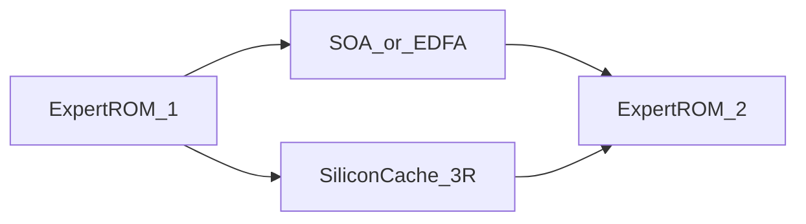
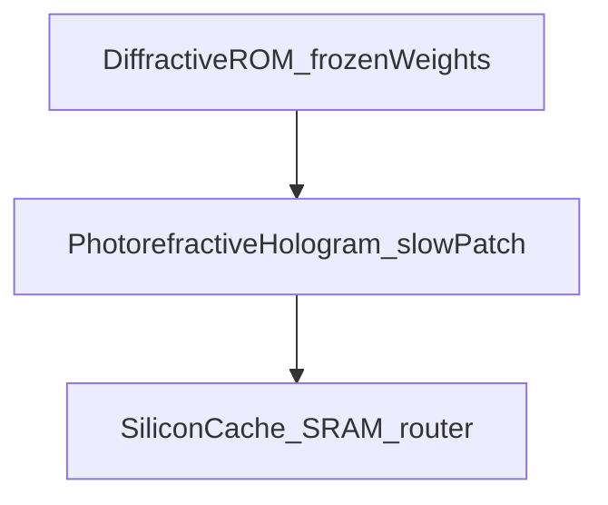

# OLLMU: optyczna jednostka modelu językowego

Koncepcja pasywnego rdzenia dyfrakcyjnego (optyczny ROM): wagi zamrożonego operatora liniowego są ośrodkiem, światło liczy MAC w przelocie, a nieliniowość, uwaga i router zostają w elektronice.

Wersja 0.3.0 · październik 2026 · licencja [OLLMU IAL 1.0](LICENSE) (realizacja nieograniczona; zachować publiczną formę autora pomysłu) · pomysł: **Anisul Wałsymzerp** · wersja angielska: [CONCEPT.en.md](CONCEPT.en.md) · cytowania: [REFERENCES.md](REFERENCES.md) · [atrybucja](ATTRIBUTION.md)

**To nie jest działający układ.** To publiczna praca koncepcyjna. Żaden pomiar z tego tekstu nie pochodzi z egzemplarza OLLMU, bo takiego egzemplarza nie ma. Licencja wymaga podania autora. Nie chroni pomysłu i nie jest zgłoszeniem patentowym: publiczne ujawnienie wchodzi w stan techniki.

---

## 1. Streszczenie

Najdroższym składnikiem inferencji dużego modelu językowego, przy dekodowaniu token po tokenie, nie jest mnożenie. Jest nim ponowne odczytanie wag z pamięci przy każdym tokenie. **OLLMU** jest hipotezą, że te wagi da się wypalić w objętościowym rdzeniu dyfrakcyjnym: światło wykonuje liniowe MAC podczas przelotu, a magistrala wag znika, bo wagi są ośrodkiem. Ten sam ruch — złożyć operator z wagami w jednym nośniku, zamiast dociągać wagi do arytmetyki — w cyfrowym krzemie robi m.in. Taalas, zapisując model na sztywno w układzie. OLLMU nie jest tamtym układem i nie dziedziczy jego pomiarów.

Reszta architektury jest tej tezie podporządkowana i jest od niej słabsza. Nieliniowość (ReLU/GELU), uwaga, softmax i router MoE zostają w elektronice. Po każdej optycznej macierzy potrzeba detekcji, przetwornika i ponownej emisji. W fotonice te przetworniki zwykle zjadają zysk energetyczny; §8.8 daje zgrubny bilans, nie pomiar. Router MoE nie powstaje z interferencji w stałym, liniowym ośrodku: wygaszenie portu jest rzutem na stałą podprzestrzeń, a wybór top-k wymaga nieliniowości. Precyzja analogowa rzędu kilku bitów oraz gęstość z §8.9 (górny sufit dyfrakcyjny) nie składają się na model o setkach miliardów parametrów. Wypalony zrzut się starzeje: kryształu nie da się dotrenować, a zrzuty frontier zmieniają się w skali miesięcy.

Laser błękitny GaN oparty na quasi-BIC (**Fakt**: Fąs et al., *Nano Letters*, 2026) jest **kandydatem na źródło spójne**, nie rdzeniem obliczeniowym. Układ z 2026 roku jest pompowany optycznie, ma rozmiar siatki rzędu \(100 \times 100\,\mu\mathrm{m}\) i nie stanowi adresowalnej matrycy.

Pełny transformer w jednym krysztale nie jest twierdzeniem tej pracy. Uczciwy podział: statyczne części liniowe FFN i macierze ekspertów MoE jako optyczny ROM; uwaga \(QK^{\mathsf{T}}\), softmax i wybór eksperta jako elektronika. Pętla autoregresyjna (detekcja → ponowne zakodowanie tokena) jest częścią architektury i **nie jest bezenergetyczna**. Duży klaster cegieł trzyma moc trzema środkami: pasmo C (~1550 nm) w krzemionce, wzmacniacze SOA/EDFA między blokami, regeneracja 3R na SiliconCache — bez udawania, że analogowy SNR jest za darmo.

Wersja 0.3 (październik 2026) nie cofa tezy o nieruchomych wagach i nie przywraca routingu interferencyjnego. Zawęża obciążenie. Zamrożony liniowy front-end pasuje do strumienia wizyjnego i do cechy w paśmie C przed odbiornikiem lepiej niż do dekodowania czatu: wejście już jest polem, kontekst to ramka albo pakiet, a wagi mają żyć dość długo, żeby w ogóle pytać o amortyzację kryształu (§10). Część wymienna to wolny hologram fotorefrakcyjny na adaptery i sygnatury, nie dotrenowanie ROM-u i nie KV-cache. Korelacja zostaje wynikiem podobieństwa. Top-k zostaje w elektronice. Żadna liczba w §10 nie jest pomiarem OLLMU.

---

## 2. Jak czytać ten dokument

Każde twierdzenie techniczne nosi jedną etykietę:

| Etykieta | Znaczenie |
| --- | --- |
| **Fakt** | Wynik z cytowanej publikacji |
| **Literatura** | Znana metoda, nie oryginalna dla OLLMU |
| **Hipoteza** | Element proponowanej architektury |
| **Oszacowanie** | Rząd wielkości, nie pomiar |

Jeśli etykiety brakuje przy liczbie, liczba nie jest wynikiem OLLMU.

---

## 3. Wstęp

Przy dekodowaniu autoregresyjnym, mały batch, każdy nowy token czyta w praktyce cały zestaw wag. Intensywność arytmetyczna takiego GEMV jest rzędu jednego MAC na wagę. **Literatura**: energia dostępu do DRAM leży o rzędy wielkości powyżej energii samej operacji arytmetycznej. Horowitz (ISSCC 2014) podaje dostęp do DRAM rzędu 1–2 nJ, a samo I/O powyżej 20 pJ/bit; w obieganej tabeli dla 45 nm odczyt 32-bitowy z DRAM to 640 pJ, mnożenie 8-bitowe to 0,2 pJ. To kotwica dydaktyczna z 2014 roku, nie datasheet HBM z 2026. Wystarcza do tezy strukturalnej: dopóki \(b \cdot e_{\mathrm{bit}} \gg e_{\mathrm{MAC}}\), rachunek jest tanim dodatkiem do wożenia wag. **Literatura (kontekst przemysłowy)**: Taalas składa ten sam wniosek w krzemie — wagi modelu są zapisane na sztywno w układzie, inferencja nie wozi ich z pamięci poza chipem, a mały SRAM zostaje na KV-cache i LoRA. Publicznie: Llama 3.1 8B i rząd dwóch miesięcy od otrzymanego modelu do sprzętu ([taalas.com](https://taalas.com/the-path-to-ubiquitous-ai/), sprawdzone 2026-10-21). To nie jest fotonika i nie jest dowodem OLLMU.

**Literatura**: fotoniczne MAC skalują się korzystnie przy dużym \(N\) i niskiej precyzji analogowej, rzędu kilku bitów, a nie FP16 (Nahmias et al., 2020). **Literatura**: sieci dyfrakcyjne D²NN wykonują inferencję pasywnie po cyfrowym treningu (Lin, Ozcan et al., 2018). **Literatura**: siatki interferometrów Macha–Zehndera realizują mnożenie macierzy na chipie krzemowym (Shen et al., 2017). Żadna z tych linii nie dała dotychczas LLM w krysztale.

Luka, którą OLLMU próbuje nazwać, a nie zamknąć: które **zamrożone** operatory liniowe warto wypalić, skoro (i) zysk istnieje tylko wtedy, gdy zniknięcie magistrali wag przeżyje koszt światło–prąd–światło, (ii) precyzja analogowa jest rzędu kilku bitów, (iii) zrzutu nie da się dotrenować, gdy model się zestarzeje. Krótki light cache i elektronika poza kryształem są dodatkami do tej tezy, nie jej substytutem. Wersja 0.3 nie zmienia tej luki. Pyta, przy jakim strumieniu zamrożenie jest mniej absurdalne: widzenie i cecha w paśmie C, nie czat (§10).

---

## 4. Fakt: laser quasi-BIC GaN

**Fakt.** Fąs, Pruszyńska-Karbownik, Sawicka, Yavorskiy, Feduniewicz, Gołyga, Słowikowski, Kacperski, Siekacz, Muzioł, Nowicki, Kazakov, Wróbel, Czyszanowski i Suffczyński wykazali lasing w zakresie 440–460 nm w temperaturze pokojowej. Wzmocnienie dają studnie kwantowe InGaN sprzężone z quasi-BIC w monolitycznej siatce podfalowej GaN. Pod strukturą leży warstwa nanoporowatego GaN z trawienia elektrochemicznego, która tłumi wyciek modów do podłoża. DOI: [10.1021/acs.nanolett.6c01930](https://doi.org/10.1021/acs.nanolett.6c01930) ([ACS](https://pubs.acs.org/doi/10.1021/acs.nanolett.6c01930), [PMC](https://pmc.ncbi.nlm.nih.gov/articles/PMC13397883/)).

Parametry z tej samej pracy:

- próg \(0{,}16\,\mathrm{mJ\,cm^{-2}}\) na impuls,
- szerokość linii poniżej \(0{,}04\,\mathrm{nm}\),
- emisja silnie spolaryzowana liniowo; stosunek TE/TM równy 52,
- siatki rzędu \(100 \times 100\,\mu\mathrm{m}\),
- projekt numeryczny (PWAM), fabrykacja e-beam + RIE + wygładzanie TMAH,
- **pompowanie optyczne**, nie elektryczne.

**Fakt, ograniczenie.** Praca nie opisuje matrycy niezależnie sterowanych pikseli laserowych, nie podaje sprawności ściany wtyczkowej elektrycznej i nie dotyczy sieci neuronowych.

**Hipoteza (zastosowanie w OLLMU).** Jeśli w przyszłości powstanie elektrycznie pompowana, adresowalna matryca o podobnej spójności i polaryzacji, nadaje się na interfejs wejściowy. Silna polaryzacja TE jest zaletą w rachunku interferencyjnym. Długość fali ~450 nm **nie** nadaje się do litografii zaawansowanych chipów; limit dyfrakcyjny jest o rząd za gruby względem EUV 13,5 nm. OLLMU nie jest projektem litograficznym.

---

## 5. Literatura, na której stoi reszta

### 5.1. D²NN

**Literatura.** Lin, Ozcan et al. (2018) trenują cyfrowo współczynniki transmisji warstw, potem fizycznie je realizują. Inferencja to dyfrakcja. Demonstracje: klasyfikacja (w tym THz, druk 3D), nie modele językowe.

Pole na warstwie \(\ell\) wiąże się z następną przez propagator dyfrakcyjny \(D_\ell\) i lokalny, wyuczony transmitancję \(T_\ell\):

\[
U_{\ell+1} = D_\ell \bigl( T_\ell \odot U_\ell \bigr).
\]

Po fabrykacji \(T_\ell\) jest stałe: to optyczny ROM.

### 5.2. Fotoniczne MAC i przemysł

**Literatura.** Shen et al. (2017): programowalna siatka MZI, rozpoznawanie samogłosek. Nahmias et al. (2020): przewaga energetyczna fotoniki przy \(N \gtrsim 500\), rozmiarze procesora \(\gtrsim 100\,\mu\mathrm{m}\) i precyzji szumowej \(\lesssim 4\) bity. Lightmatter i pokrewne firmy budują **hybrydy** elektroniczno-fotoniczne; to kontekst przemysłowy, nie dowód OLLMU.

### 5.3. Wolne światło i Kerr

**Literatura.** W krysztale fotonicznym prędkość grupowa spada: \(v_g = c / n_g\). Baba (2008) podsumowuje, że duże \(n_g\) zwiększa interakcję światło–materia i obniża próg nieliniowości, kosztem pasma (produkt pasmo–opóźnienie). Kerr:

\[
n(I) = n_0 + n_2 I.
\]

Przesunięcie fazy na długości efektywnej \(L_{\mathrm{eff}}\):

\[
\Delta\varphi = \frac{2\pi}{\lambda}\, n_2 I\, L_{\mathrm{eff}}.
\]

Slow light powiększa \(L_{\mathrm{eff}}\) i lokalne \(I\). Demonstracje aktywacji nieliniowych w fotonice (m.in. jamy PhC, Liu et al., 2026) są w skali femtodżuli / pikosekund, nie w skali LLM.

Efekt Kerra elektronowego jest szybki i słaby; efekt cieplny i dyspersja swobodnych nośników są silniejsze i wolniejsze. **Hipoteza OLLMU nie może zakładać, że Kerr sam z siebie jest ReLU.**

### 5.4. Pamięć jako opóźnienie

**Literatura.** Optyczne przetwarzanie rezerwuarowe i linie opóźniające trzymają stan jako fotony w drodze. To nie jest DRAM. Pojemność i czas życia ogranicza strata i dekoherencja.

### 5.5. Zapis 3D w szkle

**Literatura.** Femtosekundowa zmiana współczynnika załamania w szkle istnieje od 1996 (Davis et al.). Chip 3D PNN zapisany fs-laserem (2026) klasyfikuje MNIST. Kontrast \(\Delta n\) jest zwykle \(10^{-3}\)–\(10^{-2}\), nie dowolny. To nie jest skala miliardów parametrów.

### 5.6. Materiał na ~450 nm

**Fakt materiałowy.** Krzem w paśmie błękitnym silnie absorbuje (Green, 2008). Prowadzenie: Si₃N₄ (m.in. ~0,08 dB/cm przy 450 nm, Chauhan et al., 2020), GaN, LiNbO₃. Hybrydowe wiązanie diod InGaN do platformy SiN jest literaturą (Mu et al., 2026), nie produkcją matryc BIC.

### 5.7. Wagi, które stoją w miejscu

**Literatura.** Horowitz (ISSCC 2014), jak w §3: wożenie bitu z DRAM kosztuje wielokrotnie więcej niż wąski MAC. **Literatura (kontekst przemysłowy).** Taalas realizuje wniosek w cyfrowym krzemie: model jest częścią układu, a nie zawartością HBM. Elastyczność, którą firma zostawia, siedzi obok zamrożonych wag — okno kontekstu i LoRA w SRAM — a nie w przelutowaniu wag bazowych. OLLMU przenosi samą ideę „wagi są nośnikiem” do szkła. Nie przenosi ani gęstości maski CMOS, ani ścieżki LoRA, ani dwumiesięcznego cyklu od zrzutu do karty.

---

## 6. Hipoteza: architektura OLLMU

Porty są drogami optycznymi. Który ekspert świeci, gdzie włączyć nieliniowość i kiedy sięgnąć po kontekst, decyduje router elektroniczny. Faza zapisana w szkle tej decyzji nie podejmuje.

**Hipoteza.** Przetwarzanie liniowe, zamrożone, siedzi w świetle. Decyzje zależne od wejścia siedzą w elektronice. Pamięć ma cztery skale czasu.

1. **Koder tokenów (hybryda).** Wektor aktywacji jest mapowany na amplitudy i fazy. Na starcie: elektronika + modulatory.

2. **Router (elektronika).** Mała sieć: logits, softmax, top-k. Wybiera, który rdzeń eksperta oświetlić, i czy w tym takcie wołać SiliconCache albo pamięć kontekstu. Wagi routera są małe i zostają w krzemie, więc da się je wymienić bez nowego kryształu.

3. **Matryca emisyjna.** Spójne źródła. Kandydat: matryca BIC GaN. Dziś: optycznie pompowane siatki. Router włącza emisję do wybranego rdzenia; to przełącznik elektroniczny, nie interferencja w szkle.

4. **Rdzeń dyfrakcyjny (ROM) — processing.** Zapisane \(n(\mathbf{r})\). Światło liczy stały operator \(W\). Naturalny ładunek: liniowa część FFN i macierz wybranego eksperta. Przelot przez ośrodek *już* jest opóźnieniem \(\tau_{\mathrm{core}} = n L / c\); to nie jest wada, tylko zegar optyczny.

5. **Light cache (w krysztale / na krawędzi optycznej).** Tam, gdzie przyda się *lekkie* opóźnienie — zsynchronizowanie dwóch przebiegów, echo warstwy, złożenie fazy — pole idzie w wolniejszy ośrodek (większe \(n\) albo \(n_g\): wolne światło, inny kryształ, dłuższa ścieżka). To **nie** zastępuje KV-cache ani ReLU. Kerr na tej ścieżce jest opcją, nie wymogiem. Wejście na tę ścieżkę jest zaprojektowanym sprzęgłem albo przełącznikiem, nie decyzją liniowego ośrodka.

6. **SiliconCache (poza kryształem).** Detekcja → przetwornik analogowo-cyfrowy → nieliniowość (ReLU/GELU/mały MLP) i/lub wektor thinking. Tu też ląduje router, jeśli nie wydzielono go obok. Wynik wraca na matrycę emisyjną. Każde takie przejście jest światło–prąd–światło i wchodzi do bilansu z §8.8.

7. **Pamięć kontekstu (poza kryształem).** Długi stan (odpowiednik KV-cache, scratchpad, historia tokenów). SRAM/DRAM albo inny bufor elektroniczny. Światło tam nie mieszka.

8. **Matryca odbiorcza i pętla recode.** Kolejny token. **Nie jest za darmo.**

### 6.1. Cztery skale opóźnienia

| Skala | Gdzie | Co trzyma | Rząd czasu (**Oszacowanie**) |
| --- | --- | --- | --- |
| Przelot rdzenia | w krysztale | nic poza falą w locie | ps–ns na centymetr |
| Light cache | wolniejszy ośrodek optyczny | krótkie echo, faza | ps–ns, produkt pasmo–opóźnienie |
| SiliconCache | krzem poza kryształem | nieliniowość, router, thinking, alignment taktów | ns–µs |
| Context memory | krzem poza kryształem | kontekst rozmowy | µs–ms i dłużej, pojemność cyfrowa |

**Literatura.** Różne \(n\) i \(n_g\) zmieniają czas przelotu; to standard optyki, nie nowy efekt. **Hipoteza** dotyczy tylko *użytku*: krótkie echo optyczne jest zegarem i złożeniem fazy. Długi stan i decyzja „który ekspert” są elektroniczne.

### 6.2. Czego interferencja nie wybierze

**Hipoteza, fizyka.** Rdzeń o ustalonym \(n(\mathbf{r})\) jest operatorem liniowym, \( \mathbf{u}_{\mathrm{out}} = W \mathbf{u}_{\mathrm{in}} \), z jednym \(W\) dla wszystkich wejść. Moc na porcie \(i\) to

\[
P_i = \lvert \mathbf{w}_i^{\dagger} \mathbf{u}_{\mathrm{in}} \rvert^2.
\]

To stała forma kwadratowa. Zbiór wejść, które gaszą port, jest jądrem funkcjonału \(\mathbf{w}_i\): stałą podprzestrzenią, wybraną przy zapisie, niezależną od porównania „który ekspert jest większy”.

Dwa ramiona o fabrykowanej fazie \(\theta\) nie zmieniają werdyktu. Jeśli \(\theta\) gasi port dla każdego wejścia, wiersz \(W\) jest zerem i port jest martwy. Jeśli moc zależy od wejścia, nadal jest to miękkie dopasowanie do jednego, z góry wybranego kierunku, a nie top-k.

Router MoE (**Literatura**: Fedus et al.) liczy

\[
r(\mathbf{u}) = \mathrm{TopK}\bigl(\mathrm{softmax}(W_r \mathbf{u})\bigr).
\]

\(\mathrm{softmax}\) i \(\mathrm{TopK}\) są nieliniowe. \(W_r\) jest małe i zostaje w elektronice. Wybrany ekspert jest potem jednym ze stałych operatorów optycznych \(W^{(e)}\). Oświetlenie tylko tego eksperta jest włączeniem modulatora albo wyborem cegły, czyli znowu elektroniką.

Wersje wcześniejsze tego tekstu opisywały gaszenie portu fazą \(\theta = \pi\) jako politykę pamięci uczoną w geometrii. To była pomyłka: stały ośrodek nie podejmuje decyzji zależnej od wejścia. Zostaje rzecz węższa i prawdziwa. Szkło trzyma duże \(W\). Krzem decyduje, które \(W\) w tym takcie pracuje.

### 6.3. Czego rdzeń nie robi

Rdzeń nie trenuje się w locie, nie jest DRAM-em, nie trzyma 128k tokenów i nie wybiera ekspertów. OLLMU jest nośnikiem *jednego* zrzutu operatorów liniowych. Długi kontekst, nieliniowość i router są kontraktem z elektroniką. Elektronikę da się później poprawić. \(n(\mathbf{r})\) da się tylko wymienić razem z kryształem. Sąsiad też go nie przepisuje: wolna łatka fotorefrakcyjna, jeśli w ogóle powstanie, siedzi obok ROM-u (§10).

### 6.4. Wygaszenie sygnału w dużym klastrze

Duży OLLMU to szereg cegieł (ekspert → ekspert), nie jedna bryła. Światło słabnie. Trzy środki — z etykietami, bez reklamy.

**A. Pasmo C, ~1550 nm, krzemionka.** **Literatura:** w czystym rdzeniu krzemionkowym strata rekordowa to 0,1424 dB/km przy 1550 nm (Tamura et al., *JLT* 2018, DOI [10.1109/JLT.2018.2796647](https://doi.org/10.1109/JLT.2018.2796647)). **Oszacowanie** na 30 cm czystego włókna: \(\sim 4\times 10^{-5}\,\mathrm{dB}\) — margines. **To nie jest strata ROM-u.** Wypalony \(\Delta n\), rozpraszanie wokseli, dyfrakcja i defekty fs-lasera dominują nad absorpcją objętościową. Rayleigh \(\propto \lambda^{-4}\): przejście 450 → 1550 nm obniża ten składnik o czynnik \(\sim 140\). **Hipoteza skalowania:** małe chipy / interfejs BIC mogą zostać przy błękicie; **duże cegły klastra** idą na 1550 nm (fused silica). Krzem jako *falowód* jest wtedy przezroczysty; fotodioda przy 1550 nm to Ge lub InGaAs, nie czysty Si.

**B. Wzmacniacze optyczne między cegłami (SOA, EDFA).** **Literatura:** EDFA i SOA podbijają moc bez detekcji. **Hipoteza:** po ekspercie 1 słabe pole wlatuje w wzmacniacz pompowany tanim laserem i wchodzi do eksperta 2 nadal jako światło. **Nie twierdzimy**, że faza i analogowa amplituda wychodzą nietknięte. ASE dokłada szum (współczynnik szumu wzmacniacza, rząd kilku dB); SOA ma chirp (czynnik Henry'ego) i saturację, która zgniata precyzję MAC. To stacja mocy, nie magiczne kopiowanie fotonów. Kaskada wzmacniaczy **bez** zejścia do elektroniki kumuluje ten szum; patrz §8.7.

**C. Regeneracja 3R na SiliconCache.** **Hipoteza, najuczciwsza na analog.** Słabe światło pada na detektor, krzem robi nieliniowość (ReLU itd.), nowy laser strzela w kolejny rdzeń impulsem o pełnej mocy. To klasyczna regeneracja: reamplify / reshape (i ewentualnie retime). Resetuje SNR. Płaci O-E-O: czas, energia, utrata fazy, jeśli nie odtwarzasz I/Q. W architekturze OLLMU ta bocznica *już istnieje* — tu jest też stacją przepompowującą, nie tylko nieliniowością. Reset SNR i koszt przetwornika są tym samym zdarzeniem. Nie da się mieć długiego łańcucha analogowego bez kumulacji błędu i jednocześnie nie płacić za 3R.

**Kolejność użycia (**Hipoteza**):** light cache i 1550 nm tam, gdzie strata jest mała i faza ma zostać; SOA/EDFA między cegłami, dopóki analog jeszcze trzyma; SiliconCache, gdy trzeba nieliniowości, routera albo gdy analogowy SNR padł. Harmonogram jest projektem systemu. Nie jest fazą nauczoną w \(n(\mathbf{r})\).

---

## 7. Mapowanie na transformer (uczciwy podział)

**Literatura.** Warstwa transformera (Vaswani et al., 2017) to uwaga plus FFN. FFN to zwykle dwie stałe macierze i nieliniowość. MoE (Fedus et al.) wybiera podzbiór ekspertów nieliniowym routerem.

| Blok | Czy ROM optyczny wystarczy? | Propozycja OLLMU |
| --- | --- | --- |
| Embedding / unembedding | Częściowo (stała macierz) | ROM albo elektronika |
| FFN, część liniowa \(W_1, W_2\) | Tak, jako zamrożone \(W\) | Główny processing w świetle; wagi się nie ruszają |
| Nieliniowość FFN | Nie | SiliconCache; każde przejście to O-E-O |
| Macierz eksperta MoE | Tak, każda z osobna | Osobny ROM na eksperta |
| Router MoE, top-k | Nie | Elektronika; interferencja nie jest routerem (§6.2) |
| Uwaga \(QK^{\mathsf{T}}\) | Nie: macierz zależy od tokenów | Hybryda; stan w context memory |
| Softmax | Nie | SiliconCache |
| KV-cache / kontekst | Nie jako objętość optyczna | Context memory poza kryształem |
| Krótkie echo / faza | Tak, jeśli \(\tau\) małe | Light cache (wolniejszy ośrodek) |
| Autoregresja | Nie w jednym przelocie | Pętla recode |

**Hipoteza operacyjna.** Szkło = stałe \(W\), odczytywane światłem zamiast z HBM. Krzem = wszystko, co zależy od bieżącego wejścia albo co ma się dać wymienić bez nowego kryształu: \(\varphi\), router, uwaga, kontekst, ewentualna poprawka niskiego rzędu. Light cache = krótkie optyczne opóźnienie, nie pamięć rozmowy.

**Hipoteza (0.3).** Ten sam podział, inne obciążenie. Pierwsze warstwy wizyjne i korelacja z zamrożonym zestawem sygnatur są bliższe stałemu \(W\) niż uwaga zależna od tokenów. Szczegóły i granice są w §10. Interferencja dalej nie jest routerem.

---

## 8. Matematyka

Równania poniżej są standardowe. Nie stanowią dowodu, że OLLMU skaluje się do setek miliardów parametrów. Nie są też pomiarem energii na token.

### 8.1. Propagacja

**Literatura.** Między płaszczyznami \(z_\ell\) i \(z_{\ell+1}\) pole w przybliżeniu skalarnego widma kątowego:

\[
\tilde{U}(k_x, k_y; z_{\ell+1}) = \tilde{U}(k_x, k_y; z_\ell)\, \exp\bigl(i z_{\Delta} \sqrt{k_0^2 n^2 - k_x^2 - k_y^2}\bigr),
\]

gdzie \(z_{\Delta} = z_{\ell+1}-z_\ell\), \(k_0 = 2\pi/\lambda\). Na płaszczyźnie warstwy działa punktowo \(T_\ell(x,y)\). W objętości z ciągłym \(n(\mathbf{r})\) trzeba Maxwella albo przybliżenia eikonalnego / BPM. Trening wymaga **różniczkowalnego bliźniaka**; pełny FDTD na każdą epokę LLM jest niepraktyczny (**Oszacowanie** kosztu, nie pomiar).

### 8.2. Operator liniowy

Dla ustalonej długości fali i polaryzacji rdzeń realizuje

\[
\mathbf{u}_{\mathrm{out}} = W \mathbf{u}_{\mathrm{in}},
\]

gdzie \(W \in \mathbb{C}^{M \times N}\) wynika z \(n(\mathbf{r})\). Wagi cyfrowego FFN trzeba wcisnąć w fizycznie dopuszczalne \(W\) (straty, sprzężenie, zakres \(\Delta n\)). To problem odwrotny, nie kopiowanie macierzy PyTorch do szkła.

### 8.3. Opóźnienie: rdzeń vs light cache vs krzem

Przelot przez rdzeń:

\[
\tau_{\mathrm{core}} = \frac{n L}{c}.
\]

Light cache w wolniejszym ośrodku:

\[
\tau_{\mathrm{lc}} = \frac{n_g L_{\mathrm{lc}}}{c}.
\]

**Literatura.** Nie można jednocześnie mieć dowolnie dużego \(n_g\) i szerokiego pasma. **Oszacowanie:** \(\tau_{\mathrm{core}}\) i \(\tau_{\mathrm{lc}}\) to ps–ns — echo i zegar optyczny, nie kontekst 128k. SiliconCache i context memory nie podlegają produktowi pasmo–opóźnienie; ich cena to O-E-O i DRAM.

### 8.4. Kerr na light cache (opcja)

\[
\Delta\varphi = \frac{2\pi}{\lambda}\, n_2 I\, L_{\mathrm{eff}}(n_g).
\]

Wolniejsze światło podnosi lokalne \(I\) i \(L_{\mathrm{eff}}\). To może być efekt uboczny light cache. **Nie** jest to domyślna nieliniowość modelu. ReLU/GELU siedzą w SiliconCache. Kerr ≠ ReLU, chyba że ktoś to zmierzy.

### 8.5. Port jako forma kwadratowa

Niech wiersz portu będzie ustalonym \(\mathbf{w}\). Wtedy \(P = \lvert \mathbf{w}^{\dagger} \mathbf{u} \rvert^2\) zależy od \(\mathbf{u}\) tylko o tyle, o ile \(\mathbf{u}\) ma składową wzdłuż \(\mathbf{w}\). Trening przed zapisem może dobrać \(\mathbf{w}\) (jaki kierunek w ogóle sprzęga się do portu). Nie może sprawić, by ten sam port raz był ekspertem 3, a raz ekspertem 7, zależnie od tokena. Tę drugą rzecz robi router \(W_r\) z §6.2 i zostaje poza szkłem.

### 8.6. Funkcja straty

**Hipoteza.** \(\mathcal{L}_{\mathrm{task}}\) i kara za wołanie elektroniki są liczone na cyfrowym bliźniaku. W szkle ląduje tylko \(n(\mathbf{r})\) odpowiadające wybranym \(W\). Wagi routera, skalowanie nieliniowości i ewentualna poprawka niskiego rzędu zostają w opisie SiliconCache i wolno je zmienić po zapisie.

\[
\mathcal{L} = \mathcal{L}_{\mathrm{task}} + \lambda_{\mathrm{si}} \mathbb{E}[C_{\mathrm{Si}}] + \lambda_{\mathrm{ctx}} \mathbb{E}[C_{\mathrm{ctx}}] + \lambda_{\mathrm{ph}} \mathcal{L}_{\mathrm{physics}} + \lambda_f \mathcal{L}_{\mathrm{fab}}.
\]

\(C_{\mathrm{Si}}\) i \(C_{\mathrm{ctx}}\) są kosztami rzeczywistych wywołań elektronicznych (przetwornik, router, odczyt kontekstu), nie mocą optyczną na porcie udającą bit decyzyjny. Bez bliźniaka, który ma szum, O-E-O i osobny router, „wypalenie modelu w szkle” jest hasłem.

### 8.7. Precyzja analogowa i kumulacja

**Literatura / Oszacowanie.** Przy szumie addytywnym

\[
b \approx \tfrac12 \log_2 (1 + \mathrm{SNR}).
\]

Szum śrutowy, dryf fazy, rozpraszanie i błąd zapisu ograniczają \(b\) do **kilku bitów**, zgodnie z Nahmias et al. (próg ~4 bity w ich porównaniu). Dla \(b = 4\) wzór daje \(\mathrm{SNR} \approx 255\) (ok. 24 dB): błąd rms rzędu kilku procent pełnej skali, zanim doliczyć błąd zapisu i dryf. Modele cyfrowe w INT4/INT8 pokazują, że niska precyzja bywa wystarczająca w FFN — ale to arytmetyka ze skalą i dokładną akumulacją, nie łańcuch analogowy.

**Oszacowanie, kumulacja.** Są tu trzy różne mechanizmy i nie wolno ich sklejać w jedno zdanie.

- Wewnątrz jednej optycznej macierzy budżet to te kilka bitów. Tyle zostaje po zejściu na detektor, nawet jeśli poprzedni stopień przeszedł przez 3R.
- Kaskada analogowa bez zejścia do elektroniki (cegła, SOA, cegła, …) dokłada szum wzmacniacza i błąd fazy na każdym stopniu. Nieskorelowany błąd względny rośnie jak \(\sqrt{L}\); błąd systematyczny \(\Delta n\) nie uśrednia się wcale.
- Zejście na SiliconCache i ponowna emisja **resetują** SNR i **są** kosztem \(e_{\mathrm{conv}}\) z §8.8. Długa droga analogowa bez kumulacji oraz droga bez przetworników nie są jednocześnie dostępne.

Osobno: błąd zapisu \(\Delta n(\mathbf{r})\) jest systematyczny. Głośniejszy laser go nie kasuje. Ta praca nie pokazuje, że łańcuch o budżecie ~4 bitów na macierz, po dziesiątkach warstw i po realnym błędzie zapisu, zostaje w basenie jakości cyfrowego FFN w INT4.

### 8.8. Energia na token

Równanie jest rozbiciem, nie wynikiem:

\[
E_{\mathrm{token}} = E_{\mathrm{src}} + N_{\mathrm{conv}}\, e_{\mathrm{conv}} + E_{\mathrm{ctx}} + E_{\mathrm{recode}} + E_{\mathrm{attn, hyb}}.
\]

Dla zamrożonego \(W\) składnik „odczyt wag z pamięci” jest zerem. Stratę optyczną i tak płaci źródło, więc siedzi w \(E_{\mathrm{src}}\). **Fakt metodologiczny.** Zero dżuli na magistrali wag dotyczy wyłącznie tego, że \(W\) nie jedzie z HBM. Nie dotyczy tokena.

Po stronie dekodowania na GPU, jedna warstwa, batch 1, wagi nie mieszczą się w pamięci przy arytmetyce:

\[
E_{\mathrm{move}} = N_w \, b \, e_{\mathrm{bit}}, \qquad E_{\mathrm{MAC}} = N_w \, e_{\mathrm{MAC}}, \qquad \frac{E_{\mathrm{move}}}{E_{\mathrm{MAC}}} = \frac{b \, e_{\mathrm{bit}}}{e_{\mathrm{MAC}}}.
\]

\(N_w = 2\, d\, d_{\mathrm{ff}}\) dla dwóch macierzy FFN. Stosunek nie zależy od szerokości. Na kotwicy Horowitza (\(b = 4\), \(e_{\mathrm{bit}} = 20\,\mathrm{pJ}\), \(e_{\mathrm{MAC}} = 0{,}2\,\mathrm{pJ}\)) wynosi 400. Sonda „a jeśli bit jest dwadzieścia razy tańszy”, \(e_{\mathrm{bit}} = 1\,\mathrm{pJ}\), daje stosunek 20. Sonda nie jest pomiarem HBM. Pokazuje, gdzie teza pęka: przy \(e_{\mathrm{bit}}\) rzędu \(e_{\mathrm{MAC}} / b\), czyli przy ułamku pikodżula na bit dla tej kotwicy MAC, mnożenie dogania transport. Poniżej tej okolicy główna teza tej pracy traci siłę nawet przed doliczeniem laserów.

Po stronie OLLMU ta sama warstwa płaci przetwornikami. Liczymy cztery zdarzenia obciążające tę warstwę: emisja wejścia (\(d\)), detekcja po \(W_1\) (\(d_{\mathrm{ff}}\)), emisja w \(W_2\) (\(d_{\mathrm{ff}}\)), detekcja po \(W_2\) (\(d\)).

\[
N_{\mathrm{conv}} = 2\,(d + d_{\mathrm{ff}}).
\]

W stosie sąsiednie warstwy dzielą granicę (detekcja jednej jest emisją następnej), więc głęboki stos płaci mniej zdarzeń na warstwę, a budżet na jedno zdarzenie rośnie. Poniższy próg jest surowszy: każe tej warstwie zapłacić wejście i wyjście w całości.

Próg, przy którym same przetworniki doganiają sam transport wag:

\[
e_{\mathrm{conv}}^{\star} = \frac{d\, d_{\mathrm{ff}}}{d + d_{\mathrm{ff}}}\, b\, e_{\mathrm{bit}}.
\]

**Oszacowanie, nie pomiar.** Przykład szerokości w stylu warstwy 7B (\(d = 4096\), \(d_{\mathrm{ff}} = 11008\)) oraz warstwy zabawkowej fazy 1 (\(d = 256\), \(d_{\mathrm{ff}} = 1024\)):

| Założenie | \(e_{\mathrm{bit}}\) | \(E_{\mathrm{move}}/E_{\mathrm{MAC}}\) | \(e_{\mathrm{conv}}^{\star}\) przy \(d=4096\) | \(e_{\mathrm{conv}}^{\star}\) przy \(d=256\) |
| --- | --- | --- | --- | --- |
| I/O DRAM, Horowitz 2014 | 20 pJ | 400 | ~240 nJ | ~16 nJ |
| Sonda: bit 20× tańszy | 1 pJ | 20 | ~12 nJ | ~0,8 nJ |

Szeroka warstwa daje przetwornikowi budżet setek nanodżuli na kotwicy z 2014 roku i około dziesięciu nanodżuli, jeśli bit staniał dwudziestokrotnie. Wąska warstwa fazy 1 jest dużo mniej wyrozumiała. \(E_{\mathrm{src}}\) stoi **poza** tą tabelą i potrafi ją unieważnić. Tożsamość do podstawienia, nie pomiar lasera: \(1\,\mathrm{mW}\times 1\,\mu\mathrm{s} = 1\,\mathrm{nJ}\). Źródło 1 W przez 100 ns to już 100 nJ na impuls, czyli rząd progu szerokiej warstwy przy 20 pJ/bit i wyraźnie powyżej progu przy 1 pJ/bit.

Czego ta tabela nie robi: nie wolno pomnożyć 20 pJ/bit przez liczbę parametrów modelu frontier i nazwać iloczynu energią GPU. Kotwica służy do stosunku i do progu \(e_{\mathrm{conv}}^{\star}\). Werdykt „szkło bije GPU” wymaga zmierzonych \(e_{\mathrm{conv}}\) i \(E_{\mathrm{src}}\). Ta praca ich nie ma. Ma je zebrać faza 1.

### 8.9. Objętość, parametry, sufit

**Oszacowanie, nie pomiar.** Niech wokseli o rozmiarze \(\sim\lambda\) w szkle niosą po \(k\) bitów analogowych efektywnych. Dla \(\lambda = 450\,\mathrm{nm}\) i \(k = 4\):

\[
\rho \sim \frac{k}{\lambda^3} \approx \frac{4}{(4{,}5\times 10^{-7})^3}\ \mathrm{bit/m^3} \sim 4\times 10^{19}\ \mathrm{bit/m^3}.
\]

To **górny sufit dyfrakcyjny**, nie gęstość użyteczna. Sprzężenia krzyżowe, prowadnice, porty i tolerancje obcinają rzędy wielkości. Nawet wtedy mapa „parametr PyTorch = woksel” jest fałszywa: \(W\) jest gęstym operatorem falowym, nie CSR macierzą. Woksel rozmiaru \(\lambda\) nie trzyma 4 bitów z cyfrowym marginesem szumu.

Objętość przy tym suficie, \(V = N b / \rho\), dla \(b = 4\):

| Parametry \(N\) | Objętość na suficie |
| --- | --- |
| \(10^{11}\) | \(\sim 10\,\mathrm{cm}^3\) |
| \(10^{12}\) | \(\sim 0{,}1\,\mathrm{dm}^3\) |

Modele frontier są tego rzędu i większe. Sufit wygląda skromnie tylko dlatego, że jest sufitem. Trzy rzędy w dół na sprzężeniach to litry; sześć rzędów to metry sześcienne. Do tego dochodzi §8.7: nawet gdyby objętość się zgadzała, budżet kilku bitów na macierz przez dziesiątki warstw nie jest pokazany jako wystarczający. Wniosek operacyjny tej pracy jest węższy niż „cały model w krysztale”: jedna liniowa warstwa FFN, potem cegła ekspertów, jeśli fazy 1–4 w ogóle przejdą.

---

## 9. Trening przed zapisem w krysztale

**Hipoteza twarda.** Operatory \(W\), które mają siedzieć w szkle, uczą się na cyfrowym bliźniaku **zanim** \(n(\mathbf{r})\) zostanie wypalone. Po zapisie kryształ jest ROM tych operatorów. Nie ma dotrenowania \(n(\mathbf{r})\).

Kolejność:

1. Bliźniak: propagator rdzenia + light cache (\(n\), \(n_g\)) + modele detektora, ADC, nieliniowości, routera i context memory, ze szumem na poziomie zadeklarowanych bitów.
2. Trening \(\mathcal{L}\) z §8.6. Router uczy się *kiedy* wołać krzem i *który* ekspert oświetlić. Te wagi nie idą do szkła.
3. Kwantyzacja \(n(\mathbf{r})\) do tego, co umie fs-zapis / litografia.
4. Zapis w krysztale. Koniec uczenia wag optycznych.
5. Kalibracja elektroniki (progi, delay, wagi routera). To nie jest przetrenowanie kryształu.

Nowy model bazowy oznacza nowy kryształ. Poprawka, która mieści się w routerze albo w małej poprawce niskiego rzędu po stronie krzemu, kryształu nie rusza — i właśnie dlatego nie ratuje zrzutu, którego trzeba wymienić w całości. Taalas zostawia sobie na taki margines SRAM i cykl maski rzędu miesięcy. OLLMU tego SRAM-u w objętości szkła nie ma.

**Oszacowanie żywotności.** Zrzuty frontier wymienia się w skali miesięcy. GPU płaci magistralę wag i tego samego dnia ładuje następny checkpoint. Kryształ magistralę oszczędza i następnego checkpointu nie przyjmie. Cegła jest racjonalna tylko wtedy, gdy użyteczne życie zrzutu jest dłuższe niż czas zapisu, a zaoszczędzona energia transportu zdąży oddać koszt fabrykacji. Ta praca tej nierówności nie pokazuje. Zamrożenie, które przy GPU jest ceną elastyczności, tutaj jest ostrzejsze: nośnik umiera razem z modelem.

**Hipoteza.** Łatka z §10 nie jest wyjątkiem od zdania o braku dotrenowania \(n(\mathbf{r})\). Jest innym ośrodkiem, zapisywanym ekspozycją, na adaptery i sygnatury. Nie przyjmuje następnego checkpointu bazowego i nie jest dotrenowaniem wypalonego \(W\).

---

## 10. Obciążenia, które znoszą zamrożone wagi

Wersja 0.2 zostawia tezę o wagach i oddaje router elektronice. Wersja 0.3 tego podziału nie rusza. Pyta, które obciążenie w ogóle warto zamrażać. Czat token po tokenie jest tu złym klientem: kontekst jest długi, zrzut frontier żyje w skali miesięcy (§9), a każda warstwa płaci światło–prąd–światło (§8.8). **Hipoteza.** Lepszy klient to strumień, który już jest światłem i ma krótki kontekst, a jego model ma stać dłużej niż taki zrzut.

### 10.1. Widzenie i sieć, nie czat

**Literatura.** Demonstracje D²NN (Lin, Ozcan et al., 2018; §5.1) są klasyfikacją obrazu, nie modelem językowym. **Literatura.** Chang, Sitzmann, Dun, Heidrich i Wetzstein (2018) wkładają pierwszą warstwę splotową w tor obrazowania: element dyfrakcyjny zoptymalizowany pod zadanie, potem cyfrowy ogon CNN. W ich modelu światło jest przestrzennie niespójne, jak zwykła scena, i w przybliżeniu monochromatyczne po filtrze widmowym. Prototyp to wykonana maska fazowa i jedna warstwa cyfrowa w pełni połączona, na szarym CIFAR-10. Praca podaje około 30% trafności dla samej warstwy cyfrowej i powyżej 44% dla prototypu. To skala małej klasyfikacji, jedna maska, nie objętościowy ROM i nie LLM. Nie jest pomiarem OLLMU i nie jest wygraną nad GPU.

**Hipoteza (widzenie).** Za obiektywem stoi rdzeń dyfrakcyjny i liczy pierwsze warstwy liniowe (splot, wyciągnięcie cech) w przelocie. Scena jest źródłem. Detekcja jest raz, na końcu stosu liniowego. Jeśli ogon jest cyfrowy, nie ma powrotu z prądu do światła i do drugiego kryształu. Składnik \(E_{\mathrm{recode}}\) z §8.8 przy jednym przebiegu na ramkę nie wchodzi do rachunku. \(N_{\mathrm{conv}}\) nie jest wtedy \(2\,(d + d_{\mathrm{ff}})\) na każdą macierz: jedna detekcja objętości cech zamiast zejścia po każdym \(W\). To jest ten koszt przetwornika, który §8.8 stawia jako próg. Hipoteza nie przelicza progu na nowo i nie podaje nowego \(e_{\mathrm{conv}}\). Literatura cytowana wyżej ma jedną warstwę optyczną. Stos kilku zamrożonych warstw liniowych na jednej detekcji jest już hipotezą OLLMU, nie wynikiem Changa.

**Hipoteza, ograniczenie.** Front-end niespójny (Chang) i stos spójny (D²NN) to dwa różne kontrakty. Scena zasila ten pierwszy bez osobnego kodera. Stos spójny wymaga wpisania obrazu na pole spójne, czyli modulatora, czyli z powrotem ceny wejścia. Filtr widmowy, oświetlenie i lokalny oscylator, jeśli fazę w ogóle się mierzy, nie są zerem w \(E_{\mathrm{src}}\). Nieliniowość, próg i jakikolwiek wybór top-k zostają w elektronice (§6.2). Optyczny front-end nie kasuje cyfrowego ogona.

**Literatura.** Duże cegły OLLMU i tak siedzą w paśmie C, ~1550 nm, bo tam specyfikuje się włókno krzemionkowe (§6.4, Tamura et al.). **Hipoteza (sieć).** Ruch w światłowodzie już jest tym polem. Liniowy prefiltr albo cecha anomalii może powstać na odczepie, zanim pełne O-E-O odda przebieg elektronice. Kontekst jest pakietem albo oknem przebiegu, nie rozmową. Nie ma KV-cache o długości czatu.

**Hipoteza, ograniczenie.** To, co widać w polu przed deszyfracją, jest warstwą fizyczną: widmo, struktura czasowa, polaryzacja, kształt modulacji. Zaszyfrowany ładunek wyższych warstw nie jest hologramem do odczytania. WDM to wiele nośnych w jednym włóknie; jeden zamrożony filtr na jednej długości fali nie jest routerem sieci. Stan przepływu, parser nagłówka i decyzja „czy to alarm” są nieliniowe albo zależne od polityki i zostają w SiliconCache. Jeśli odczep jest dopiero po O-E-O i deszyfracji, premisa „światło jeszcze nie zeszło na detektor” odpada. Sam odczep ma stratę wtrąceniową. Tej straty tu nie szacujemy.

**Hipoteza (dlaczego zamrożenie).** Obciążenie, o które tu chodzi, ma model mały wobec frontier, krótki kontekst (ramka albo pakiet), strumień ciągły, niski budżet opóźnienia i wagi, które mają przeżyć dłużej niż zrzut wymieniany w skali miesięcy (§9). Kryształ amortyzuje się żywotnością tych wag. Nierówność z §9 — życie zrzutu dłuższe niż zapis, a zaoszczędzony transport większy niż fabrykacja — nadal nie jest pokazana. Wersja 0.3 tylko nazywa miejsce, w którym ta nierówność jest mniej oczywiście fałszywa. Model trenowany od nowa co tydzień wpada z powrotem w zarzut z §9. **Hipoteza (precyzja).** Detekcja i wynik anomalii mogą mieścić się w kilku bitach analogowych, czyli w budżecie już nazwanym w §8.7. To nie jest pokazany detektor. To zgodność z budżetem, nie pomiar trafności.

**Hipoteza, ograniczenie.** Zagrożenia się zmieniają, a zamrożony model da się sondować. Część wag musi być wymienna szybciej niż nowy kryształ. Tą częścią nie jest ROM.

### 10.2. Hologram jako wolny most

**Literatura (przodek).** Psaltis, Brady, Gu i Lin (*Nature*, 1990) łączą optoelektroniczne neurony hologramami zapisanymi w kryształach fotorefrakcyjnych. Uczenie jest w tamtej pracy częścią obrazu. OLLMU nie bierze tego obrazu jako aktualizacji w tempie tokena. **Literatura.** Psaltis i Farhat (1985) opisują optyczną realizację pamięci asocjacyjnej, której model ma próg i sprzężenie zwrotne. Próg i pętla są nieliniowe. W podziale z §6 zostają w elektronice. Hologram dostarcza mapy liniowej.

**Literatura (korelacja).** Vander Lugt (1964) pokazuje, jak w układzie spójnym zrealizować ogólny zespolony filtr przestrzenny do detekcji znanego sygnału. Filtr dopasowany do zapisanego wzorca \(s\) daje na wyjściu korelację wejścia \(u\) z \(s\). Mierzona moc jest kwadratem modułu tej korelacji. \(\star\) oznacza korelację:

\[
c(\mathbf{x}) = (u \star s)(\mathbf{x}), \qquad P(\mathbf{x}) = \lvert c(\mathbf{x}) \rvert^2.
\]

Przy zerowym przesunięciu \(P(0)\) jest proporcjonalne do \(\lvert \langle s, u \rangle \rvert^2\). To ten sam obiekt co moc portu w §8.5.

**Hipoteza.** To jest optyczny stopień podobieństwa: zapytanie wobec zapisanych wzorców, sygnatura wobec odczepu, albo odpowiednik wyniku \(QK^{\mathsf{T}}\) liczonego na jednym zestawie zapisanym z góry. Zostaje to zgodne z wersją 0.2. \(P\) jest stałą formą kwadratową, miękkim dopasowaniem, nie wyborem. \(\arg\max\), próg i top-k są nieliniowe i liczy je router elektroniczny. Jasna plamka korelacji nie przywraca routingu interferencyjnego (§6.2). Uwaga, której klucze zmieniają się razem z kontekstem, zostaje przypadkiem z §7 i zostaje w elektronice. Hologram trzyma tylko zestaw stały.

**Literatura (zapis wymienny).** W Fe:LiNbO₃ Mok (1993) zapisał do 5000 hologramów obrazów 320 × 220 pikseli w jednym krysztale, multipleksowanych kątowo; do poszerzenia pasma użył też multipleksowania fraktalno-przestrzennego (fractal-space multiplexing). **Literatura.** Multipleksowanie długością fali w krysztale fotorefrakcyjnym jest osobną osią (Rakuljic, Leyva, Yariv, 1992), zestawioną tam z osią kątową właśnie pod kątem przesłuchu. **Literatura.** Lee, Gu i Psaltis (1989) pokazują, że przesłuch sprzężeń objętościowych ogranicza liczbę niezależnych połączeń. **Literatura.** \(M/\#\) (Mok, Burr, Psaltis, 1996) jest ich stałą systemu. Przy równym podziale zakresu dynamicznego sprawność dyfrakcyjna każdego z \(M\) hologramów wynosi

\[
\eta(M) = \left(\frac{M/\#}{M}\right)^2.
\]

**Literatura (ścieranie).** Buse, Adibi i Psaltis (1998): odczyt jednorodnym światłem zwykle kasuje hologram fotorefrakcyjny i podbija światło rozproszone. Utrwalanie termiczne i elektryczne dało demonstratory laboratoryjne z praktycznymi wadami. Ich odpowiedź to LiNbO₃ z dwiema pułapkami (żelazo i mangan): zapis przy ultrafiolecie, odczyt światłem czerwonym bez ścierania, o ile ultrafioletu przy odczycie nie ma. Zostaje kasowanie optyczne ultrafioletem. Na ich kryształach sprawność dyfrakcyjna sięga 32%. To nie jest cykl zapisu SRAM i nie jest pojemnością OLLMU.

**Hipoteza (rola w OLLMU).** Obok wypalonego ROM-u stoi objętość fotorefrakcyjna jako wolna łatka: adaptery liniowe i sygnatury, które wolno wymienić ekspozycją, bez nowego kryształu bazowego. Zapis jest ekspozycją, która przesuwa ładunek, nie cyklem pamięci. Dlatego łatka jest narzędziem na czas sygnatury albo adaptera, nie na czas tokena. Odświeżenie albo utrwalenie jest częścią kontraktu. Bez niego odczyt kasuje wagi, które miały być stacjonarne. Jeśli sygnatura starzeje się szybciej niż cykl ekspozycji i utrwalenia, wymiana zostaje w SRAM SiliconCache, a hologram tej sygnatury nie bierze.

**Literatura (kontekst przemysłowy, nie pomiar).** Firma InPhase Technologies zajmowała się pamięcią holograficzną. Współczesna relacja: w lutym 2010 firma już nie działała (TV Technology, 8 lutego 2010); wniosek o upadłość w trybie Chapter 11 opisuje relacja z 2011 roku (BizWest, 19 października 2011). To nie jest sieć neuronowa i ta praca nie traktuje tamtego nośnika jako zmierzonego medium OLLMU. **Literatura.** Project HSD w Microsoft Research (Cheriere et al., 2025) pyta, czy pamięć holograficzna ma sens w chmurze. Autorzy podają 1,8× gęstości wobec poprzedniego stanu sztuki, na częściach z półki, z uczeniem maszynowym od szumu, oraz 14× wobec poprzedniego podejścia w ich modelu energii końca-do-końca, na typowym obciążeniu, bez oddania pojemności. Wniosek autorów: wciąż daleko do gęstości, skalowania pojemności i energii HDD albo SSD; ośrodek potrzebuje jeszcze 1–2 rzędów wielkości w sprawności energetycznej, bez utraty gęstości. Odświeżanie przy odczycie jest u nich operacją utrzymaniową. **Literatura.** Project Silica (Anderson et al., SOSP 2023) to inna gałąź: trwały zapis femtosekundowy w stopionej krzemionce, nośnik jednokrotnego zapisu (WORM). Praca podaje czas życia zapisanych struktur powyżej 1000 lat. Odczyt jest mikroskopią polaryzacyjną, a światło odczytu woksela nie kasuje. To kuzyn §5.5 (Davis, chip fs-PNN), czyli kuzyn zamrożonego ROM-u, nie łatki fotorefrakcyjnej. Żaden z tych trzech wątków nie jest egzemplarzem OLLMU.

### 10.3. Hierarchia pamięci

**Hipoteza.** Trzy nośniki, trzy prędkości zapisu. To nie jest piąta skala opóźnienia z §6.1. Light cache zostaje krótkim echem. Hierarchia mówi, kogo wolno przepisać.

**Hipoteza.** W przebiegu sygnału pole może przejść ROM, potem łatkę, i zejść raz do krzemu. Strzałka nie znaczy, że łatka jest obowiązkowa w każdym takcie, ani że każdy foton odwiedza wszystkie trzy stopnie. Porządek na rysunku jest porządkiem zapisu: od najwolniejszego do najszybszego.

| Nośnik | Co trzyma | Zapis | Czego nie trzyma |
| --- | --- | --- | --- |
| ROM dyfrakcyjny, wypalony | główne wagi liniowe | nowy kryształ | łatek, kontekstu, top-k |
| Hologram fotorefrakcyjny | wolne łatki, sygnatury, korelację | ekspozycja, potem utrwalenie albo odświeżenie | KV-cache, routera |
| SiliconCache, SRAM i router | szybki kontekst ramki albo pakietu, nieliniowość, top-k | cykl elektroniczny | dużego zamrożonego \(W\) |

**Hipoteza.** ROM jest stacjonarny, jak w wersji 0.2. Mała poprawka po stronie krzemu z §9 zostaje w krzemie. Hologram jej nie zastępuje i nie jest ścieżką LoRA. Jest wolnym stopniem optycznym dla łatki, której warto poświęcić ekspozycję: adaptera albo sygnatury, które mają spotkać pole przed tą jedną detekcją. \(\arg\max\) i router do hologramu się nie przeprowadzają.

### 10.4. Czego łatka nie zrobi

Poniższe punkty są granicą hipotezy. Nie są wynikiem.

- Zapis fotorefrakcyjny jest ekspozycją. Ta praca nie ma czasu zapisu w milisekundach i go nie wymyśla.
- Odczyt kasuje hologram, dopóki nie ma utrwalenia albo odświeżenia (Buse et al.).
- Przesłuch i \(M/\#\) tną liczbę niezależnych stron. To nie jest pojemność na zrzut frontier.
- Kilka bitów to budżet z §8.7, nie zmierzona trafność detektora.
- Korelacja nie wybiera top-k.
- To nie jest konwersacyjny KV-cache. Fazy 8 i 9 (§16) to sprawdzian tej granicy, nie skrót do modelu językowego. Fazy 1–4 dalej bramkują cokolwiek, co ma wyglądać jak warstwa języka (§8.9).

---

## 11. Materiały i fabrykacja

| Rola | Kandydat | Uwaga |
| --- | --- | --- |
| Źródło | Quasi-BIC GaN (Fąs 2026) | Dziś optycznie pompowane |
| Prowadzenie widzialne | Si₃N₄, GaN, LN | Nie krzem SOI |
| Źródło (duża cegła) | DFB / InP, ~1550 nm | Pasmo C; dojrzalsze niż matryca BIC |
| Objętość ROM (klaster) | Fused silica, zapis 1550 nm | Absorpcja włókna ≠ strata ROM |
| Wzmacniacz między cegłami | SOA, EDFA | ASE, chirp, saturacja |
| Detekcja przy 1550 nm | Ge / InGaAs | Nie czysty krzem |
| Light cache | Wolniejszy ośrodek, PhC, dłuższa ścieżka | Krótkie echo, nie KV-cache |
| SiliconCache | CMOS poza kryształem | Nieliniowość, router, thinking, takt |
| Context memory | SRAM/DRAM poza kryształem | Kontekst; da się wymienić bez nowego szkła |
| Łatka wolna | hologram objętościowy, Fe:LiNbO₃ | Ekspozycja; ścieranie przy odczycie; \(M/\#\); nie KV-cache (§10) |
| Detekcja | Matryca Si / GaN | Faza wymaga interferometru lokalnego |

Niebieskie światło: mniejsza \(\lambda\) zagęszcza woksele, Rayleigh \(\propto \lambda^{-4}\). **Hipoteza skalowania (§6.4):** BIC GaN jako kandydat na mały interfejs; duże cegły na 1550 nm. Detektor Si nie widzi 1550 nm.

---

## 12. Model błędu

Źródła błędu, które dokumentacja uznaje z góry:

- niedokładność \(\Delta n(\mathbf{r})\) przy zapisie (składnik systematyczny, §8.7),
- chropowatość i strata,
- dryf termiczny fazy (szczególnie Kerr cieplny),
- wibracje i niestabilność interferometrów,
- szum śrutowy i ADC,
- ASE i saturacja SOA/EDFA w kaskadzie bez 3R,
- fotodioda przy 1550 nm (Ge/InGaAs, nie Si),
- niezgodność bliźniaka z Maxwelllem,
- starzenie źródła i fotociemnienie,
- starzenie *modelu*: zrzut w szkle nie przyjmuje następnego checkpointu (§9),
- ścieranie hologramu fotorefrakcyjnego przy odczycie, dopóki nie ma utrwalenia albo odświeżenia (§10),
- przesłuch i podział zakresu dynamicznego (\(M/\#\)) przy wielu stronach w jednej objętości (§10).

Bez kalibracji po wypaleniu układ jest rzeźbą, nie akceleratorem. Kalibracja poprawia elektronikę i progi. Nie przepisuje \(n(\mathbf{r})\).

---

## 13. Argumenty za

1. **Wagi się nie ruszają.** To jest teza tej pracy. Przy dekodowaniu token po tokenie GPU czyta zestaw wag na każdy token, a arytmetyka jest przy tym tania (§3, §8.8). Wypalenie \(W\) w krysztale zdejmuje ten odczyt z magistrali. W cyfrowym krzemie ten sam ruch robi Taalas; cytujemy to jako kontekst, nie jako wynik OLLMU.
2. **Pasywne MAC są warunkiem z literatury, nie wynikiem.** Zgodnie z D²NN i z Nahmiasem szkło może być tańsze energetycznie na sam operator liniowy przy dużym \(N\) i precyzji rzędu kilku bitów. Warunek konieczny, żeby to przeżyło, stoi w §8.8: \(e_{\mathrm{conv}}\) i \(E_{\mathrm{src}}\) muszą zmieścić się pod progiem.
3. **Light cache** wykorzystuje to, że kryształ i tak opóźnia falę; wolniejszy ośrodek tam, gdzie krótkie echo jest użyteczne — nie jako KV-cache.
4. **Podział nośników.** Szkło trzyma to, co ma być duże i stałe. Krzem trzyma to, co zależy od wejścia albo co ma zostać wymienne: nieliniowość, router, uwagę, kontekst, małą poprawkę.
5. **Źródło BIC:** pokojowa temperatura, niski próg optyczny, wąska linia, silna polaryzacja — *jeśli* powstanie matryca elektryczna.
6. **Granica jest nazwana.** Faza 1 ma policzyć jedną warstwę, szum i energię na token, zanim ktokolwiek mówi o modelu.
7. **Strumień zamiast czatu.** Wejście wizyjne już jest polem, a ruch w paśmie C już jest we włóknie. Jedno zejście na końcu liniowego front-endu omija pętlę recode i zejście po każdej macierzy, czyli koszt, który §8.8 dopiero nazywa (§10). To hipoteza o miejscu tezy, nie pomiar.
8. **Wolna łatka obok ROM-u.** Adapter i sygnatura, które żyją dłużej niż token i krócej niż kryształ, mają kandydata w hologramie fotorefrakcyjnym. Bazowe \(W\) zostaje zamrożone. Sygnatura szybsza niż ekspozycja zostaje w SRAM.

## 14. Argumenty przeciw

1. Laser BIC 2026 nie jest matrycą elektryczną.
2. Krzem nie prowadzi 450 nm.
3. D²NN i fs-PNN są na MNIST / małych sieciach.
4. Każda nieliniowość i każdy router to światło–prąd–światło. Przetworniki i laser potrafią zjeść zysk z nieruchomych wag; §8.8 pokazuje próg, nie wygraną.
5. Interferencja w stałym rdzeniu nie jest wyborem top-k (§6.2).
6. Kerr na light cache ≠ ReLU.
7. Budżet ~4 bitów na macierz, błąd systematyczny zapisu i kaskada SOA bez 3R nie są pokazane jako znośne przez dziesiątki warstw (§8.7).
8. Gęstość z §8.9 to sufit. Modele frontier mają rząd \(10^{11}\)–\(10^{12}\) parametrów; użyteczna gęstość i mapa „waga = woksel” są otwarte.
9. Wypalony zrzut starzeje się w miesiącach i nie przyjmuje następnego checkpointu. GPU, które wagi wozi, przynajmniej potrafi je wymienić. Tu ta sama sztywność jest ostrzejsza (§9).
10. Bliźniak musi modelować krzem, przetwornik i Maxwella — drogi i przybliżony.
11. Brak publikacji, która składa te kawałki w LLM. Ta praca też tego nie robi.
12. Zamrożony detektor da się sondować, a zagrożenia nie stoją w miejscu. Łatka jest wolna: ekspozycja, ścieranie, \(M/\#\). Nie łapie tygodniowego checkpointu frontier ani KV-cache (§10).
13. Hybrydowy front-end optyczny jest literaturą na małej klasyfikacji (Chang et al.). Nie jest kamerą bezpieczeństwa ani parserem pakietów. Pole przed deszyfracją nie zawiera ładunku wyższych warstw.
14. Korelacja jest wynikiem podobieństwa. Nazwanie najjaśniejszej plamki decyzją przenosi \(\arg\max\) z powrotem do elektroniki. Hologram nie wskrzesza routingu interferencyjnego (§6.2).

---

## 15. Granica wersji 0.2 i 0.3

Wersja 0.1 stawiała routing interferencyjny jako sposób, w jaki geometria sama wybiera pamięć i ekspertów. Stały ośrodek liniowy tego nie umie; twierdzenie odpada (§6.2). Teza, która zostaje, jest węższa: zamrożony operator liniowy nie ściąga wag z pamięci przy każdym tokenie. Nieliniowość, uwaga i wybór eksperta zostają w elektronice, a ich koszt jest otwarty (§8.8). Żywotność zrzutu jest argumentem przeciw, nie za (§9, §14).

Wersja 0.3 (październik 2026) nie cofa granicy 0.2. Interferencja dalej nie jest routerem (§6.2). Bilans §8.8 dalej jest progiem, nie wygraną. Żywotność zrzutu frontier dalej jest argumentem przeciw czatowi (§9, §14). Nowość jest węższa: obciążenie, przy którym zamrożenie jest mniej absurdalne, to strumień wizyjny i cecha w paśmie C, a część wymienna to wolny hologram fotorefrakcyjny na adaptery i sygnatury (§10). Korelacja zostaje wynikiem liniowym. Top-k zostaje w elektronice. Żadna liczba w §10 nie jest pomiarem OLLMU.

---

## 16. Fazy badawcze

Żadna faza nie jest wykonana w tym repozytorium. Repozytorium jest publiczną dokumentacją i nie zawiera symulatora.

Następny artefakt, który da się pokazać albo złożyć jako notę, to faza 1: mały różniczkowalny symulator, nie kryształ i nie model frontier. Fazy 8 i 9 sprawdzają zwrot wersji 0.3 (front-end wizyjny, cykl łatki). Nie wchodzą przed fazę 1 i nie znaczą, że faza 1 przeszła.

| Faza | Cel | Kryterium sukcesu | Co nie jest sukcesem |
| --- | --- | --- | --- |
| 0 | Ten dokument | Etykiety Fakt/Hipoteza; teza o wagach na wierzchu; router opisany jako elektronika; obciążenie 0.3 i hologram opisane jako wolny wynik, nie jako router | „Mamy optyczny LLM” |
| 1 | Różniczkowalny symulator jednej warstwy FFN: \(W_1\), \(\varphi\), \(W_2\), szum analogowy, bilans \(E_{\mathrm{token}}\) | Kod; błąd MAC względem NumPy przy nazwanym SNR; \(E_{\mathrm{token}}\) przy nazwanych \(e_{\mathrm{bit}}\), \(e_{\mathrm{conv}}\), \(E_{\mathrm{src}}\) | Układ, skala GPT, werdykt że O-E-O wygrywa z GPU |
| 2 | Zabawkowa klasyfikacja (jak D²NN) | Trafność bliska cyfrowej przy kilku bitach SNR | Język naturalny |
| 3 | Ta sama warstwa przy szerokości 64–256 | Krzywa błędu od szerokości i od SNR | Transformer |
| 4 | Router elektroniczny i 2–4 optyczne ROM-y ekspertów | Top-k liczy krzem; port o stałym \(\mathbf{w}\) pokazany jako rzut, nie jako router | „Interferencyjny top-k” |
| 5 | Hybryda: uwaga cyfrowa + FFN optyczne | Energia *systemu* wobec odczytu wag na tym samym FFN | „Zero watów” |
| 6 | Źródło: od pompy optycznej do elektrycznej matrycy | Osobna linia materiałowa GaN | Wymagane do fazy 5 tylko jeśli SiN+InGaN nie wystarczy |
| 7 | Pasmo C + SOA między dwiema mini-cegłami | SNR analogowy po wzmacniaczu zmierzony, w tym kumulacja bez 3R | „Strata jak we włóknie 0,15 dB/km” |
| 8 | Optyczny front-end małego klasyfikatora wizyjnego wobec cyfrowej linii bazowej | Na nazwanym małym zbiorze obrazów front-end plus cyfrowy ogon mieści się w nazwanej z góry luce trafności wobec w pełni cyfrowej linii o tym samym ogonie; stos optyczny liczony jako jedna detekcja na końcu, a ta liczba zestawiona z zejściem po każdej macierzy | Czat, werdykt że O-E-O bije GPU, utożsamienie optyki niespójnej ze spójnym D²NN |
| 9 | Łatka fotorefrakcyjna: zapis, odczyt, odświeżenie albo utrwalenie | Jedna nazwana łatka (mały adapter albo kilka sygnatur) zostaje zapisana, odczytana jako mapa liniowa albo wynik korelacji i odświeżona albo utrwalona, zanim ścieranie spadnie poniżej wierności nazwanej z góry | KV-cache w tempie tokena, top-k w hologramie, przepisanie wypalonego ROM-u |

---

## 17. Czego nie twierdzimy

- Że OLLMU istnieje w laboratorium.
- Że laser Fąsa et al. (2026) jest akceleratorem AI.
- Że energia inferencji LLM spadnie do ułamka promila GPU.
- Że bilans z §8.8 jest pomiarem albo wygraną nad GPU.
- Że pełny model frontier zmieści się w krysztale. §8.9 to sufit, nie pojemność.
- Że ~4 bity analogowe przeżywają dziesiątki warstw.
- Że interferencja w stałym rdzeniu wybiera ekspertów top-k albo włącza cache.
- Że Kerr na light cache jest ReLU.
- Że wolne światło zastąpi KV-cache.
- Że model bazowy uczy się *po* wypaleniu kryształu.
- Że zamrożenie wag jest zaletą, gdy zrzut żyje miesiące.
- Że błękitny laser pobije EUV w litografii.
- Że 0,15 dB/km włókna podmorskiego to strata wypalonego ROM-u.
- Że SOA/EDFA kopiują fotony bez szumu i bez zmiany fazy.
- Że wersja 0.3 robi z OLLMU konkurenta czatu.
- Że front-end dyfrakcyjny kasuje cyfrowy ogon albo że scena zeruje \(E_{\mathrm{src}}\) w stosie spójnym.
- Że kilka bitów wystarcza na detekcję albo na wynik anomalii. To hipoteza zgodna z §8.7, nie pomiar.
- Że hologram fotorefrakcyjny jest szybkim KV-cache albo aktualizacją wag w tempie tokena.
- Że plamka korelacji jest wyborem top-k.
- Że InPhase, Project HSD albo Project Silica jest OLLMU, wygraną energetyczną albo przepisem na łatkę.
- Że zamrożony model bezpieczeństwa zostaje bezpieczny wobec kogoś, kto może go sondować.
- Że licencja daje prawo wyłączne. To atrybucja. Publiczne ujawnienie przed zgłoszeniem odbiera nowość w systemie europejskim (art. 54 Konwencji o patencie europejskim). To informacja o ujawnieniu, nie opinia prawna.

---

## 18. Wnioski

OLLMU jest **nazwaną hipotezą o nośniku wag**. Przy dekodowaniu token po tokenie drogie jest wożenie wag, nie samo mnożenie. Wypalenie stałego \(W\) w szkle zdejmuje to wożenie z magistrali. W krzemie ten sam ruch jest już robiony na sztywno zapisanym modelu; szkło jest inną fizyką tego samego skrótu, nie skrótem darmowym.

Reszta jest warunkiem, pod którym teza przeżywa. Nieliniowość, uwaga i router zostają w elektronice, więc każda warstwa płaci światło–prąd–światło. Interferencja nie wybiera eksperta. Kilka bitów analogowych i sufit dyfrakcyjny nie są planem modelu o setkach miliardów parametrów. Zrzut w krysztale starzeje się razem z modelem i nie da się go dotrenować.

Najbardziej uczciwa następna praca to faza 1: różniczkowalny symulator jednej warstwy FFN, z szumem i z bilansem energii na token przy nazwanych założeniach. Dopiero taka nota ma co pokazać. Rzeźba modelu frontier nie ma.

Wersja 0.3 nie przenosi tej tezy na czat. Przenosi pytanie na strumień, którego wejście już jest światłem, a kontekst jest krótki: ramka albo pakiet w paśmie, w którym i tak stoi klaster. Wymienność, której wypalony ROM nie ma, jest albo wolną łatką holograficzną, z utrwaleniem i z limitem \(M/\#\), albo zostaje w krzemie. Fazy 8 i 9 sprawdzają front-end i cykl łatki. Nie zastępują pomiaru, którego ta praca nie ma.

---

## 19. Cytowania

Pełna lista z DOI (pozycje 1–21 sprawdzone w Crossref 2026-09-07; Horowitz, Taalas i pozycje 24–36 dopisane 2026-10-21; pozycje 33–34 to relacje prasowe, bez DOI): [REFERENCES.md](REFERENCES.md). Kluczowe: Fąs et al. 2026; Lin/Ozcan 2018; Shen 2017; Nahmias 2020; Horowitz 2014; Taalas (kontekst przemysłowy); Chang 2018; Psaltis 1990; Vander Lugt 1964; Mok 1993; Buse 1998; Baba 2008; Vaswani 2017; Fedus 2022.
